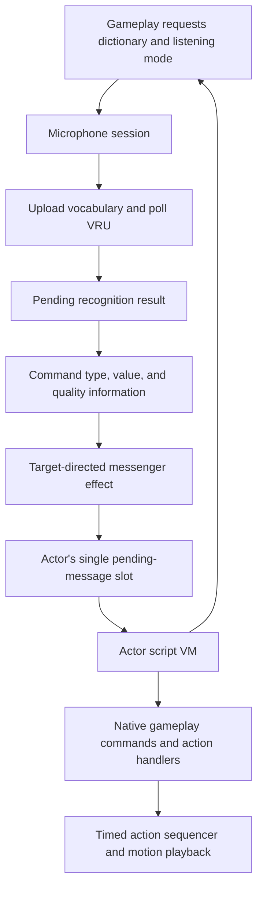

# Voice interaction and actor scripts

Voice recognition produces a candidate command. Actor scripts decide what that
command means in the current activity. Between those stages, gameplay can suppress,
redirect, or modify delivery. Recognizing a word therefore does not guarantee a
particular response.

This guide describes the recovered C control flow. Names such as `ScriptVm` and
`voiceCommandTakeMessage` describe that behavior; they are not claims about the
original source names. The VM's debug strings call it "PPU"; here that means the
script interpreter, not an additional hardware processor.

## From speech to behavior



### 1. Select vocabulary and control listening

[Microphone requests](../src/game/microphone_requests.c) queue configuration for
processing by the controller thread. Returning from a request does not establish
that the requested dictionary has finished uploading or that recognition has begun.

The [microphone session](../src/game/microphone_session.c) manages device discovery,
controller-button triggers, amplifier state, dictionary changes, and recognition
requests. Trigger mode can be held or toggled; recognition can follow the trigger
or an explicit override.

A dictionary is a list of global word IDs. Each word has encoded text for the VRU
and associated gameplay metadata. During a dictionary change, the session suppresses
recognition requests, waits for the current read to become inactive, and registers
words in batches of ten. Recognition polling resumes when uploading is complete.
See `micSessionUpdate`, `micSessionUpdateDictionary`, and `voiceDictionaryUpload`.

### 2. Consume a recognition result

[Voice recognition](../src/game/voice_recognition.c) starts and polls VRU reads through
`osVoiceStartReadData` and `osVoiceGetReadData`. A completed read supplies candidate
indices, match distances, warning flags, voice level, and voice duration. Candidate
indices refer to the active dictionary; `voiceDictionaryGetWordId` resolves them to
global word IDs. Match distance is a device metric, not a probability.

`voiceRecognitionTakeResult` consumes the pending-result notification, even if its
output pointer is null. It returns the first answer index or -1 when no result is
pending. Consumers must check the answer count before treating an answer as valid.
The stored data is not a queue of every past utterance.

### 3. Translate and deliver a command

[Voice command processing](../src/game/voice_commands_text_panel.c) resolves word
metadata, rejects unusable word lookups, and adds quality flags. The prepared
six-word message has this meaning:

| Field | Prepared voice-command meaning |
| --- | --- |
| `type` | Word's gameplay command category |
| `arg0` | Word's gameplay command value |
| `arg1` | Device warnings, plus 0x400 for quiet input and 0x4000 for a match distance above the configured threshold |
| `arg2` | Voice level |
| `arg3` | Voice duration |
| `arg4` | Interaction candidate selected by `voiceCommandUpdate` |

The shared [ScriptMessage type](../include/script_message.h) defines this six-word
layout. These meanings apply to voice commands. Other script-message producers can
use arguments differently. The command type and value are metadata, not the raw
recognition index.

`voiceCommandLaunchEffect` checks whether gameplay permits delivery, chooses a
recipient, and creates a [messenger](../src/game/flipbook_messenger.c). Its visual
flight participates in delivery: homing or collision can lead to `messengerDeliver`,
which calls `actorPostScriptMessage`. Loss of a target or an expired lifetime can
prevent delivery. Special recipient/contact modes can modify the prepared message;
the table above describes it before those transformations.

### 4. Inspect and acknowledge the mailbox

The [actor mailbox](../src/ovl/actor_target_interaction.c) holds one pending message.
Posting normally fails when a message is already pending. A forced post replaces
it. A successful post copies the message; the caller need not retain its storage.

[Script message commands](../src/ovl/actor_script_messages_items.c) expose the pending
flag, type, and arguments to the VM. Inspecting fields leaves the flag unchanged.
`actorAcknowledgeScriptMessage` clears the pending flag and returns its previous
value; it does not erase the stored fields. Scripts should use the pending flag to
distinguish a new message from previously stored data.

### 5. Let the actor's program choose a response

The [actor VM](../src/ovl/script_vm.c) evaluates expressions, branches, accesses local
and global variables, calls script subroutines, and invokes native gameplay commands.
An actor retains its instruction position and execution context across updates.

`actorRunScriptVm` runs until execution yields, transfers to an action handler,
finishes, or encounters an invalid instruction or missing context. Ordinary
instructions do not automatically yield once per frame. A program must reach a
yielding operation for other frame work to proceed.

Native commands are selected through the context's command table by
`actorScriptDispatchRegisteredCommand` in
[actor_script_action_commands.c](../src/ovl/actor_script_action_commands.c).
Commands consume arguments from the VM stack and can push a result. Their status
controls scheduling:

| Native-command result | Interpreter behavior |
| --- | --- |
| 0 | Continue interpreting immediately |
| 1 | Yield; resume bytecode on a later actor update |
| 2 | Transfer to the actor action handler |
| Other nonzero value | The interpreter treats it as a yield |

The actor update stores an execution state separately:

| VM state | Actor update behavior |
| --- | --- |
| 0 or 1 | Run bytecode |
| 2 | Advance the selected action handler |
| 4 | Finished; reset the execution state to 0 on the next update |
| 5 | Missing context or invalid opcode reported by the interpreter; a later update with a context resets the state to 0 |

An action handler can remain in state 2 across updates, then return 1 so bytecode
can resume on a later update. See `actorUpdateScriptVm`, `actorScriptYield`,
`actorScriptStartActionAndWait`, and `actorScriptWaitForActionResult`.

The lower-level [action sequencer](../src/game/action_script.c) is a separate system.
It schedules timed action requests, iteration waits, and sounds. Its callback return
values are not the actor VM's scheduling statuses. Motion playback is handled in
[motion_playback.c](../src/game/motion_playback.c).

## Recovered shared interfaces

The first type-recovery pass introduces these headers:

| Header | Recovered concepts |
| --- | --- |
| [`voice_recognition.h`](../include/voice_recognition.h) | Selected vocabulary, global word records, command metadata, and result-consumption contracts |
| [`voice_commands.h`](../include/voice_commands.h) | Command production/delivery contracts and gameplay quality flags |
| [`actor_script.h`](../include/actor_script.h) | Actor-state prefix, pending mailbox, and shared post/acknowledge contracts |
| [`script_vm.h`](../include/script_vm.h) | Five-byte values, known value tags, stack/return fields, execution states, and native-command callbacks |

`RuntimeObjectPrefix.state.actor` is the link at object offset `0x54`.
The recovered actor-state view names `vmAddress` at `0x1B8`,
`messengerContactMode` at `0x214`, `messagePending` at `0x218`, and
`message` at `0x21C`. Initialization establishes a `0x408`-byte actor-state
allocation. The separate runtime object prefix does not establish the actor
object's full allocation or transfer ownership of referenced resources.
Posting and acknowledgement at `0x80118E74` and `0x80119200`, together with the
script getters beginning at `0x8011C884`, establish the shared layout.

`ScriptValue` has byte alignment and a five-byte stride. Its named `data` view
contains a tag and four payload bytes; its `bytes` view supports whole-value
copies. Integer, float, string-index, and string-pointer tags are recovered.
Tag 2 is handled as integer-like by the interpreter but remains unnamed because
its distinct meaning has not been established. Do not replace the payload with
an aligned C word or numeric union: that changes the value stride.

`ScriptVm` retains the original `0x2C8` extent. The value-stack depth and pointer
are at `0x18` and `0x20`; saved depths, return offsets, and local-frame bases
start at `0x28`, `0x12C`, and `0x22C`. The command table at `0x2AC` contains
callbacks invoked with both the actor and its context. Unknown regions remain
explicitly unknown. Native callback signatures describe the dispatch ABI;
some native implementations consume only the actor argument.

Each `VoiceWord` at `0x8010452C` occupies sixteen bytes: display name, device
text, command category, and command value. The former table symbols at
`0x80104534` and `0x80104538` are interior addresses of those last two fields,
not independent tables. Accessors at `0x80040CF8` and `0x80040D60` confirm the
stride and field addresses. Using a common record changes two object relocation
expressions from interior symbol addresses to record address plus field offset;
the linked instructions and complete ROM remain identical.

The shared interfaces preserve existing target calling conventions. In
particular, mailbox posting still accepts a 32-bit actor address. Unprototyped
VM helpers that receive surplus arguments have not been globally rewritten;
changing those calls would change the original instruction stream. These
remaining ABI questions and unknown fields are further recovery work, not
claims that all actor or VM types are understood.

## Conceptual interaction

This is explanatory pseudocode, not a decoded retail script or its actual syntax:

```text
request the dictionary for this activity

repeat:
    if no message is pending:
        yield
        continue

    read the message type, value, and quality flags
    acknowledge the message

    choose a response for the message and current gameplay state
    start that response and wait for its action to finish
```

Dictionary readiness, successful delivery, and an acceptable recognition result
are separate conditions. An actual program can choose how to handle each one.

## Bytecode reference and reading order

Script values occupy five bytes: a tag followed by a four-byte payload. Numeric
accessors treat tags 0 and 2 as integers; setters emit 0 for integers and 1 for
floats. String access distinguishes table indices (tag 3) from borrowed pointers
(tag 4). The recovered code also contains conversions; consult the value accessors
before assigning meaning to another tag.

Instructions use a one-byte opcode with operands determined by the operation.
Selected structural opcodes in `actorRunScriptVm` are:

| Opcode | Operation |
| --- | --- |
| 10 | Store a variable |
| 24 / 25 | Push a literal / variable |
| 26 / 30 | Script call / return |
| 27 | Dispatch a native command |
| 28 / 29 | Unconditional jump / jump when false |
| 31 | Discard a value |
| 32 | Set up a local frame |
| 33 / 34 | Read / write an indexed value |
| 35 | End execution |

These numbers come from the interpreter switch. Native command selectors are a
separate namespace interpreted through the configured command table. This guide
does not identify every retail script, dictionary, or command-table entry.

Start with `micSessionUpdate`, then follow `voiceCommandUpdate`, `messengerDeliver`,
`actorPostScriptMessage`, and `actorRunScriptVm`. For a script command, follow its
native dispatch into the `actor_script_*.c` files and then into the gameplay helper
it calls. Existing function comments retain original decompilation identifiers and
addresses for comparison with disassembly.
