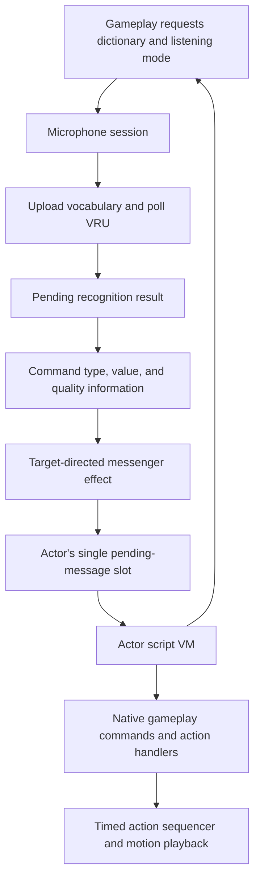

# Voice interaction and actor scripts

Voice recognition produces a candidate command. Actor scripts decide what that
command means in the current activity. Between those stages, gameplay can suppress,
redirect, or modify delivery. Recognizing a word therefore does not guarantee a
particular response.

This guide describes the recovered C control flow. Names such as `ScriptVm` and
`voiceCommandTakeMessage` describe that behavior; they are not claims about the
original source names. The VM's debug strings call it "PPU"; here that means the
script interpreter, not an additional hardware processor.

## From speech to behavior



### 1. Select vocabulary and control listening

[Microphone requests](../src/game/microphone_requests.c) queue configuration for
processing by the controller thread. Returning from a request does not establish
that the requested dictionary has finished uploading or that recognition has begun.

The [microphone session](../src/game/microphone_session.c) manages device discovery,
controller-button triggers, amplifier state, dictionary changes, and recognition
requests. Trigger mode can be held or toggled; recognition can follow the trigger
or an explicit override.

A dictionary is a list of global word IDs. Each word has encoded text for the VRU
and associated gameplay metadata. During a dictionary change, the session suppresses
recognition requests, waits for the current read to become inactive, and registers
words in batches of ten. Recognition polling resumes when uploading is complete.
See `micSessionUpdate`, `micSessionUpdateDictionary`, and `voiceDictionaryUpload`.

Decoded vocabulary and native storage contracts are described
[below](#vocabulary-and-native-storage-contracts).

### 2. Consume a recognition result

[Voice recognition](../src/game/voice_recognition.c) starts and polls VRU reads through
`osVoiceStartReadData` and `osVoiceGetReadData`. A completed read supplies candidate
indices, match distances, warning flags, voice level, and voice duration. Candidate
indices refer to the active dictionary; `voiceDictionaryGetWordId` resolves them to
global word IDs. Match distance is a device metric, not a probability.

`voiceRecognitionTakeResult` consumes the pending-result notification, even if its
output pointer is null. It returns the first answer index or -1 when no result is
pending. Consumers must check the answer count before treating an answer as valid.
The stored data is not a queue of every past utterance.

### 3. Translate and deliver a command

[Voice command processing](../src/game/voice_commands_text_panel.c) resolves word
metadata, rejects unusable word lookups, and adds quality flags. The prepared
six-word message has this meaning:

| Field | Prepared voice-command meaning |
| --- | --- |
| `type` | Word's gameplay command category |
| `arg0` | Word's gameplay command value |
| `arg1` | Device warnings, plus 0x400 for quiet input and 0x4000 for a match distance above the configured threshold |
| `arg2` | Voice level |
| `arg3` | Voice duration |
| `arg4` | Interaction candidate selected by `voiceCommandUpdate` |

The shared [ScriptMessage type](../include/script_message.h) defines this six-word
layout. These meanings apply to voice commands. Other script-message producers can
use arguments differently. The command type and value are metadata, not the raw
recognition index.

`voiceCommandLaunchEffect` checks whether gameplay permits delivery, chooses a
recipient, and creates a [messenger](../src/game/flipbook_messenger.c). Its visual
flight participates in delivery: homing or collision can lead to `messengerDeliver`,
which calls `actorPostScriptMessage`. Loss of a target or an expired lifetime can
prevent delivery. Special recipient/contact modes can modify the prepared message;
the table above describes it before those transformations.

The recipient's [messenger contact policy](../include/messenger_contact.h) is a
full signed word, separate from the projectile's flight mode.
`MESSENGER_CONTACT_REBOUND` (one) clears only the message type before attempting
posting, then rebounds; it does not clear the arguments or skip delivery. Other
values use the ordinary delivery/removal path for supported recipients.

`MESSENGER_CONTACT_ACTION_ORBIT` (two) and `MESSENGER_CONTACT_PREFER_ORBIT`
(three) can add an orbital steering offset during homing. Both use
`ACTION_ATTRIBUTE_ENABLE_MESSENGER_ORBIT`; the prefer-orbit policy also permits
the offset unless `ACTION_ATTRIBUTE_SUPPRESS_OPTIONAL_MESSENGER_ORBIT` is set.
The enabling bit takes precedence. These flags affect approach steering, not
whether delivery is allowed: the contact-distance test uses the target distance before the offset.
The setter stores arbitrary signed mode words without validation or clamping;
zero does not mean that a supported actor ignores the message.

The decoder lists the known enum values in `messenger_contact_policies` and
records setter arguments in each configuration's `messenger_contact_requests`.
Only supported constant words receive policy names; dynamic expressions and
other signed words remain explicit. A recovered request does not establish that
contact, delivery or orbit execution occurs.

### 4. Inspect and acknowledge the mailbox

The [actor mailbox](../src/ovl/actor_target_interaction.c) holds one pending message.
Posting normally fails when a message is already pending. A forced post replaces
it. A successful post copies the message; the caller need not retain its storage.

[Script message commands](../src/ovl/actor_script_messages_items.c) expose the pending
flag, type, and arguments to the VM. Inspecting fields leaves the flag unchanged.
`actorAcknowledgeScriptMessage` clears the pending flag and returns its previous
value; it does not erase the stored fields. Scripts should use the pending flag to
distinguish a new message from previously stored data.

### 5. Let the actor's program choose a response

The [actor VM](../src/ovl/script_vm.c) evaluates expressions, branches, accesses local
and global variables, calls script subroutines, and invokes native gameplay commands.
An actor retains its instruction position and execution context across updates.

Local frames belong to each VM. Frame -1 instead selects the shared bank of 500
packed `ScriptValue` records declared in `script_vm_globals.h`. Profile
initialization and `scriptVmResetGlobals` both clear the same 2,500-byte bank;
returning from a completed visit also requests that reset through bedroom
scenario selection. The bank is separate from each context's owned value stack.
Its indices and any borrowed string lifetimes remain caller responsibilities.

`actorRunScriptVm` runs until execution yields, transfers to an action handler,
finishes, or encounters an invalid instruction or missing context. Ordinary
instructions do not automatically yield once per frame. A program must reach a
yielding operation for other frame work to proceed.

Native commands are selected through the context's command table by
`actorScriptDispatchRegisteredCommand` in
[actor_script_action_commands.c](../src/ovl/actor_script_action_commands.c).
Commands consume arguments from the VM stack and can push a result. Their status
controls scheduling:

| Native-command result | Interpreter behavior |
| --- | --- |
| 0 | Continue interpreting immediately |
| 1 | Yield; resume bytecode on a later actor update |
| 2 | Transfer to the actor action handler |
| Other nonzero value | The interpreter treats it as a yield |

The actor update stores an execution state separately:

| VM state | Actor update behavior |
| --- | --- |
| 0 or 1 | Run bytecode |
| 2 | Advance the selected action handler |
| 4 | Finished; reset the execution state to 0 on the next update |
| 5 | Missing context or invalid opcode reported by the interpreter; a later update with a context resets the state to 0 |

An action handler can remain in state 2 across updates, then return 1 so bytecode
can resume on a later update. See `actorUpdateScriptVm`, `actorScriptYield`,
`actorScriptStartActionAndWait`, and `actorScriptWaitForSequencerStop`.

The lower-level [action sequencer](../src/game/action_script.c) is a separate system.
It schedules timed action requests, iteration waits, and sounds. Its callback return
values are not the actor VM's scheduling statuses. Motion playback is handled in
[motion_playback.c](../src/game/motion_playback.c).

## Recovered shared interfaces

The first type-recovery pass introduces these headers:

| Header | Recovered concepts |
| --- | --- |
| [`voice_recognition.h`](../include/voice_recognition.h) | Selected vocabulary, global word records, command metadata, and result-consumption contracts |
| [`voice_commands.h`](../include/voice_commands.h) | Command production/delivery contracts and gameplay quality flags |
| [`actor_script.h`](../include/actor_script.h) | Actor-state prefix, pending mailbox, and shared post/acknowledge contracts |
| [`script_vm.h`](../include/script_vm.h) | Five-byte values, known value tags, stack/return fields, execution states, and native-command callbacks |

`RuntimeObjectPrefix.state.actor` is the link at object offset `0x54`.
The recovered actor-state view names `vmAddress` at `0x1B8`,
`messengerContactMode` at `0x214`, `messagePending` at `0x218`, and
`message` at `0x21C`. Initialization establishes a `0x408`-byte actor-state
allocation. The separate runtime object prefix does not establish the actor
object's full allocation or transfer ownership of referenced resources.
Posting and acknowledgement at `0x80118E74` and `0x80119200`, together with the
script getters beginning at `0x8011C884`, establish the shared layout.

`ScriptValue` has byte alignment and a five-byte stride. Its named `data` view
contains a tag and four payload bytes; its `bytes` view supports whole-value
copies. Integer, float, string-index, and string-pointer tags are recovered.
Tag 2 is named `SCRIPT_VALUE_CODE_REFERENCE`: decoded uses select bytecode offsets
or configured native-command slots while retaining signed integer conversion.
The tag alone does not establish a particular reference role or a host pointer. Do not replace the payload with
an aligned C word or numeric union: that changes the value stride.

`ScriptVm` retains the original `0x2C8` extent. The value-stack depth and pointer
are at `0x18` and `0x20`; saved depths, return offsets, and local-frame bases
start at `0x28`, `0x12C`, and `0x22C`. The command table at `0x2AC` contains
callbacks invoked with the actor; each command accesses its retained VM through
actor state. The retained table at `0x8012B400` has 278 handlers and reserved null
selector zero. All handlers share the actor-only callback signature.
`python3 tools/native_commands.py --json` lists selectors, function names,
addresses and source locations. Unknown regions remain explicitly unknown.

Each `VoiceWord` at `0x8010452C` occupies sixteen bytes: display name, device
text, command category, and command value. The former table symbols at
`0x80104534` and `0x80104538` are interior addresses of those last two fields,
not independent tables. Accessors at `0x80040CF8` and `0x80040D60` confirm the
stride and field addresses. Using a common record changes two object relocation
expressions from interior symbol addresses to record address plus field offset;
the linked instructions and complete ROM remain identical.

The shared interfaces preserve existing target calling conventions. In
particular, mailbox posting still accepts a 32-bit actor address. Unprototyped
VM helpers that receive surplus arguments have not been globally rewritten;
changing those calls would change the original instruction stream. These
remaining ABI questions and unknown fields are further recovery work, not
claims that all actor or VM types are understood.

## Conceptual interaction

This is explanatory pseudocode, not a decoded retail script or its actual syntax:

```text
request the dictionary for this activity

repeat:
    if no message is pending:
        yield
        continue

    read the message type, value, and quality flags
    acknowledge the message

    choose a response for the message and current gameplay state
    start that response and wait for its action to finish
```

Dictionary readiness, successful delivery, and an acceptable recognition result
are separate conditions. An actual program can choose how to handle each one.

## Bytecode reference and reading order

Script values occupy five bytes: a tag followed by a four-byte payload. Numeric
accessors treat integer tag 0 and code-reference tag 2 as integers; setters emit
0 for integers and 1 for floats. String access distinguishes table indices (tag 3) from borrowed pointers
(tag 4). The recovered code also contains conversions; consult the value accessors
before assigning meaning to another tag.

Instructions use a one-byte opcode with operands determined by the operation.
Selected structural opcodes in `actorRunScriptVm` are:

| Opcode | Operation |
| --- | --- |
| 10 | Store a variable |
| 24 / 25 | Push a literal / variable |
| 26 / 30 | Script call / return |
| 27 | Dispatch a native command |
| 28 / 29 | Unconditional jump / jump when false |
| 31 | Discard a value |
| 32 | Set up a local frame |
| 33 / 34 | Read / write an indexed value |
| 35 | End execution |

These numbers come from the interpreter switch. Native command selectors are a
separate namespace interpreted through the configured command table. This guide
does not identify every retail script, dictionary, or command-table entry.

Start with `micSessionUpdate`, then follow `voiceCommandUpdate`, `messengerDeliver`,
`actorPostScriptMessage`, and `actorRunScriptVm`. For a script command, follow its
native dispatch into the `actor_script_*.c` files and then into the gameplay helper
it calls. Existing function comments retain original decompilation identifiers and
addresses for comparison with disassembly.

The interpreter names its recovered byte operations with the private `ScriptOpcode`
enum in `src/ovl/script_vm.c`. Binary operands use the second-from-top stack value
as the left operand: opcode 13 is greater-than, while 14 is less-than. Floating
equality has separate named relative and absolute tolerances. Packed values use
`SCRIPT_VALUE_BYTES` and `SCRIPT_VALUE_PAYLOAD_BYTES` from `script_vm.h`; their
storage remains byte-aligned. Bytes zero through two each consume one opcode byte
without changing the value stack; a following instruction still executes normally.
`SCRIPT_VALUE_CODE_REFERENCE` (tag two) carries bytecode offsets and native-command
selectors in the retained configuration corpus. It follows the signed integer
reader and is rejected by the decimal-string parser, just like integer tag zero.
The name describes those observed roles; the original compiler terminology is
unknown. The optional [semantic review](SEMANTIC_REVIEW.md) covers those
contrasts alongside asymmetric integer and floating-equality scenarios.

Dictionary selection uses `VOICE_DICTIONARY_NONE`, and consuming a result without
a pending notification returns `VOICE_RECOGNITION_NO_RESULT`. Amplifier operation
arguments use `VoiceAmplifierSetting`; the retained amplifier state remains a
Boolean. The session limits uploads to `MIC_DICTIONARY_UPLOAD_BATCH_WORDS` per
update. Startup and injected-command/no-speech scenarios observe these paths
without establishing physical VRU fidelity. Device command-status codes whose
individual meanings remain unresolved retain their numeric forms.

## Held-item launch selectors

Cue operation `ACTION_CUE_LAUNCH_HELD_ITEM` (25) carries a signed launch-kind word
and a floating speed argument. Its private `ActionLaunchKind` enum describes
trajectories, separately from the cue operation, actor target mode and item mode.
For positive command speeds:

| Kind | Meaning |
| --- | --- |
| 0 | Aim horizontally at the player when following a live player target; otherwise use the actor's heading. |
| 1 | Use the actor's heading with an upward component. |
| 2 | Use the actor's heading plus 240 degrees with an upward component. |
| 3 | Use the actor's heading with a steep upward component. |
| 4 | Use the actor's heading with a downward component. |
| 5 | Aim from the item's world position toward the stored three-dimensional target. |
| 6 | Randomize speed and heading around actor heading plus 200 degrees. |
| 7 | Randomize heading over a full circle and emit linked and falling-particle effects. |

Kind 5 produces zero velocity when the target is too close to normalize. Kind 7
chooses horizontal speed independently of the command speed; the command still
scales its vertical component. Kinds outside zero through seven are unsupported.
The original branches and three launch tables establish these descriptions;
they do not establish animation intent, gameplay reachability or collision behavior.

## Script decoder

The independent Python reader supports three separate formats:

| Format | Representation | Consumer |
| --- | --- | --- |
| `vm` | One-byte opcodes with packed five-byte operands | `actorRunScriptVm` |
| `cue` | Twenty-byte timed cues and selection tags | `actorUpdateActionScript` |
| `sequence` | Sixteen-byte action-sequencer records | `actionScriptUpdate` |

Start with a newly authored example, without a ROM:

```sh
python3 -m tools.script_decoder vm --demo
python3 -m tools.script_decoder cue --demo
python3 -m tools.script_decoder sequence --demo
```

Each command writes `listing.txt` and `listing.json` under
`build/script-decoder/demo-FORMAT/`. The text shows labels, operand roles, candidate
branches/calls and source locations. JSON also records raw tag/payload encodings,
code-reference uses, opcode/tag counts, diagnostics and unparsed byte ranges.
No extracted retail scripts or strings are bundled with the tool or examples.

For your normalized USA ROM, supply an explicit window. For example, after a
matching build, the first retained action-sequencer program can be read with:

```sh
python3 -m tools.script_decoder sequence --symbol 0x8006EE60 \
  --elf build/pikachu.elf --bytes 0x20
```

Use `--rom-offset OFFSET --bytes LENGTH` for a known ROM range, or
`--symbol SYMBOL_OR_ADDRESS --elf build/pikachu.elf --bytes LENGTH` for a known
mapped program. Scene addresses require the exact `--section .scene_NAME`.
The tool authenticates mapped ELF section bytes against the supplied ROM;
it does not guess which overlay was active during a runtime capture.

For a VM configuration, use `vm --config SYMBOL_OR_ADDRESS --elf ... --bytes ...`.
This reads the established configuration prefix and follows its program pointer
within the explicit mappings. Add `--native-count COUNT` to bound its command
table. For a standalone VM program, native resolution instead takes
`--native-table SYMBOL_OR_ADDRESS --native-count COUNT`. Counts include any
reserved null slot. The retained `D_8012B400` table has 279 slots, including slot 0.
Alternative tables must be identified explicitly; their slots need not agree.

Native-handler links come from the authenticated table, not merely matching
selector numbers. Four retained text handlers also consume an inline packed
string-count operand. Their reviewed layouts preserve the next instruction
boundary. Unknown handler layouts stop that path; argument stack effects and
dynamic return locations remain unresolved. VM calls expose both their target
and return continuation, while conditional branches expose both possible paths.
Use repeated `--entry OFFSET` options to inspect additional known VM entry points.
Larger programs can raise the explicit budget with `--max-instructions 100000`.
VM targets are offsets from the program start: keep that start at window offset
zero rather than rebasing a fragment taken from the middle of a program.

Decompressed or captured script windows can be read with
`--input /path/to/local/script.bin --bytes LENGTH`, optionally adding
`--input-offset OFFSET`. Such inputs are explicitly marked as lacking ROM
authentication. Decompression, heap relocation, string extraction and automatic
resource discovery are outside this decoder. `--bytes` bounds a read; it does not
assert that the complete allocation or program size is known.
Raw VM inputs may still use `--elf`, `--native-table` and `--native-count` to resolve
handlers from your ROM. The report authenticates those tables separately and
continues to mark the input script as unauthenticated.

All listings stay under ignored `build/script-decoder/`; `--output` may select a
subdirectory there. Keep extracted content and generated listings local. The CLI
returns 0 for a decode without diagnostics, 1 for a partial decode with diagnostics,
and 2 for an input or mapping error. None of these results establishes execution,
gameplay reachability, resource ownership or a recovered source-language meaning.

To catalog the retained layout across the resident and scene sections:

```sh
python3 -m tools.script_decoder.catalog --elf build/pikachu.elf
```

The catalog authenticates every scanned section and keeps its overlay identity.
It finds aligned configuration candidates that reference the retained native table
and a local program preceding the header. A program-to-header window bounds the
decode; it is not an inferred allocation size. Each candidate retains diagnostics,
code fingerprints, frame operands, global-reference base indices, native calls and
code-reference roles. Direct `actorCreateForKind` calls are linked only when the
script argument is an exact configuration symbol or its address; 70 candidates
have such bindings. Nine more configurations have conditional local assignments
before actor creation; the catalog records these separately as possible sources,
without asserting branch feasibility. It also follows 47 explicit scenario
selector return indices through the 23 area configurations to Pikachu's scripts,
retaining the overlay at every pointer read. It validates the source area's
selection against the linked, ROM-authenticated catalog. These are configured
references, not a claim that
every scene or script branch has executed. Other candidates remain explicitly
unproven as live configurations. The results stay under
`build/script-decoder/catalog/`; this scan does not discover every possible script
layout or compressed resource. Two of the 128 candidates currently have no
recovered binding: resident configuration 0x8012B870 and front-yard configuration
0x80158B7C. This is not evidence that they are unused. A search of 485 object
relocation sections found only the resident program symbol's own configuration
pointer, without recovering a caller of that configuration. Its empty program
suggests a possible fallback resource, but no fallback registration is established.
The front-yard program requests dictionary three, saved dictionary restoration
and control scheme one. Those outgoing dependencies describe behavior, not a
creation owner; six front-yard configurations share its metadata value of sixty.
Equal virtual addresses in other overlays remain separate resources.

`caller_frame_analysis` computes conditional relative evaluation-stack floors
from the decoded control flow and active immediate/deferred native reviews. Its
finite 100,000-step work budget is shared across roots and cached callee summaries;
exhaustion leaves a proof incomplete. A larger budget permits more exploration,
without changing operand, join, call or native-effect rules. Relative floors do
not establish physical allocation, nonaliasing, operand types, resource lifetime
or scheduling safety.

Three fishing programs retain a different limitation: helper 122 jumps to root
entry zero instead of returning. The original VM treats that as an ordinary
jump followed by another frame entry. It does not reset the value stack, saved
depths, return locations or previous frame bindings. In bounded original-VM
probes of their six-local root and three-local helper pattern, each restart adds
thirteen physical value slots, two saved depths and one return location.
Historical locals and metadata remain in value storage. This requires enough value and
saved-stack capacity for the actual number of restarts; an ordinary balanced-call
summary would conceal that obligation. The catalog keeps those summaries
unresolved. These authored probes establish the interpreter behavior, without
proving how often the retail fishing paths restart.

Decoder report schema 2 calls tag 2 `code_reference` and records its uses in
`code_reference_uses`. These references select bytecode offsets or configured
native-command slots; their payloads retain signed integer conversion behavior.
The catalog preserves separate entries for overlays even when virtual addresses
coincide, and fingerprints decoded code to expose repeated programs.

## Vocabulary and native storage contracts

The decoder's `voice_vocabulary` catalog reads the separate vocabulary DMA bank,
whose original loader copies ROM 0xA9800..0xB3C70 to 0x80100680. It records a
neighbor-delimited view of 640 word definitions and a reviewed prefix of 43
dictionary descriptors, containing 2,053 ordered entries. All 640 words have
membership in that prefix. These bounds do not prove that arbitrary dictionary
requests are valid. Display bytes and device vocabulary bytes remain separate;
the latter are not interpreted as ordinary display text.

Each word links its dictionary-local indices, global word ID, message category
and command value. Multiple words can share a command value, and a value can
have different vocabulary labels across dictionaries. The report retains those
associations instead of treating a value as a universal word identity. Original
vocabulary bytes remain in ignored local reports. Eight authored dictionary
cases check the original metadata getters, including reordered word IDs, distinct
categories and invalid-selection/index results; they do not exercise recognition.

`VOICE_DICTIONARY_DEFAULT` (0) is requested at gameplay startup and supplies the
session fallback when its requested ID is unset. `VOICE_DICTIONARY_WORLD_MAP` (31)
is requested by `wholeMapConfigureVoiceInput`; its 24 entries include destination
words carrying `SCRIPT_MESSAGE_WORLD_MAP_DESTINATION` (18). The map menu interprets
argument 0 as a destination selector, including a special-training request. These
selectors are distinct from map destination indices and scene area IDs.

The catalog records all 255 decoded `actorScriptRequestMicDictionary` calls.
Of these, 236 have literal integer-converted IDs resolving within the reviewed
dictionary prefix; 19 retain symbolic expressions. Each request remains in its
configuration's overlay and retains existing creation/scenario bindings. Reverse
links on dictionary descriptors connect them to those request sites and to written
C requests. These are possible resource uses, not scene ownership or executed paths.

### Bedroom name activity

One symbolic request belongs to the bedroom Pokémon-name activity. Its native
`actorScriptGetPokemonNameDictionaryGroup` reads the per-name group in
`gBedroomPokemonNameDictionaryGroups`. The group is a voice vocabulary partition,
not a Pokémon species, elemental type or message category. The 153 retained
catalog entries use groups 2 through 12; the script requests dictionary
`18 + group - 1`, giving IDs 19 through 29. It compares the group with a cached
value before issuing the request. The catalog indices and the recent-selection
history's 100 slots now have named extents in the source.

The decoder's `bedroom_name_catalog` authenticates both scene tables and links
each entry to command category 10, command value `catalog_index + 8`, and matching
word membership in its computed dictionary. All 153 entries have that membership.
Six catalog labels lack an exact vocabulary-label match because of case,
punctuation or alternate recognition spellings; the report preserves both views.
It does not merge catalog indices with global word IDs.

The request analyzer recognizes the guarded group conversion and records a
conditional dictionary domain. Its precondition is a valid catalog argument from
0 through 152 with intact, nonoverlapping VM frames. It does not prove caller
arguments, activity reachability or upload completion. Three authored-table cases
exercise the original native at endpoint indices and check unsigned-byte conversion;
the synthetic value 255 is not a retained retail group.

### Requested state and saved locals

The request native consumes one dictionary ID, pushes zero and yields. Configuration
dispatch changes the requested ID and acknowledges dispatch; uploading and uploaded
IDs remain independent. The native query reads requested state rather than either
upload field. Six original-instruction cases check that distinction with three
different requested IDs, including the unset value, while guarding the other fields.
They do not exercise queue submission, microphone hardware or vocabulary upload.

The other 18 symbolic requests read locals saved from the requested-dictionary
query. `saved_local_analysis` checks that the save dominates the request and
follows returning script calls with their frame bindings. A callee establishing
the same frame number temporarily shadows the caller's local base; a callee
using another frame can still write the caller's frame explicitly. The analyzer
rejects direct overwrites, possible indexed writes, unresolved frame transitions
and exhausted budgets. All 18 candidates pass its bytecode preservation check.

That check assumes valid stack/array accesses and intact, nonoverlapping frames
across yields. Native alias effects and context replacement remain separate
review obligations, listed in `native_effect_frontier`; these candidates are not
promoted to resolved runtime IDs or unconditional restoration claims. Two authored
original-VM programs contrast same-frame shadowing with a deliberate caller-frame
write, checking the full declared stack, VM state and query globals. They establish
the frame distinction, without certifying arbitrary native effects or retail paths.

### Native storage effects

The 18 catalogued saved-dictionary analyses reach 103 distinct native callbacks.
Each now has the required conditional footprint review, including deferred phases
where reached. This clears their native-effect frontier under the recorded
conditions; it does not prove operand floors, resource validity, context lifetime
or runtime dictionary restoration. Other native commands and deferred actions
outside these corridors still need review.

The cue-change and HUD-guide contracts include the original SDK's PI transport,
queue and scheduler paths. A returning call requires successful queue admission,
a live request until completion, an accessible aligned DMA window, and delivery
of its completion event. Game code ignores submission errors: failure can leave
the call blocked or spinning after consuming operands. A returned sequence handle
does not establish accepted MIDI data or audible playback. These are static
original-instruction reviews, with transport conditions recorded in the manifest.

Releasing a held item appends its resolved kind even when release is refused.
The retail release table has only two nonnull hooks: light-bulb material reset
and baseball-cap scale reset. The reviewed helper closure includes those hooks,
holder handles, item state and hierarchy writes. It requires valid separate
storage and terminating animation/hierarchy traversal. Eating has its own conditional
phase review, including replacement creation and registry removal. Deferred
destruction and actor/VM lifetime between invocations remain separate obligations.

`actorScriptTryHoldItem` replaces the requested handle with the actor's final held
item kind. Rejection can therefore return the previously held kind rather than
zero. Forced release does not bypass pickup eligibility. After accepting the new
item, the helper attempts to release the old one but ignores that release result;
an unreleasable old item can retain its ownership state. The immediate native
invokes only the two retail release hooks above, with no hold hook or allocation.
Valid item and owner layouts, stable handles and terminating hierarchy/animation
traversal are prerequisites of this contract.

`actorScriptFindInteractableItem` returns an item kind, not a handle. It searches
world-owned items within the distance and a 45-degree viewing cone; kind 165
selects ordinary kinds 1 through 164. Pickup eligibility is checked after choosing
the nearest candidate, so rejection does not retry a farther item. Its 500-ms
cooldown reads the retained interaction timestamp without updating it. Search can
rearrange the search tree and overwrite shared query state, making it nonreentrant.

Position-based actor and item searches return handles and use different boundaries:
actors must be strictly closer than the limit, while items may lie exactly on it.
Actor search excludes the caller. Item search uses an ownership filter, with six
accepting any ownership, and does not check pickup eligibility. Weighted item
search can prefer a farther item and resets only the selected item's priority.
Both queries rearrange shared search state and tree links. Fifteen authored
original-instruction probes check these distinctions, kind-range aliases and
protected VM/query/tree storage; they do not prove later pickup or object lifetime.

`actorScriptDestroyItem` removes collision and item-search registrations, requests
destruction of the item and its following siblings/descendants, and decrements the
live-item count. Held items may run the two release hooks above first. The native
does not free object/state allocations; a later sweep performs cleanup. It requires
an initialized item even though the wrapper does not check the object's kind, and
the marked hierarchy must not own the executing VM or its program storage.

Choosing an escape destination switches to fixed targeting while preserving the
stored target handle. Ordinary separation advances the RNG once and chooses a
rotated destination away from the player. Near-coincident positions instead use
the live fallback object's position without advancing the RNG. Neither path moves
the actor immediately or proves that the destination is reachable.

Four setters have narrower effects than their names might suggest:

| Native | Immediate effect |
| --- | --- |
| `actorScriptSetPlayerYaw` | When permission allows it, normalizes yaw and also normalizes and clamps the existing player pitch. It does not refresh the camera. |
| `actorScriptSetPlayerPitch` | When permitted, normalizes the retained yaw and wraps/clamps requested pitch. It does not refresh the camera. |
| `actorScriptSetItemImpactCount` | Stores the full signed 32-bit bounce count unchanged on an available item; returns one on update, zero otherwise. |
| `actorScriptSetPikachuAppearanceVariants` | Stores two signed variant selections on the active Pikachu and sets or clears their persistence flag; returns zero. |

Yaw wrapping requires values for which the original repeated floating-point
adjustments terminate; finite values alone do not guarantee that. Negative bounce
counts and unchecked appearance variants can be stored immediately, but their
later physics and rendering behavior need separate validation. Thirteen authored
original-instruction probes cover permitted and denied yaw updates, signed counts,
missing or ineligible item targets, and both persistence branches. They preserve
protected VM values and guarded surrounding storage; they do not establish later
resource lifetimes or valid renderer indices.

Fifteen additional original-instruction probes check pitch boundaries and wrapping,
permission denial, negative-zero preservation, and view getters with signed offsets.
The getters include yaw shake or pitch offset and do not normalize their sums.
The probes preserve protected values, frame metadata and guarded actor/player
storage; very large or nonfinite angles remain outside these observations.

Numeric native contracts distinguish the game's operations from host math calls.
Float pass-through converts integer-like payloads to binary32 and retains the float
tag. Sine uses a 513-sample quarter-wave table; cosine first adds 90 degrees using
the original floating-point operation. Their rounded table-index conversion must
fit signed 32-bit storage. Square root converts the binary32 operand to double,
executes the FPU square root and converts back to single; no SDK square-root call
occurs. These immediate storage contracts require the target FPU environment and
do not promise unchanged floating-point status flags.

Camera view assignment stores eye and target coordinates and restores the world-up
vector. Transition configuration instead captures the existing camera endpoints
and stores destination endpoints plus duration; it does not start a transition or
change player mode. Clip distances retain raw floats, while fog bounds convert
through binary32 before truncating to integers. Seventeen original-instruction
probes check these immediate writes, including coincident view endpoints, zero and
negative durations, negative zero and integer rounding through binary32. They do
not establish valid projection settings or safe later interpolation.

Item material-frame assignment disables material animation and retains the low
16 bits of the requested frame. Draw-mode assignment also retains a halfword but
changes rendering, separately from the item's behavioral mode. Tint channels wrap
to bytes rather than clamp. Animation assignment evaluates its borrowed program
immediately, so terminating control flow and valid interpolation data are required.
Scaling recursively changes existing hierarchy bounds; repeated scaling does not
restore every child's original bounds. Tint and draw mode use live-object lookup
and can affect toolbox items; frame, animation and scale use the availability filter.

Path-coordinate queries have distinct failure contracts. Area paths reject axes
above two before accessing path storage, but do not guard negative indices. A
missing path-object handle returns zero; a wrong object kind returns -65536. The
following-point query measures 3D proximity after projecting both positions onto
terrain, then returns the next waypoint's raw coordinate, including its unadjusted
Y. It traverses path and terrain data even when the requested axis exceeds two.
Valid path storage and a complete end-marker triple remain prerequisites.

Emitter creation places the new object at an available target or fallback position
and retains settings for later following and emission. A reference handle and
horizontal offset do not immediately move that initial position. Creation does
not invoke the retained emission callbacks, including the audible style's callback.
Wisp creation allocates and registers its object, initializes graphic/opacity
storage and evaluates animation at step zero. Its ten styles differ in retained
templates, scale, color, count and animation; style three advances the RNG twice.
These source-bound creation contracts require valid resources, registry capacity
and successful separate allocations. Later callbacks and resource lifetimes
remain independent obligations.

Motion resource links decode the [action attributes](../include/action_attributes.h)
and include the authenticated action-definition hash, motion
archive ID, endpoint poses, continuation ID and decoded attribute word. The low
three bits select the established motion playback mode. Named flags distinguish
loop permission, cue suppression during intermediary transitions, registration
of pose pairs, turning permission, continuation fallback on a pose mismatch and
priority for an existing continuation. Every other bit remains in
`unresolved_attribute_bits`; a resource flag alone does not prove a successful
transition or rendered motion.

Attribute `0x400` projects to bit `0x1` in the creature-action query, but disabled
playback also returns that bit. It cannot be treated as a universal playing or
idle flag. Scene consumers combine it with other query bits for their own
conditional stop and classification policies. Likewise, the resource sets for
`0x800` and `0x100` include exceptions to simple running and turning descriptions;
these bits retain their numeric identities until their shared contract is known.

Loop permission is conditional: an exit request, a nonzero update result or a
rejecting initializer prevents another cycle. Pose-map registration also requires
differing endpoint poses and an unclaimed pair. Continuation fallback applies to
a requested record whose initial pose is incompatible; continuation priority
applies to the existing continuation when a pending request competes with it.
These are separate choices in the action state machine, not interchangeable
forms of looping.

Additional [action attributes](../include/action_attributes.h) identify terrain-facing
restrictions, the higher upward-motion limit, target/camera-facing permissions,
retained world motion while airborne and terrain/gravity bypass. Target/camera
permissions remain subject to the actor's independent inhibition flags; they do
not guarantee an orientation change. The higher upward limit is 30 rather than
5 in scaled motion displacement. World motion applies when the terrain updater's
ground-clearance conditions permit its airborne branch.

The top two attribute bits select automatic action-resource change during gameplay
model updates: recover one unit per second, spend ten, hold, or recover ten.
Other explicit adjustments remain independent, and the resource stays clamped to
zero through 100. The decoder exposes this field as `action_meter_policy_name`.

Each linked motion definition also includes `script_action_flag_projection`.
This describes the status for a live creature with active playback, rather than
assuming that the definition is selected at runtime. Script bit `0x10` projects
the higher upward limit and bit `0x20` projects action-requested terrain/gravity
bypass. Other bits remain numeric. Actor behavior inhibition is excluded, and
inactive playback supplies a separate default attribute word returning status
`0x21`; zero status alone therefore does not prove that terrain constraints run.

Nine [motion-action identities](../include/motion_action_ids.h) name head-turn,
forward-jump collision, target-turn variants and the destination-walk chain.
The decoder names matching definitions and their continuations while retaining
motion archive IDs separately. These labels and consumers do not establish
names for every pose or for ambiguous pivot variants.

Twenty-four original full lookup-chain probes cover action-status projection,
disabled playback and rejected handles/kinds. Four bounded original meter-dispatch
slices verify the four rates, resource ownership and HUD effects; earlier gameplay
callbacks are outside those slices. A 2,048-row status enumeration is a separate
host check, not 2,048 emulator runs.

Motion definitions link their initializer and update callback addresses to the
functions in the selected resident sections. Null callbacks remain explicit.
These are resource links, not evidence that a callback ran or accepted an action.
They let readers follow a timed program through its motion record into the
movement behavior that supplies its completion and continuation rules.

The arrival callbacks share `ActorScriptState.targetDistanceAllowance`; the old
private `MovementState.radius` view did not identify a separate physical radius.
The three-dimensional approach compares full distance with one plus the
allowance. The scene-bounds approach first clamps target X/Z and replaces its Y
with the actor world Y before comparing. Equality does not satisfy either strict
arrival check. Other movement callbacks also use collision width, so the three
quantities must not be merged. Ten original entry-to-arrival-branch probes confirm
these thresholds and storage distinctions; later movement and callback completion
remain outside those prefixes.

Four collision-width loads retain float byte views at the named member's offset.
Isolated direct-member trials change generated code, while the member-offset views
and other shared-field conversions preserve the strict object comparison. The
maze byte-view exception belongs to `actorApproachTargetWithinSceneBounds`, which
owns those bounds accesses.

The decoder's `pose_transitions` reconstructs the initialized pose map from
sentinel-bounded explicit records and the 330 action definitions. Keys pair the
current source pose with the requested initial pose. Explicit entries take
precedence; eligible action definitions follow in table order, and the first
entry for each pair wins. The retail explicit table is empty: its first source
pose is the terminator 48. Of 58 eligible-flag records, two have equal endpoint
poses and one repeats an earlier pair, leaving 55 installed mappings. Action 27
wins that duplicate against action 28. The map has capacity 293, not 293 poses.

Map values normally store a bridge action ID plus 256. The resolver also supports
value 254 for a generated blend and decoded action ID -3 (map value 253) for
direct acceptance; neither special value is installed by the retail initializer.
An absent pair returns zero. The resulting invalid bridge ID falls back to a
blend only when there is no previous continuation; otherwise the previous record
is retained. The decoder preserves insertion failures and unsupported zero values
instead of silently turning them into valid transitions.

Original-instruction probes executed the heap and pose-map initializers and
checked all 293 captured slots against an independent model. Synthetic explicit
records checked priority, direct/blend words and collisions; these records do not
establish retail producers. Seventeen original lookups ran in the emulator. A
separate exhaustive check of all 65,536 pose pairs used captured contents on the
host, rather than claiming that every pair ran through the original lookup.

Three retained attached-effect definitions at `0x80074EB8` select templates of
runtime kind `0xAC`, with no child or sibling templates. Their scales are
`0.1`, `1`, `1`; opacity-program selectors are `0`, `0`, `1`.
This establishes the observed prefix, rather than an allocation bound inferred
from an ELF symbol size. The immediate creation contract covers the heap,
handle pool, active list, search tree and animation initialization. It requires
successful separate allocations of `0x68` bytes for the object, `0x2C` for state
and `0x80` for matrices, plus available registry capacity. Replacing
the actor's old attachment only requests hierarchy destruction; freeing happens
later. The four special companion tracks display skull-and-crossbones, scribble, anger-mark
and steam-puff icons. They advance the RNG and add one to
`PROGRESS_FIELD_PIKACHU_NEGATIVE_REACTION_CREDIT` (field 26) when the sample
exceeds one-half. This saturating credit influences disappearance selection;
it is neither current anger nor a count of every negative reaction.

The decoder's `effect_programs` lists eleven named slots and their authenticated
integer keys. Each configuration's `attached_effect_requests` links recovered
kind and track expressions to these programs. The other identified icons are
an exclamation mark, question mark, blinking light bulb, flower, cross,
spiral-centered sun and zigzag. Physical symbols alone do not establish emotions.
A static walk stops at a held key or records a repeated key as a loop; it does
not establish allocation bounds, rendering or gameplay reachability.

Integer keys distinguish constant values, inclusive ranges, one-shot emissions
and signed relative jumps. Negative-duration keys hold unless their mode is
relative jump. `INTEGER_ANIMATION_EMITTED` advances the key without replacing
the retained value; initialization consumes an initial one-shot. A timed key
advances only after its duration is exceeded, not at equality.

Control-scheme action selector 10 waits in game mode 3 before accessing the VM.
Otherwise it consumes one scheme, applies it, appends zero and yields. Unlike
program-start actions, it does not test `actionInitializing`; treating that flag
as a universal action phase gate would be incorrect. Its retained callbacks can
request rumble. Its deferred review includes those hooks and the original blocking
queue/scheduler path, under the stated lifetime and noninterference conditions.
Nine authored original-instruction probes cover the early mode-three wait,
initialization zero/one, numeric conversion and real player helpers without rumble.
Target-focus cleanup restores the saved companion selection under the old
permissions; installing new permissions afterward does not retry a denied restore.
These probes guard the complete player record, protected VM values and callback
tables, but do not exercise blocking services or subsequent player input.
Text-window selector 13 also waits in mode 3. Its conditional review includes owned
image destruction and the heap/glyph creation chain, including cache misses and
DMA completion. Position controls can reset measured width, so every glyph's
placement must fit the final image independently. Cache reclamation only visits
an unpinned prefix; free entries elsewhere do not guarantee allocation succeeds.
The manifest records these bounds, successful-allocation requirements and borrowed
glyph lifetimes explicitly.

Microphone dictionary and configuration natives have returning-call contracts
through the original blocking message queue. A full queue can suspend the caller;
a waiting receiver can run before the send returns. Caller VM storage must remain
live and untouched across that scheduling interval. The controller queue holds
16 pointers, while microphone requests occupy only eight reusable 20-byte slots:
queue capacity does not prevent premature slot reuse. Serialized producers and
consumer completion before reuse are explicit requirements. Submission acknowledges
queue admission, rather than dictionary upload or device completion.

Configuration queues raw override and trigger-following values, then normalizes
availability and voice permission to Boolean globals. Unused packet fields retain
arbitrary existing stack bytes in the original full-record copy. SDK instruction
range hashes and generated local assembly dependencies bind the queue review;
those implementations remain local build inputs. Missing inputs revoke the
contracts until the matching build materializes them.

The initial sixteen immediate scalar-append contracts are recorded in
`tools/script_decoder/native_frame_reviews.json`: fifteen direct getters/yield
callbacks and the requested-dictionary query. These callbacks
consume no arguments and append one integer or float. They preserve existing
locals only when those locals and frame metadata lie below the active stack depth,
one value slot is available, borrowed state is valid and the context remains intact.
Their return may continue or yield; this review does not cover later lifecycle or
concurrent changes.

The decoder validates explicit source fingerprints for each reviewed callback,
its scalar-push helpers, stack macros and relevant value/command definitions.
Embedded actor layouts are bound as well as helper bodies: changing a nested
record can move VM or gameplay fields without changing a caller.
The manifest shares identical frozen dependencies by source identity. Reference
expansion preserves the original review records, rejects missing definitions and
never refreshes fingerprints. Compaction was checked for exact activation equivalence,
idempotence and revocation of every affected review after a shared-helper tamper.
Source or dependency changes revoke the affected evidence rather than creating a
new review. The catalog reports stale reviews and excludes them from active contracts. Unreviewed
callbacks remain explicit in `native_effect_frontier`.

The root review index lists checksummed callback files grouped by source unit.
Loading preserves the original callback order and every frozen dependency record.
Missing, altered, duplicate or out-of-directory parts stop validation. Catalog
fingerprints cover the complete logical review set, including every part. Storage
checksums do not replace source fingerprints or approve a changed contract.

Sixteen authored original-instruction cases check the fifteen direct
callbacks, including both blend-status branches, while guarding saved locals,
frame metadata, VM state and globals. `actorScriptPushTotalElapsedTime` now names
the clock accumulated across script resets, separately from the resettable timer
read by `actorScriptPushTimer`. The cases use distinct clock values and establish
handler footprints, without a scheduler, hardware or complete-lifetime proof.

Additional source-bound contracts cover the current chase stage, resettable timer,
integer conversion, selected timed-program identifier and target/suppression
setters. `actorScriptPushChaseStage` reads the current unsigned byte, separately
from saved furthest-stage progress. Resetting the timer clears `elapsed` and
appends zero; it preserves `totalElapsed` and action time. Integer pass-through
converts the operand to an integer, so a floating operand does not retain its tag.
The selected timed-program identifier remains readable after natural completion;
it is not a test for an active command.

Eighteen original-instruction probes check these four scalar commands with
protected values, frame metadata and distinct actor/player storage. Chase-byte
edges through 255 remain unsigned; tested finite floats truncate toward zero;
timer reset preserves the accumulated clock; null command cursors retain the
selected identifier. Invalid tags, nonfinite or out-of-range conversions and
complete gameplay lifetimes remain outside these observations.

Target-position arguments are pushed X, Y, Z. The command selects fixed tracking
and zero allowance, retaining the stored target handle. Tracking-mode assignment
stores the converted word; it does not resolve a target or validate the mode.
Horizontal suppression toggles its own behavior flag. Interaction-visibility
suppression hides the hierarchy when enabled; disabling it resumes automatic
updates without immediately unhiding objects. These effects leave later movement,
visibility and object lifetimes to their respective update paths.

Twelve authored original-instruction cases, each replayed three times in the N64
interpreter, check target coordinate order, raw tracking modes and suppression
branches with full storage guards. Visibility enable and disable use separate
states, rather than a claimed live game trajectory. Unicorn raised unsupported
CPU exceptions for these fixtures; its runs supply no acceptance evidence.

Further source-bound contracts distinguish immediate placement from movement
updates. `actorScriptMoveToTargetPosition` copies the stored target into both
local and cached world coordinates, even when the actor has a separate hierarchy
root. It performs no coordinate conversion, traversal or seek completion, and
leaves velocity, tracking, target handles and timers unchanged. Later updates
can therefore move it again.

The uniform-scale query returns the first stored scale component. For objects
with area scaling enabled, it divides that component by the current area's scale;
it does not combine the other axes. Unavailable handles, including pending
destruction and toolbox-owned items, return floating zero. Initialized area data
and a finite nonzero area scale remain prerequisites for that branch.

Thirteen original-instruction probes cover placement with distinct local/world
coordinates and a separate root, raw signed area IDs, unavailable objects, and
positive/negative scale values with area scaling enabled or disabled. Full
storage guards preserve unrelated records and protected VM values. These cases
establish immediate effects, without rendered-hierarchy or lifetime guarantees.

`actorScriptPlayCue` consumes a cue ID and returns a logical playback handle,
continuing execution. It does not change the current-cue selection. Startup at
full volume is immediate; exhausted slots return zero. A positive handle records
slot assignment even when MIDI header initialization fails, so it does not prove
audible playback. The source-bound review includes bank-cache and first-header
transfers under explicit PI-manager, queue, buffer and scheduling preconditions;
later MIDI decoding and synthesis remain separate. No new runtime probe of this
cue native is claimed.

The rotation setter consumes angle then axis, returning zero. Valid axes are
pitch, yaw and roll; it changes actor-state orientation rather than the object's
separate rotation fields. Angle wrapping must terminate: finite values alone do
not guarantee progress for repeated floating-point additions/subtractions of
360 at large magnitudes.

Uniform-scale assignment consumes handle then requested scale. It updates all
three scale components and adjusts radius using the prior X scale and the area
scaling convention. Area-scaled objects need a finite nonzero area factor, and
the computed old scale must remain finite and nonzero. A requested zero scale
is supported, but makes a subsequent rescale require separate care. Neither
setter traverses descendants, runs callbacks or refreshes collision structures.

Held-item release control changes the ordinary-release permission and selects
HUD guide four or zero; it does not physically release or transfer the item.
The permission change precedes any guide-selection cue transport. Ten guarded
original-instruction cases check rotation, scale and held-item branches. Guide
changes that trigger audio were not executed by these probes and retain the
source-bound transport preconditions.

Player-position assignment consumes X/Y/Z, updates the primary player and clears
only downward velocity. Camera-update permission can suppress its camera refresh;
otherwise the original angle-table and camera-storage contracts apply. It does
not place the calling actor or guarantee that later movement will stop.
Interaction-mode assignment also targets the primary player, using the calling
actor's handle. Modes one and two have separate permission gates; other converted
words are stored without validation. The zero result does not report acceptance.

Secondary-meter assignment targets active Pikachu independently of the caller.
Finite values clamp to zero through one hundred, retaining negative zero. The
action-resource getter is separate and performs no adjustment or HUD request.
Action elapsed and duration getters retain their respective values independently
of VM clocks and command activity; duration is not time remaining. Bounding-radius
lookup returns the stored radius for available objects, without an area conversion.
Fifteen original-instruction cases check the player setters with distinct records;
position observations cover the camera-suppressed path. The active-camera branch
has a source/helper review, without a new runtime trace. Nonfinite meter inputs
are outside the numeric contract.

The item catalog links both creation natives' X/Y/Z/pitch/yaw/kind expressions
to 166 retained configurations and their borrowed display labels. Kinds zero
and 165 have no model template; the creation contract admits one through 164.
All 134 retained item-creation requests now have complete six-operand expression
lists. Runtime actor/player coordinates and current-area path-point coordinates
remain opaque symbolic results. Path expressions retain path, point and axis in
script push order; they do not establish valid paths, points or axes, finite
positions, or placement safety. Coordinate validity remains a separate obligation
from linking the kind. The decoder retains kind-only recovery for unsupported
producers in other inputs rather than guessing their stack effects.

A nonnull template is necessary, with allocation, registry, animation, terrain
and later borrowed-resource obligations remaining explicit. A structural link
alone does not establish creation safety or execution.

Item interaction queries use selectors one through five, independently of the
returned unsigned reaction code:

| Selector | Recovered request meaning |
| --- | --- |
| 1, 2 | Unresolved alternatives selected by shared profile/friendship logic |
| 3: `ITEM_RESPONSE_TASTE` | Taste or eat |
| 4: `ITEM_RESPONSE_SMELL` | Smell |
| 5: `ITEM_RESPONSE_PLAY_OR_USE` | Play, use, or sound |

The voice-message flow and authenticated vocabulary connect selectors three through
five to those requests. Querying does not itself perform the interaction. Shared
scripts choose between selectors one and two probabilistically and can override
that choice after a voice request; this does not establish liked/disliked meanings.

In the reviewed shared selector, category two is chosen when a random integer
below one hundred exceeds five times the item's profile counter; otherwise it
chooses category one. Other state can invoke a separate selection window, where
a voice command chooses three, four or five, a timeout randomly chooses among
those same categories, and a zero result aborts. Category one is also queried
directly by scene-specific reaction-code gates, so neither column has a universal
“autonomous”, “liked” or “disliked” meaning. Different items can select eating or
electric-action responses from either column.

`actorScriptTestTasteResponse` reads the third interaction-response byte and
recognizes codes two, four, five and six. Its catalog view is named
`gItemKindTasteResponseEntries`; it is unrelated to transformation cause three.
The predicate reports membership in that code set, without performing an item
interaction or establishing a universal preference meaning.

`itemGetKindResponse` accepts all 166 retained kinds for supported selectors,
including kinds with no model. An unsupported selector returns zero and ignores
the kind. `itemGetResponse` also returns zero for a missing or response-suppressed
item; an available handle must refer to initialized item state. These interfaces
return reaction codes, rather than booleans or category selectors. The retained
bytes contain codes one through twenty plus twenty-four and twenty-five. The
ordinary shared reaction dispatcher handles one through twenty; the remaining
codes still need scene-specific interpretation.

The decoder's `item_response_requests` preserves category and kind/handle argument
expressions for both VM query natives. A supported constant selector and bounded
constant kind can be linked to its catalog response byte. A live handle is never
interpreted as a kind identifier. Dynamic selectors, unsupported selectors and
unresolved arguments remain explicit; these links establish neither execution
nor live-item validity.

Each catalog entry also exposes authored `initial_state_flags`, their recovered
`ItemStateFlag` names and an explicit unresolved-bit mask. These defaults are
separate from live item state and object-hierarchy flags. Recovered item flags
cover rotation reset, full or horizontal camera facing, world collision-grid
exclusion, material-controlled child visibility, airborne motion and shrinking.
Grid exclusion does not disable terrain physics; material visibility governs the
child hierarchy while its parent is visible. Full camera facing takes precedence
over horizontal facing, and either can override rotation reset.

Player and actor pickup have independent inhibition bits. Held-transfer permission
bypasses holder restrictions but never those inhibition bits. Cooperation likewise
has two independent requirements: kind capability (`COOPERATION_SUPPORTED`) and
runtime on/off state (`COOPERATION_ENABLED`). Only capability-bearing items accept
the on/off setter. The exhausted-bounce disposal exemption affects the default
contact-disposal path; it does not make an item indestructible.

Three flags permit using the kind's nonzero configured replacement:

| Transformation cause | When its replacement permission is absent |
| --- | --- |
| 0: consumption | Remove the consumed item |
| 1 | Use charcoal instead of the configured replacement |
| 2 | Retain the original item |

Cause two is also requested after collisions; its debug label mentioning thunder
does not establish an electric-only contract. Consumption and interaction-response
suppression share another flag, independently of pickup inhibition.

Ground bounce, component-derived rotation and horizontal-speed rolling have
separate flags. Component-derived rotation takes precedence over speed-based
rolling; airborne state retains the existing angular rates. Balloon inflation can
halve the kind's gravity/friction coefficient. Player- and Pikachu-origin throw
flight are tracked separately until floor contact. Significant impact and handled
area-contact notification are runtime state, not permanent kind classifications.

`ITEM_STATE_PLAYER_PICKUP_RECORDED` records direct player pickup and survives
release and configured replacement. Toolbox withdrawal alone does not set it.
The eating handler returns this history before attempting consumption, so its
zero/one result does not prove that consumption succeeded. Its result can already
be available while the handler waits for a follow-up action.

The catalog retains bits `0x1` and `0x20000` explicitly because their purposes are
unresolved. Unknown bits are preserved by the decoder.

The decoder's `item_response_dispatch` follows the authenticated shared bedroom
program's twenty ordinary response branches and 37 helper graphs. It records
potential calls and their argument expressions, including conditional sound,
message, profile and item requests. These are static possibilities; a listed call
need not execute, return or complete its requested action. Response eighteen with
item-kind argument 76 (tissue) has a separate route before ordinary dispatch. Codes twenty-four
and twenty-five remain unresolved.

Across the full program catalog, each configuration's
`literal_native_argument_contexts` records supported literal caller inputs to a
helper's first unchanged-formal native consumer. The current snapshot admits 1,352
callsite contexts across 37 configurations, among 13,652 syntactic script calls.
It covers action selectors, timed requests, item creation, overlay fading and a
few destination/search calls. Unadmitted calls retain their original expressions;
this is conditional context coverage rather than an execution percentage.

The analysis retains literal tags, payloads and bounded producer instructions,
including supported negation. Native-derived constants and unsupported computed
boxing remain unresolved. Source-bound VM and native reviews, canonical complete
static decoding, valid frame storage and stable bindings are prerequisites.
`ENTER_FRAME` rebinds incoming argument cells in place; it does not copy them into
a separate array. Protected caller/root storage must be disjoint from the reused
argument cells, additional locals and saved metadata. The analysis stops at native
entry and proves neither native success nor later helper behavior.

Only reviewed `script_id` arguments extend request-derived resource links. This
adds programs 115, 134, 153 and 246; the many default-action selectors stay in their
own domain. Raw arguments and the separate complete resource inventory remain
available.

Three additional original-instruction prefix probes confirm the boxed arguments
for item creation, overlay fading and destination selection, including physical
argument-cell reuse and protected frame storage. All executed bodies and script
prefixes authenticate against the ROM. The probes stop before target native entry;
they do not establish target conversion, resource acceptance or gameplay outcomes,
and do not constitute runtime coverage of all 1,352 contexts.

For 53 distinct literal-argument helper calls in the shared response graph, the
decoder also records a
`conditional_native_argument_context` linking caller values to the first native
that consumes unchanged formal arguments. It retains the original symbolic
arguments and checks the intervening linear prefix against current source-bound
preservation reviews. Branches, formal writes, ambiguous bindings and stale reviews
prevent the link. These contexts assume valid, disjoint frames and stable bindings;
they do not establish native success, later helper behavior or mode restoration.
Only arguments identified as timed-program IDs extend the resource catalog, adding
program 113; default-action kinds remain a separate domain.

Four original-VM prefix probes confirm representative argument forwarding through
these helpers, including the intervening native calls. They stop before the target
native bodies, so they do not establish target acceptance or gameplay reachability.

The named `ItemReactionCode` values describe shared dispatcher plans. They are
separate from query categories, item kinds, transformation causes, motion IDs and
timed-program IDs. A plan can request several actions; its name does not establish
successful consumption, launch, perception, sound or an emotional preference.

| Code | Shared plan |
| --- | --- |
| 1 | Choose a nod or tilting gesture from the held item's storage class. |
| 2 | Eating cue 2, program 230, then request +10 secondary meter. |
| 3 | Eating cue 0 and profile feedback. |
| 4 | Eat, choose one of two shivering cues, then request -5 secondary meter. |
| 5 | Same ordinary plan as code 2; the distinct stored code is preserved. |
| 6 | Eating cue 17, coughing, then request -5 secondary meter. |
| 7 | Smell, tilt, put down, then request +10 secondary meter. |
| 8 | Smell and throw; optionally request Thunderbolt, then -5 secondary meter. |
| 9 | Smell, program 84, put down, then request +10 secondary meter. |
| 10 | Smell and cough, then request -5 secondary meter. |
| 11 | Smell and sneeze; optionally request Thunderbolt, then -5 secondary meter. |
| 12 | Smell, wait, release the held item, then start the sleep helper. |
| 13 | Smell, nod twice, eat and request program 84, then +10 secondary meter. |
| 14 | Smell, request program 239, eat and request program 175, then +10 secondary meter. |
| 15 | Throw with default cue 2 and profile feedback. |
| 16 | Tilt and request profile feedback. |
| 17 | Track the held item, throw gently, then request Thunderbolt. |
| 18 | Ordinary code-17 plan, with a separate tissue-specific wrapper route. |
| 19 | Select harmonica, trumpet or grass-whistle gesture by held kind, then program 150 and +10 secondary meter. |
| 20 | Track and throw; optionally request Thunder, then -5 secondary meter. |

Meter requests clamp to 0–100. Profile feedback remains conditional on the profile
key and helper guards. Codes 9, 13 and 14 retain numeric identities rather than receiving broad names
for their compound plans. Programs 84, 175, 230 and 239 also retain numeric
identities where the gesture meaning is unresolved. Codes 24
and 25 occur in the catalog but have no branch in this ordinary dispatcher;
they still receive the dispatcher's common prefix, and scene-specific handling
still needs evidence.

The tissue helper's random choice is stored in frame 1, slot 0, while its costed
action selector is read from frame 0, slot 0. These are distinct storage locations;
the random stores do not establish a random Thunder/Thunderbolt selection. Likewise,
the dispatcher's profile-key local is preserved across a same-frame nested helper:
the discarded eating-handler result does not become that profile key.

Eating requests reference timed programs 105, 106 and 107. Costed electric moves
use the five retained [ActorCostedActionPolicy](../include/actor_script.h) selectors:

| Policy | Move | Referenced program / insufficient variant | Cost per repetition | Admission check |
| --- | --- | --- | --- | --- |
| 0 | Thunder | 212 / 213 | 60 | Enabled |
| 1 | Thunderbolt | 214 / 215 | 30 | Enabled |
| 2 | Thundershock | 216 / 217 | 5 | Enabled |
| 3 | Thunder | 212 / 213 | 60 | Skipped |
| 4 | Thunderbolt | 214 / 215 | 30 | Skipped |

The voice mailbox maps command eleven to policy two, twelve to one, and thirteen
to zero. These match the retained timed programs and their motion debug identities.
[Timed-program IDs](../include/action_script_ids.h) 212/213 request
[motion-action IDs](../include/motion_action_ids.h) 18/19; the corresponding pairs
are 214/215 to 20/21 and 216/217 to 22/23. The failure names identify retained
resource variants; they do not certify rendered effects or damage.

Skipped admission checks still charge resource and do not select the insufficient
variant. This establishes electric-move identities, without identifying the
resource meter's broader gameplay meaning. A dynamic selector keeps its original
expression and any separately supported conditional relationships. Policy,
timed-program and motion-action identifiers remain distinct domains.

Each configuration's `costed_action_requests` lists the cost selector and repetition
expressions separately from timed-program requests. The shared
`costed_action_policies` view authenticates all five retained records. Bounded
selectors link both referenced programs; a dynamic selector keeps its expression
without inventing a policy. Resource eligibility uses the requesting actor's value,
while an accepted request charges its owning root's clamped meter. Waiving the
check does not waive that charge.

`ActorCostedActionResult` distinguishes insufficient resource (zero), an accepted
start (three), and a different live replacement item produced by an action cue
(one). One can include the transformation's fallback replacement; destruction
without a live replacement does not set it. These results do not establish that
every effect completed or that the interaction succeeded overall.

For a dynamic cost selector, `local_selector_analysis` can retain a finite set of
alternatives from all reaching constant assignments. `conditional_local_policy_alternatives`
keeps these separate from the original selector expression and its unresolved
constant-policy link. The shared bedroom program has two reviewed sites with
alternatives zero/one, and one with zero/one/two after a guard excludes sentinel
five. This does not choose a branch, prove execution or establish affordability.

These alternatives require valid active frame intervals, balanced returns,
protected operand floors, stable program/VM identity and caller frame bindings,
the listed native contracts, and no asynchronous VM mutation across waits. Same-index nested frames can preserve caller locals by
restoring their previous binding; different frame indices can still alias physical
storage. The soundness conditions therefore concern physical slots. The reviewed
helper's frame-zero slot 258 write is bounded by the sole root frame's 261 locals
and requires that root interval to remain below the caller's protected storage.
Unknown or indirect writers, unreviewed calls and incomplete assignment paths
retain an unresolved local-domain result. This is not a whole-program frame or
scheduler preservation proof.

The shared two-argument action helper has its own dispatch mode, separate from a
cue-selection tag. Its costed-action branch consumes the first argument as a cost
selector only when the second argument equals six. Some callers obtain the
first argument from a producer that also updates a borrowed mode variable. Its
return value must therefore be interpreted together with that mode: mode six
pairs only with selectors zero/one/two, while other modes can pair with timed
program identifiers or the no-action sentinel.

`conditional_caller_policy_relations` retains this relationship per caller,
including producer returns, mode writes, the consumer guard and intervening
preservation evidence. It does not replace the shared formal selector or declare
all callers resolved. A missing mode write, an overwritten argument, an unknown
call or incomplete producer return prevents that caller relation. Physical frame
separation, stable program/VM bindings and the full listed native prerequisites
remain conditions, including across waits. These pairs describe static returning
paths; they do not prove a particular branch executes or a cost policy succeeds.

For intervening helpers, a constant indexed write can preserve the paired mode
when both its base slot and computed destination fit the admitted active root or
callee frame and the destination is not the mode slot. The analysis records the
index, exact destination and five-byte value width. Dynamic indices remain
unresolved. Absolute frame bases, scaled offsets and target addresses must not
wrap; the complete destination must lie in allocated value storage before frame
metadata, and active physical frame ranges must remain disjoint. Logical frame
counts alone do not establish these conditions.

Two authenticated helpers snapshot target X/Y/Z into root slots 94–96 and 97–99.
Their coordinate values remain symbolic. Original-VM probes confirm the packed
writes and demonstrate that a write aimed at the paired mode destroys the
relationship. This supports the bounded write rule without proving that every
retail caller reaches those helpers with valid storage.

The retained decoded programs now have conditional relations for all 43 direct
call contexts: 36 producer/mode pairs and seven formal-forwarding wrappers. This
closes the direct-call inventory under the stated frame, native and scheduling
conditions. The shared formal argument itself stays symbolic. Eighteen upstream
contexts have paired relations; a further literal no-program sentinel is handled
only by its guard-based exclusion, without inventing a cost selector.

The intervening-effect review includes retained action elapsed-time reads, object
escape tracking, cue playback and nearby-actor queries. Escape tracking can change
actor target fields and RNG; a failed or unsupported result does not imply that
nothing changed. Cue transport requires its reviewed queues and completion domain.
Nearby-actor lookup changes shared query state, visitor state and splay-tree links.
These effects preserve protected VM locals only with the full per-native
allocation, operand-floor, nonaliasing and nonreentrancy prerequisites. The caller
relations do not establish gameplay reachability or successful action playback.

A wrapper can forward an unchanged formal argument to that shared helper. The
decoder keeps a separate `formal_forwarding` tree for its recovered upstream
callers, carrying the same borrowed mode coordinate through each step. A wrapper
with one argument uses its own slot zero for that argument; entering a nested
function with the same logical frame index temporarily rebinds the index to a
different physical interval, then restores the earlier binding on return.

A producer result can also feed a one-argument wrapper directly. When the
producer's return continuation is exclusively the immediately adjacent wrapper
call, `actual_producer_call` links the return/mode pairs without inventing a local
assignment. Both the producer relation and the wrapper's separate prefix proof
are required. Other argument expressions and intervening effects remain explicit.

Only a preserved path from wrapper entry to the inner call supports a forwarded
relation. A rewrite of the formal, a mixed entry/local-definition path, recursion,
unbounded storage or an unreviewed effect prevents the corresponding claim.
Unknown upstream callers remain visible, and the shared formal is never replaced
with a universal policy domain. `mode_guards` records dominating comparisons
without pruning policy alternatives or proving that a branch executes.
Preservation for an action wait requires both the immediate native review and its
deferred handler review, plus the stated absence of asynchronous mutation of
protected storage. The decoder does not prove that
those scheduling prerequisites hold during gameplay.

A caller may also exclude the helper's cost branch without establishing its
producer's return domain. `conditional_non_cost_caller` records a dominating
comparison that rules out dispatch mode six, together with preservation evidence
from that guard to the call. Earlier producer effects remain outside this suffix
proof. The original unresolved selector and producer reason remain visible; the
annotation does not establish a policy or show that the caller executes. An
intervening mode write, a bypass around the guard or an unreviewed suffix effect
prevents this evidence.
Its `comparison_contract` binds the VM implementation, packed value layout and
comparison helpers to the original semantics. Floating equality uses a relative
and absolute tolerance of 0.001; it is not exact equality. For unchanged finite
numeric modes, the equality region around six remains separate from those around
other integer literals. Stale comparison or layout evidence suppresses this guard
annotation. Nonnumeric values and NaNs are outside the admitted model.

`conditional_sentinel_exclusion` records a separate wrapper guard for a specific
integer actual. In Viridian Deep, a caller passes minus one and the wrapper skips
its direct call to the shared action dispatcher. The alternate branch still sends
a message, updates script state and invokes other helpers. The annotation covers
that single wrapper-to-dispatcher edge; the raw literal and unresolved policy
status remain visible. A changed formal, guard bypass or guard revisit prevents
the exclusion proof.

Throw and acquisition requests also expose their timed-program operands in
`native_action_calls`. Throw consumes one program operand when its deferred
handler initializes. A zero held handle produces minus one; a nonzero handle
permits startup without proving that the item is live. Later zero reports stopped
sequencing, not a successful throw.

Acquisition operands are pushed as program, kind filter and search range. The
handler retains both search settings before checking for an existing held handle;
that early completion can skip playback. Otherwise completion requires stopped
sequencing and an ended or superseded last action. The result is the live held
item's kind, or zero when absent. A kind filter or range never becomes a timed
resource identifier. Dynamic or unrecovered program expressions stay explicit.
Item-kind lookups and target-distance allowance reads are retained as symbolic
native results, including the shared acquisition helper's allowance-plus-five
expression. They do not establish a constant kind, distance or live target.

`search_priority_maximum` and `search_priority_replenishment_per_second` describe
selection priority, independently of model scale or physical growth. Creation
starts priority at its maximum; weighted searches clear the selected item's
priority, and updates replenish depleted priority up to the kind's maximum.
The weighted-distance penalty is described below; it is not normalized by each
kind's maximum. Catalog values do not establish an item's current eligibility.

The ordinary item-creation review covers all 122 reachable retail templates and
the sole nonnull texture-motion initializer, with the original allocator and
registry helpers. It covers material-track initialization and the negative-Y
ground-placement path under bounded terrain/index/arithmetic preconditions.
Construction registers the item, can fill cached collision radii in the shared
kind catalog, and returns its handle. It does not enforce an item-count limit,
run simulation or drawing, or establish later rendering-resource lifetimes.
The stationary variant has the same creation contract followed by mode-two
participation rules. That mode assignment changes hierarchy flags conditionally;
it does not run physics, drawing or an extra initializer. Three original-instruction
creations exercise a simple item, cold catalog radii and a texture-motion child.
All real initialization helpers ran, with protected VM/caller storage unchanged.
The fixture has sufficient storage, positive Y and area scale one; negative-Y
terrain placement, exhaustion and later physics have no new runtime evidence.

The alternate shared-text builder has a separate `shared_text` sink contract. Its
inline count consumes that many representations and returns integer zero. Text is
the first 79 bytes of concatenation in argument order, retained until another
shared-text command overwrites it. It neither queues nor displays the result.
Numeric operands still require bounded formatter output and borrowed inputs must
not alias construction or scratch storage. This contract is based on original
instructions and helper review; it has no separate runtime probe.

Eight helper-backed getter contracts follow their read-only helper chains: chapter,
held-item kind, movement collision flags, target mode, player held item, view-control
selection, sequencer activity and interaction candidate. The held-item lookup
writes a predecessor result to a C-stack temporary, without changing the handle
pool or VM locals. Its contract requires an initialized nonzero-capacity pool with
valid chains and a valid item state for a live held handle. Chapter lookup requires
initialized progress metadata and save storage. These conditions remain explicit.

Helper dependencies are attached to their individual callback reviews, so a helper
change reopens the affected review without discarding unrelated evidence.
Fourteen authored original-instruction cases cover helper lookup branches, unsigned
collision flags, independent view flags and guarded scalar appends. They establish
immediate write footprints, without proving broader object lifetimes or scheduling.

Three further contracts cover `actorScriptGetItemKind`, `actorScriptGetActorKind`
and `actorScriptGetObjectType`. Each replaces one numeric handle with an integer
result, leaving the stack depth unchanged. This preserves saved locals only if
the argument lies above every protected local and frame record. The decoder
reports that additional precondition; it does not prove the operand floor.
Integer and code-reference payloads are read as integers; supported finite float
handles truncate toward zero. Invalid numeric conversions remain outside the review.

The domains are distinct: `RUNTIME_OBJECT_KIND_ITEM` (134 / 0x86) selects item-owned
state, whose item-catalog kind is a separate value. Actor configuration kinds span
1 through 37, including props. Runtime tag 130 is the voice-reactive spinner, whose
script category is five. Toolbox items and
destroy-pending objects are unavailable to these handle queries. Twenty-four
authored original-instruction cases check these branches and argument replacement,
guarding the VM, saved values, handle pool and borrowed records. Held-item fixtures
also use the constructor-established tag and full item-state allocation.

`actorScriptGetItemState` instead uses a live-handle lookup and retains toolbox
and suspended ownership states. It returns minus one for a missing handle or a
non-item object. The runtime item-kind discriminator is unsigned, while the
ownership byte is signed and is returned without validation. Ordinary initialized
states are zero through five; a corrupted negative ownership byte can therefore
collide with the unavailable sentinel. This query does not change ownership or
certify that the item is available for interaction.

Six further one-argument contracts cover numeric getters:

| Getter | Supported input after integer conversion | Stack result |
| --- | --- | --- |
| World coordinate | Nonnegative axis | World X/Y/Z, or -65536 above two |
| Stored target coordinate | Nonnegative axis | Target X/Y/Z, or -65536 above two |
| Local rotation coordinate | Axis zero through two | Local angle in degrees |
| Player coordinate | Axis zero through two | Primary player world X/Y/Z |
| Profile counter | Index zero through 165 | Saved counter from zero through fifteen |
| Creation script argument | Handle identifying valid actor state when live | Retained creation argument, or -1 when not live |

Rotation, player and profile getters do not enforce their supported index bounds.
The creation-argument getter uses the live-object lookup directly, without the
available-handle query's toolbox exclusion or an actor-kind check. Valid actor
state is a caller obligation. The profile's 83 bytes hold even counters in the
low nibble and odd counters in the high nibble.

Thirty-five authored original-instruction cases cover all coordinate axes,
world/target sentinels, profile endpoint nibbles and live/missing/destroy-pending
creation-argument lookups. Fractional inputs truncate toward zero; code-reference
payloads use their integer encoding. The cases guard protected values, VM state
and borrowed storage. They do not extend the contracts to invalid indices,
unsupported conversions, later lifetimes or arbitrary gameplay paths.

The scene-region highlight query replaces a handle with the region's unsigned
highlight byte, or zero if the object is missing or pending destruction. The query
does not check the object's kind or normalize the byte. Region updates ordinarily
produce zero or one: the player must be within the horizontal bounds and at or
above the region, and Pikachu satisfying those tests first suppresses highlighting.
Highlighting therefore does not mean occupancy by either character.

The live-item response query consumes response category followed by item handle.
Missing objects and item-state flag 0x00800000 produce zero. Categories one through
five select unsigned catalog response bytes; other categories produce zero. The
helper does not validate object kind, kind index, or catalog availability. A live
handle must identify valid item state with an initialized catalog kind.

Item display names are borrowed catalog strings. Selector zero prefers the
alternate name and falls back to the default; selector one selects the default;
other selectors return null. Even a valid selector can return null if the catalog
name is absent. The VM stores the pointer with its string tag, without copying or
owning the text. Catalog and string lifetime remain caller obligations. A separate
borrowed string pointer contract records
this five-byte result, its nullability and the lifetime obligation; it does not
classify the pointer as an integer or infer ownership from a successful call.
Eleven authored original-instruction probes confirm the selection and numeric
conversion branches, including null defaults and unsupported selectors. An unmapped
authored address is returned unchanged, demonstrating that the native does not
validate or dereference the string. Protected values, frame metadata and invented
catalog/text storage remain unchanged. The inactive former selector slot is not
cleared. These observations establish the immediate footprint, not safe later use.

Actor display names use the same borrowed-pointer result but a different selector
contract: zero prefers the alternate name, while any nonzero value requests the
default. The two operands are actor kind followed by selector. A missing alternate
falls back to the default, which may itself be null. The immediate accessor neither
reads the text nor extends its lifetime. The messenger-contact and player-movement
getters likewise return their stored signed words unchanged, without validating or
normalizing them; the movement getter reads the primary player, not the caller.

Four additional update contracts distinguish stored values from success flags:

| Native | Operands in push order | Integer result |
| --- | --- | --- |
| `actorScriptAddProfileCounter` | Counter index, signed adjustment | Updated counter, clamped to zero through fifteen |
| `actorScriptAddProgressValue` | Field selector, signed adjustment | Updated value, clamped to the field's range |
| `actorScriptSetProgressValue` | Field selector, requested value | Requested value clamped to the field's range |
| `scriptCommandAdvanceFriendship` | Milestone zero through nineteen | Awarded progress flag, or -1 if already earned |

These handlers continue execution immediately. Counter updates preserve the other
nibble in the same byte. Progress updates preserve neighboring packed fields and
use the initialized field encoding's signed or unsigned limits. A direct or
area-relative selector must resolve to a valid field; these update helpers do not
reject the missing-field sentinel. Addition must fit signed 32-bit arithmetic
before clamping. The area selection and borrowed metadata must remain stable.
These operations change in-memory storage; they do not write EEPROM.

The catalog's `progress_fields` authenticates all 244 field encodings, eight
encoding-limit records and 161 area-selector cells. `progress_field_requests`
links read/minimum/maximum/set/add operands to these records, attaching recovered
names only where the source establishes them. Symbolic selectors remain
expressions. Area-relative requests retain every current-area alternative,
including absent entries; the containing script's scene is not assumed to be
the runtime current area. No live save contents or field meanings are inferred
from an encoding or numeric ID alone.

Recovered field names now distinguish these saved roles:

| Field | Meaning |
| --- | --- |
| 6 | Completed visits, displayed as days spent with Pikachu. |
| 8 | Select follow movement when enabling companion control; zero selects Pikachu view tracking. |
| 10 / 11 | Saved music / sound-effect volume, each zero through fifteen. |
| 13 | Completed chapter-three visits used for early story progression. |
| 14 | Game-clear flag enabling post-clear behavior. |
| 16 | Shopping-errand cardboard-box instruction sequence recorded. |
| 17 / 18 | Disappearance / shopping-errand episode currently active. |
| 19 / 20 | Visit-based disappearance / errand trigger counters. |
| 22 / 23 | Togepi hatched / egg growth stage. Qualifying Abra-shop turn-ins advance growth up to five on the recovered path; storage permits fifteen. |
| 24 | Saved normalized Togepi hatch-size parameter. |
| 26 | Probabilistic negative-reaction credit used by disappearance selection; saturates at fifteen. |
| 27–30 / 32–35 | Recorded acquisition of the cupcake, beach ball, flying acorn, fishing hook, watering can, watering jug, harmonica and megaphone, respectively. |
| 36–58 | Per-area gameplay-scene initialization counts, saturating at fifteen. |
| 59–68 | World-map destination unlock flags, still subject to chase-stage area availability. |
| 72 | Caterpie babysitting introductory instructions recorded. |
| 75 / 77 / 79 | Springleaf entrance / Oddish Meadow / Springleaf watering introductions recorded. |
| 86 | Additional Ochre entrance resident stage, zero through three; not a count including the unconditional Bulbasaur. |
| 93 | Completed disappearance episodes, used for first/repeat search narration. |
| 160 | Bedroom passage to the front yard enabled instead of its initial descriptive proxy. |
| 162 | Bedroom quiz unlock stage: picture, shadow, then strobe-shadow. |

The disappearance trigger counter adds one or two per completed visit, while the
errand trigger counter adds one. Their retained debug names end in `Timer`, but
neither measures seconds. Chapter eight can select an errand independently of
the counter. The disappearance count advances on the recovered episode exit paths;
it does not count every Viridian-edge visit or prove a successful voice response.

The egg script derives field 24 from delivered player voice messages, capped at
the field maximum, and saves it before hatching. Later Togepi creation converts
that normalized parameter to a scale between one-half and full area scale. It is
separate from egg growth stage and does not establish an ongoing age counter.
Field 15 remains numeric: its debug abbreviation does not establish its meaning.

Acquisition flags enable item availability; they do not track current possession
or remaining consumable quantities. The catalog's `availabilityField`, inventory
recording and toolbox supply recording establish their shared meaning. The debug
setter formerly named for disappearance flags now describes item availability;
its behavior and original function address are preserved.

`PROGRESS_SELECTOR_CURRENT_AREA_SCENE_ENTRY_COUNT` names area-relative selector
zero. Scene initialization checks that this selector exists, then increments the
current area's counter. These counters do not count completed visits. The decoder
labels the selector and all 23 alternatives without assuming that a script's
containing scene is the runtime current area. World-map unlock flags likewise do
not prove prior visits: a destination must also have a valid area for the current
chase stage. Springleaf and Olivine Lake destinations can select different areas
as the stage changes.

The introductory flags record their script paths, rather than completed visits
or proof that every line was seen. The Caterpie repeat-introduction branch also
writes field 72. Field 73 gates repeat babysitting setup and introduction, but
its producer/reset event remains unresolved, so it remains numeric. Retained
Viridian creation loops supply Caterpie arguments zero through four and Metapod
arguments zero through nine; Springleaf growth creators supply zero through four.
These bounded producer domains do not establish additional meanings for the
remaining numeric progress fields.

The bedroom script advances quiz stage zero to one after at least eight correct
picture-quiz answers, and one to two after a perfect shadow round. Its selection
routine gates the corresponding modes. Two-bit storage also admits three, whose
meaning is not established by those progression writes. Togepi hatching is
recorded after the kind-transformation native returns. These are script and
producer meanings, not claims that every path is reachable in a live session.
The lucky-hook flag names persistent fishing access rather than current item
ownership or a particular narrative episode.

Further decoded producer/consumer links recover these saved roles:

| Field | Meaning |
| --- | --- |
| 21 | Forest Togepi-egg encounter recorded; enables the unhatched egg at Abra shop. |
| 25 | Chapter-five together narration recorded; the front-yard sequence resets this gate. |
| 31 | Lucky hook and expanded fishing residents unlocked. |
| 74 | Viridian-deep babysitting result sequences credited, excluding the introductory branch. |
| 76 / 78 / 80 | Springleaf entrance / Oddish Meadow / Springleaf field trip result sequences credited. |
| 81 / 82 | Olivine lakeshore / lake activity result sequences credited. |
| 100 | Next meadow visit uses five Vileplume; cleared on arrival. |
| 111 | Special Oddish growth/scale progress; the recovered threshold phase resets at forty. |
| 117 | Best shopping-errand elapsed seconds; zero denotes an unset record. |
| 134 | Best eligible megaphone-game elapsed seconds; setup can store 255 as a sentinel. |
| 154 | Lucky-hook explanation path processed. |
| 155 | Adaptive fishing proficiency, zero through fifteen. Success raises it; failure paths halve it; it also affects fishing-resident size. |
| 156 / 157 | Cumulative caught-Pokemon count / largest single-visit count. Storage caps them at 65535 / 255. |
| 158 / 159 | All-species / all-world-record congratulations paths recorded. |
| 161 | Chapter-seven morning-greeting sequence recorded, including its timeout outcome. |
| 172 | Ochre cooking result-recording point reached, before later presentation and regardless of dish quality. |
| 173 | Abra shopping wrap-up reached, including alternate item/egg branches; not proof of a purchase. |
| 174 | Haunter interaction reached its recorded reaction point, for either random response. |
| 175 | Diglett encounter reached its common exit, including command/cancellation paths without a stumble. |

The fishing script's labels and arithmetic distinguish proficiency, cumulative
catches and the best daily count. One-shot notice flags record script processing,
not proof that the player saw the dialogue. The meadow flag is pending setup,
rather than a permanent evolution ledger. Egg-found state does not identify an
item owner or current holder. These names retain those narrower established roles.

The six result-sequence counters saturate at fifteen and are separate from scene
initialization counts. Their relative selector resolves the current area at each
call. Original scene/scenario tables bind the reviewed programs to these areas;
the containing script section alone would not establish that relationship. Credit
follows the result helper and precedes collection-results dispatch, without a
successful-objective requirement. Other fields in the same selector row remain
unnamed; no universal completed-visit meaning is assigned to the row. The lake
program also reads literal field 81 for lakeshore history, separately from its
current-area result count.

Both best-time fields use unsigned eight-bit storage: elapsed values are truncated
to integers and clamped to zero through 255. Shopping time is captured after the
requested-item closing sequence, and a zero record is reinitialized. The megaphone
game excludes its timeout path from record improvements; setup while the completed
disappearance count is zero requests five minutes, which clamps to 255. These are
bounded script records, not unbounded timing minima or voice-recognition latency.
The decoder now links these writers through explicit integer-conversion and
arithmetic expressions. Runtime progress getters retain their authored selectors
and integer result tags without assuming save contents. Constant integer products,
quotients and remainders are folded only within the supported signed-32 domain;
integer division truncates toward zero. Zero divisors and minimum-integer divided
by minus one remain unsupported. Float arithmetic stays symbolic. Competing
control-flow entries, unknown native calls and the producer-window limit still
stop recovery; an unlinked request is not evidence that a field has no writer.

The chapter-seven bedroom sequence requires its greeting flag to be clear and
records it after the greeting helper returns. The helper can return after ten
seconds without a recognized greeting. The four other event flags have located
script writers and matching debug-menu labels; their later presentation or
interaction outcomes are distinct from the recording points. These links cover
retained direct operands, not arbitrary computed selectors or runtime reachability.

Progress read contracts require a direct field in 0–243 or an area-relative
selector that resolves to one. Bit 30 selects a row from the seven-row table;
the current area chooses its column. Missing entries contain -1, which these
getters do not reject. The final retained row/area cell is also absent; a symbol's
shorter inferred size must not hide that final table word. Minimum and maximum
come from the field's encoding rather than a gameplay-specific threshold.
Value reads sign-extend signed encodings, zero-extend unsigned encodings and
extract packed fields without clamping. Packed masks retain original MIPS
variable-shift behavior; their oversized C shift counts are not portable host C.
The current-area native simply returns the signed global word without enforcing
the loaded-area range. These getters perform no EEPROM operations or callbacks.

Twenty-four progress-getter cases replayed three times use the original field
layout initializer and guard all tables, the live save record, layout, VM and
stack. They cover all seven encodings present in the retail catalog; signed
halfword encoding is absent. Row six/current area eight resolves to field 116
and is exercised by all three getters. Row six/current area 22 resolves to -1
and is recorded as an excluded unsafe call, rather than tested as a valid getter.

Friendship awards affect the primary player, independently of the calling actor.
An already-earned milestone leaves the player and progress flag unchanged. A new
milestone sets its flag and records its index; a nonzero index also increments the
friendship level by exactly one, with byte wrap. Milestone zero does not increment
the level. Awards need not arrive in numeric order. A returned flag therefore does
not establish that the resulting level is valid for every later title lookup.

The two-operand contracts replace the lower consumed slot; the friendship contract
replaces its one operand. Protected locals and frame records must remain below
those operands, and writable profile/player/progress storage must not overlap the
VM or its values. Source and original-instruction review establishes these
conditional footprints, not arbitrary-memory safety or persistence to a save device.

Distance queries also retain their coordinate-frame distinctions:

| Native | Position source | Result |
| --- | --- | --- |
| `actorScriptPushOriginDistance` | Object world position | Approximate distance to the origin |
| `actorScriptPushPlayerDistance` | Object local position and primary player position | Approximate distance to the player |
| `actorScriptPushTargetApproachDistance` | Actor local position and stored target position | Approximate distance minus approach allowance, clamped to zero |

These natives append a float without consuming an operand. A stored target position
does not imply that tracking has refreshed it. `actorScriptPushTargetHandle` appends
the available stored-target handle even in fixed-target mode; it returns zero for
missing, pending-destruction or toolbox-held targets. Its meaning differs from
asking whether tracking is enabled. The scalar contracts require valid borrowed
state, separate VM storage and room for the appended value.

The handle-consuming distance and height natives both use world coordinates.
Distance returns -1 for an unavailable target; height difference returns zero,
which is also a valid result for two objects at the same height. Both replace one
handle operand with a float and use the available-handle exclusions above.

Runtime kind `RUNTIME_OBJECT_KIND_VOICE_REACTIVE_SPINNER` (130) is established by
its authenticated lifecycle table entry: `voiceReactiveSpinnerInitialize` allocates
four bytes, `voiceReactiveSpinnerUpdate` advances rotation, and the state destructor
releases the allocation. `VoiceReactiveSpinnerState` names the shared rotation-speed
field. Recorded recognition status five enables distance-dependent acceleration;
the updater also applies decay and wraps yaw. Decay may leave the stored speed
negative, while `voiceReactiveSpinnerGetSpeedByHandle` reports only positive speed
and otherwise returns zero. These are distinct storage and query contracts.
Category five identifies this object class; its script kind query returns runtime
kind 130, rather than an item-catalog or actor-configuration identifier.

Category two identifies the player-control hierarchy root, runtime kind 127.
`playerCreateControlHierarchy` establishes this identity. Tracking consumers treat
it specially: look-at positioning uses the selected camera eye, while the held-item
launch path aims toward the player position. It is a control hierarchy object,
distinct from the primary player-state record and from item-catalog kind 127.

Runtime kind 143 identifies the cannon landmark created on Cobalt Island and
described by the cannon interaction helper. Runtime kinds 141, 142 and 144 are also
constructed through `landmarkCreate`, but their precise landscape identities remain
unresolved. No retained source producer establishes kinds 145 through 148. The
script classifier accepts that entire range as category three, so its enum retains
the numeric range rather than asserting that every member has a recovered identity.

Target selection also has distinct immediate contracts. Selecting the player's
primary object stores the handle and enables following without resolving the
object or refreshing the stored destination. Selecting the secondary object uses
the full tracking operation, which copies an available object's world position.
If that lookup fails, tracking is disabled but the previous handle, allowance and
destination remain stored. Selecting secondary-object escape preserves the
previous allowance and destination. A fallback selection requires a live fallback
object and copies its position without changing the old tracked handle.

Three further runtime kinds have constructor-supported names:

| Runtime kind | Meaning | Owned state and borrowed references |
| --- | --- | --- |
| `RUNTIME_OBJECT_KIND_PASSAGE` (0x87) | Door, sign, or gate | Sixteen-byte passage record: description kind, destination, entrance, access state |
| `RUNTIME_OBJECT_KIND_INTERACTION_PROXY` (0x8A) | Descriptive interaction target | Sixteen-byte proxy record, including caller-defined context and borrowed description text |
| `RUNTIME_OBJECT_KIND_CAVE` (0xB0) | Cave interaction point | Thirty-two-byte cave record with two anchors, a borrowed landmark, and description selector |

Cave tail bytes remain uninterpreted. Proxy context means remaining uses in one
consumer, but that does not establish its meaning for every creator. Runtime kind
0x89 selects the save-prompt action; its physical identity and constructor remain
unresolved. The generic state destructor alone establishes no allocation for it.
Runtime tags and item-catalog IDs are separate domains: item kind 0x8A is a
cardboard box, while runtime kind 0x8A identifies the proxy.

The explicit object-tracking native consumes handle and allowance, then returns
the target's script category. Zero is not a success predicate: an available object
with an unsupported category still becomes the tracked destination. Both operands
must be above protected saved values and frame records; the integer result occupies
the lower consumed slot.

Scalar reviews remain active only while their source and helper bindings agree. Remaining callbacks stay explicitly listed
in each saved-dictionary candidate's `native_effect_frontier`; a reviewed immediate
footprint does not establish a runtime dictionary ID or unconditional restoration.

The unit-float native advances the shared generator once and appends a float in
inclusive `[0,1]`. Single-precision rounding can produce one; callers must not
assume an exclusive upper endpoint. The bounded-integer native replaces one numeric
operand with a value below its positive signed limit. Nonpositive limits return
zero without advancing the generator. These contracts describe the range and state
effects, without asserting a statistical distribution or gameplay reachability.

### Deferred action requests

Twelve additional reviews cover only the immediate request phase of action-start
natives. The request selects `actionHandler`, sets `actionInitializing` and returns
`SCRIPT_COMMAND_WAIT_FOR_ACTION`. It neither consumes arguments nor pushes a
result. Arguments and any eventual result belong to the selected action handler.

`actorUpdateScriptVm` chooses its branch using the VM state at update entry. A
ready or yielded VM runs bytecode; a request makes that update finish in the waiting
state. A waiting VM instead dispatches its action handler, records its returned
state and clears `actionInitializing`. It does not resume bytecode in that same
update, even if the handler has finished. A handler selecting another handler
during dispatch does not retain a newly set initialization flag past that clear;
such handoffs need their own review.

Twenty-four authored original-instruction cases check all twelve request natives
with two previous initialization values, guarding pending operands and frame data.
Three separately seeded scheduler cases check request, stopped-poll and running-poll
branches, including both clocks and the initialization clear. They establish these
bounded transitions, without certifying a complete multi-frame game trajectory.

The decoder lists request-only evidence in `reviewed_immediate_native_effects` and
keeps unreviewed later effects in `deferred_native_effect_frontier` and the overall
`native_effect_frontier`. Request-only evidence therefore does not clear deferred
alias, stack, context-lifetime or gameplay obligations.

The loop-exit requests, including the alternate native, additionally have a
source-bound deferred review for selector three. Each dispatch requests loop exit
on the actor and tests the sequencer command cursor. A nonnull cursor keeps waiting
without touching VM values; a null cursor appends integer zero and yields. Motion
playback activity is a separate state and does not determine this completion test.
Protected locals and frame records must remain below the active depth, with a free
result slot and intact, nonoverlapping actor/VM storage throughout the wait.

Eight authored original-instruction cases cover stopped/running sequencing, both
initialization states and direct versus scheduler dispatch, guarding the loop flag,
saved values, VM state and clocks. They do not prove motion advancement or eventual
completion. The decoder exposes validated later effects in `active_deferred` and
`reviewed_deferred_effects`. Changes to the dispatch/helper chain revoke this later
review independently of the immediate request review.

The timed-action request additionally has a deferred selector-two review. Its
initializing handler consumes one program ID, resets the established sequencer
fields and returns waiting. Later polls do not consume that operand again: they
leave VM values untouched while a command remains, or append integer zero and yield
when sequencing stops. The scheduler's initialization clear separates these phases.
This contract requires a valid numeric program operand above protected records,
valid table backing and intact, separate actor/VM storage throughout the wait.

Twelve authored original-instruction cases check initialization with integer,
finite fractional and code-reference operands, no-program selection, waiting and
completion through direct and scheduler dispatch. The original no-program sentinel
preserves independent motion and still returns waiting on initialization; completion
requires the later poll. Its negative C array index remains an authenticated target
exception, requiring explicit handling in a portable host implementation. These
cases establish phase footprints, without simulating timed-program advancement or
certifying eventual completion.

The costed-action request has a deferred selector-nine review. Initialization
consumes a cost selector followed by a repetition count in push order. Five
retained records select accepted and insufficient-resource timed programs and a
cost per repetition. Two records waive the admission check while still charging
resource. Admission reads the script actor's resource; charging adjusts its owning
root's resource and clamps that balance to zero through 100. Those records need not
be the same object. The repetition count also sets the later target-burst allowance.
Running polls consume nothing; completion appends the retained outcome: initially
zero for insufficient resource or three after acceptance, with one available from
later response handling. This footprint does not prove that the program finishes.

Interruptible playback, selector five, starts its program before checking for
messages on later polls. A pending message then takes precedence over sequencing
status: the handler supplies its raw integer flag and stops command execution,
without acknowledging the mailbox or stopping independent motion. With no message,
sequencing must stop before it supplies zero.

Throwing, selector six, consumes the program even when the held handle is zero;
that case supplies -1 immediately. A stale nonzero handle still permits startup.
Later completion supplies zero when sequencing stops. This handler itself neither
releases nor launches an item, so its result does not establish a successful throw.

Acquisition, selector seven, consumes program, kind filter and range, retaining the
settings even when an existing raw held handle bypasses startup. A live handle
supplies the item kind; a stale one supplies zero. Later completion requires both
stopped sequencing and a nonzero recorded request that has ended or been superseded.
Startup clears that recorded request: a program that records no action can remain
waiting after sequencing stops. Eighteen original-instruction dispatcher probes
cover these three handlers and their real helper chains, guarding protected values,
actor state and handle-pool storage. They are independent phase states, not proof
of throwing, acquisition or termination in a complete game trajectory.

The area-transition request selects handler eleven. Initialization only shows the
area label; subsequent polling tests accumulated VM time strictly greater than
1.5 seconds. Requesting it does not restart that clock. Fade setup selects handler
twelve, whose newly set initialization flag is cleared by the updater before the
next dispatch. The successor waits while fade time is positive, then hides the
label, clears music-ducking inhibit flags and supplies zero. Neither setter draws
the label or changes audio volume immediately. Ten original-instruction probes
cover the equality boundary, handoff and successor states, including updater
bookkeeping. Actual fade advancement and area loading are separate operations.

Kind transformation transfers the original VM to a newly created actor instead of
copying it. The original actor's VM address is cleared before its hierarchy is
marked for deferred destruction; its later destructor therefore leaves the
transferred context alone. The updater retains that same context across dispatch,
so its scheduling result is written to the replacement's VM. Other borrowed actor
references, including global actor pointers and effect anchors, are not generally
retargeted. This ownership transfer does not prove their later lifetime safety.
Its conditional review covers all 37 actor configurations and the 15 nonnull
initializers reached through 1,048 templates, together with effect constructors,
cue transport and cold resource loads. All 35 compressed actor assets were decoded
independently and by the original N64 interpreter: output hashes and sizes match,
with output, input and shared-workspace guards intact. Those bounds cover the
authenticated retail inputs; they do not establish malformed-archive safety.

Actor assets occupy a permanent 36-entry cache, without font-cache-style eviction.
Cold loads require serialized staging ownership and wait before decoding or freeing
staging. Texture initialization uses a separate cache and transfer queue; waiting
for actor assets does not synchronize textures. Their buffers must remain pinned
through transfer completion and later renderer use. The factory interface records
that synchronization requirement rather than promising all resources are immediately
ready for arbitrary use.

The held-item eating request selects handler eight without consuming its program
operand. Initialization consumes that operand once. A missing or ineligible held
item supplies -1 immediately; otherwise the handler enables shrinking, starts the
selected program and waits. Waiting polls leave the stack alone. The scheduler
clears initialization after dispatch; invoking the dispatcher directly does not.

When sequencing stops, the handler resolves the current held item and appends -1
if missing, one if it has player-pickup history, or zero otherwise. It then attempts
consumption. The result describes the item before that attempt: **zero or one does
not prove consumption**. An item that became ineligible after initialization can
still produce zero or one. Eligible processing attempts transformation and adjusts
the owning/root actor's action resource by ten, capped at one hundred; transformation
can retain or replace the item, and its return is ignored.

If a live item remains in the actor's held slot, the handler starts program 0x4F
and selects handler one. That successor waits for sequencing to stop and supplies
no further result. The eating result can therefore already be on the stack while
the VM is still waiting. Across the full action, the program operand is replaced
by one integer; during initialization and waiting the stack is temporarily one
slot shallower. Protected frame values must lie below that operand.

Ten authored original-instruction interpreter probes cover the request, rejected
and eligible initialization, active waiting, missing and newly ineligible completion,
pickup history, and successor polling. These are independent phase states, not a
complete retail gameplay trajectory. The separate static helper review covers
allocation, replacement, registry removal and ownership transfer for all 39 nonzero
catalog replacement targets. Their 39 model templates use kinds zero and `0x98`,
both with null initialization callbacks; holding a replacement invokes no held
update callback synchronously. This bound includes eligibility changed by mutable
item flags. Successful allocations, valid resources and intact actor/VM storage
remain prerequisites. Eventual animation completion and lifetime across arbitrary
world updates are not established by the handler footprint.

The text-window request retains indicator, style and scene-view mode until the
runtime leaves text-window game mode. Its handler then consumes all three settings
and supplies integer zero even if an already-active window rejects opening.
`text_window_requests` exposes the settings expressions and keeps that zero result
separate from successful presentation. The later-effect review covers fresh prompt
allocation, font and image ownership under its resource and transport conditions.
Seven full original-instruction probes and one helper-entry probe cover mode-three
waiting, active-window rejection and numeric conversion, guarding protected values
and the complete window state. They do not exercise successful image generation
or rendering. Page history and continuation pointers remain borrowed; displaying
a page does not extend the source text's lifetime. Entering window mode also
assigns neutral player input and accounts elapsed play time, without an EEPROM save.

The auxiliary-icon and feature-mask HUD natives each consume one integer and
return integer zero on the script stack, continuing execution. Both retain the raw
signed word: auxiliary visibility is interpreted later as nonzero, and the feature
setter does not discard unknown mask bits. Neither setter draws or submits work.
The guide-style native can play an audio cue, and enabling alternate overlay mode
submits two blocking microphone-configuration requests before clearing gameplay
microphone permissions. Disabling the overlay does not restore those permissions.
The overlay word retains its raw signed value. Zero only stores that word; any
nonzero value submits override-disable followed by trigger-follow-disable, then
clears permissions only after both submissions return. These natives have
conditional immediate reviews through their audio and controller helper chains;
queue capacity, retained-ring lifetime and consumer scheduling remain explicit
prerequisites. Enqueue completion does not acknowledge a device operation.

The default-action-mode setter retains the target's low sixteen bits; the messenger
contact-mode setter retains the full signed word. Both replace their operand with
integer zero and continue, without validating the later mode interpretation or
starting an action. The object world-coordinate query consumes handle followed by
axis. Availability is checked first: an unavailable object yields float zero;
an available object yields its world coordinate for axis zero through two, or
-65536 above two. Negative axes are unsupported because the original bound check
is signed. These contracts still require the operand floor, valid borrowed state
and disjoint writable storage described above.

Additional immediate contracts preserve several distinctions between data and
side effects:

| Native | Operands in push order | Result and immediate effect |
| --- | --- | --- |
| `scriptCommandGetItemClass` | Valid item kind | Signed class byte; values above 127 sign-extend |
| `scriptCommandIsItemInCategory` | Item kind, category zero through eighteen | Integer membership in the category's inclusive signed bounds |
| `actorScriptSetDoorAccessState` | Created door-registry index, access state | Integer zero; stores the full access-state word in the live passage |
| `actorScriptSetCueRate` | Numeric rate | Integer handle-found result; retains the requested rate and updates the first matching slot when applicable |
| `actorScriptEnableElapsedTimeTint` | Initial elapsed seconds | Integer zero; nonnegative finite input enables tint and records initial seconds, while negative input preserves both |
| `actorScriptStopActionScript` | None | Integer zero; requests sequencer loop exit and cancels pending action selection |

Item-class lookup does not check the kind bounds. Category membership does not
index the item catalog: any signed item value can be compared, but the category
index must be valid. Door lookup requires an initialized registry entry with a
live passage; it does not handle a missing object safely. None of these helpers
validates later access-state meanings or starts a transition.

Cue-rate success means that a matching handle was found, including a stopped
slot; it does not establish audible playback. Cue ID two retains the requested
rate but skips slot lookup and returns zero. Tint enablement leaves its time-origin
fields unchanged. Stopping the sequencer is not a promise that actor motion has
already stopped. Each native's protected-value and alias conditions remain explicit.
Changing a cue has a separate three-operand and ROM/sequence-startup review
frontier, including failed allocation/start behavior; the cue-rate contract does
not cover that path.

Search natives return handles but also change shared search state. Object and
actor facing searches consume minimum kind, maximum kind, distance and cone.
Position searches consume X/Y/Z, minimum kind, maximum kind and distance. Item
searches consume minimum kind, maximum kind, distance, cone, state filter and
weighted preference. Each replaces all its operands with one integer handle or
zero. Every consumed operand must lie above protected locals and frame records.

Object searches use an exclusive approximate-distance limit and exclude the
executing object. They require a nonempty initialized object tree. Actor endpoint
38 maps to the first creature kind for the minimum and Pikachu for the maximum.
Object facing uses the object's rotation; actor item search uses actor-state
orientation, and player-view item search uses player position and view yaw.

Item searches use an inclusive raw-distance limit. Endpoint 165 maps to minimum
one or maximum 164; state filter six bypasses ownership-state filtering. A weighted
search adds a penalty mapping priority zero through two to two hundred through
zero, clamped at the endpoints. It then clears the selected item's priority.
Weighting can select a farther item, and the ranked score may exceed the raw
maximum distance. Ties retain the first qualifying traversal candidate. Cone
limits are also distinct: object cones of at least 360 and item cones of at least
180 disable angular filtering.

Both query families overwrite shared contexts and perform splay lookups that may
change tree roots and links. Traversal installs its own callback and clears it
instead of restoring an earlier visitor. They are nonreentrant; registry nodes,
objects and query storage must remain valid and disjoint from the VM. No new
allocation or ownership transfer occurs, and no separate available-handle lookup
extends the returned handle's lifetime. Empty initialized item trees return zero.

Eleven authored original-instruction searches verify unrestricted-cone boundaries,
kind/state exclusion, empty item trees, priority weighting/reset and protected VM
storage. A separate object prefix stops before calling the query helper; it does
not establish support for an empty object tree. Narrow-cone behavior has source
and original-instruction review but no runtime coverage in these probes.

Five additional state contracts retain their own distinctions. Fixed destination
consumes X/Y/Z/allowance, supplies zero, selects fixed targeting and preserves the
old stored handle. Escape tracking can return category zero after successful
selection; an unavailable handle clears only mode. Separation at most 0.001 uses
the live fallback object without RNG advancement; otherwise one RNG advance
chooses an angle from -15 through 44 degrees. The secondary-meter native adjusts
the active Pikachu's owning root, which may differ from the calling actor.

Interaction-region eligibility does not guarantee selection as preferred target.
Only a strictly better eligible score replaces the candidate; ties preserve it,
and Pikachu itself cannot replace it. Chapter advancement is also conditional:
visits and objective flags gate particular chapters, and chapters eight or nine
can revert to seven. The native reapplies milestone unlock writes even when the
chapter remains unchanged. These are source-bound immediate contracts under valid
camera, actor, progress and borrowed-resource prerequisites; later gameplay and
persistence remain separate obligations.

Three ordinary timed-program startup natives differ from deferred action requests.
`actorScriptStartActionScript` consumes one program ID; `actorScriptStartActionWithMode`
consumes program ID and inherited default mode; `actorScriptStartTimedAction`
consumes program ID and duration. They immediately supply integer zero and yield,
without installing a waiting handler or advancing any timed commands. Startup
selects borrowed command storage and resets sequencer clocks, requests and tracked
sound handle. Clearing that handle does not stop the sound. No-program selection
uses the authenticated null predecessor, preserving independent motion; portable
hosts must handle that sentinel explicitly. Mode uses signed16 storage; duration
is f32, with negative values removing the limit. Thirteen original-instruction
probes cover program endpoints, the sentinel, mode bounds, numeric conversion,
negative zero and unchanged protected frame/motion state.

Color commands consume red, green, blue, alpha and duration, then supply zero.
Primary-overlay blending clamps channels to zero through 255 and applies its
strict near-zero duration tolerance. Actor environment transition instead keeps
the low byte of each channel and stores the raw duration. Both update transition
targets, without immediately replacing the displayed color. Subsequent interpolation
and valid-duration policies remain separate. Clearing messages likewise supplies
zero, resets display timers and logically discards queued entries; it retains
queued text and image resources rather than freeing them.

Sound pan and volume setters consume playback handle followed by the new value
and return the number of matching logical slots. That count includes slots without
a physical voice and updates rejected by an exhausted SDK parameter pool. Pan
zero through 255 maps to zero through 126; only stereo output submits its synth
update. Volume retains its multiplier and uses the first matching slot to choose
a zero or ten-millisecond default ramp, reused for duplicate matches. Reviewed
original SDK paths briefly change interrupt masks and append parameter updates;
these contracts require the authenticated SDK, valid disjoint voice/update lists
and the stated numeric domains. Later synth consumption and audible output are
not established by the immediate result.

Inline-count text commands have a separate bounded contract. Their packed
five-byte instruction count advances the PC and is not a value-stack operand.
They consume that many string representations and append integer zero, a stack
delta of one minus count. Counts must fit the operands above protected values.
Borrowed/indexed strings require valid terminated storage and disjoint writable
buffers. Integer/code values fit their shared decimal conversion buffer; floats
require an original formatted result of at most 31 bytes before the terminator.
Finite floating-point input alone does not establish that limit.

Enqueue can construct up to 79 characters but copies into a 60-byte queued-text
field without bounding that copy; a safe insertion therefore needs at most 59
bytes plus its terminator. Its zero result does not report insertion success.
Empty and full-queue paths can leave the queue unchanged; matching the displayed
text's prefix can refresh duration instead. Pending-window append writes content
without a terminator and requires a preexisting zero after the final character.
It must stay within the actual 2,500-byte arena, leaving at most 2,499 characters;
the original 0x9C5 helper limit can reach the adjacent scene-view word and does not
establish a safe allocation size.

Thirteen original-instruction probes cover the safe count/string/numeric paths,
queue outcomes and final window character. They preserve protected VM state and
adjacent storage; unsafe overflow paths were not executed. Saved-dictionary reports
now list each inline call's literal count and conditional stack delta, while
leaving operand placement, string lengths and alias conditions explicitly unproven.
A known count outside the reviewed domain remains in the native-effect frontier.

Sound-start natives assign logical handles before physical playback is guaranteed.
A free logical slot can receive a nonzero handle even when no physical voice or
start-update node is available. The original SDK records a deferred start update;
it does not immediately fetch sample data. Voice stealing changes the previous
voice and requires an available first update node because that allocation result
is unchecked. Tracked sound also manages the actor's handle ring and can replace
its tracked voice, stopping the previous handle even if the new result is zero.
These immediate contracts require initialized original SDK lists and valid borrowed
bank/sample records; deferred sample DMA and audible output remain separate.

Area and collection requests already supply integer zero when they yield. Area
requests wrap the supplied area through 23 identifiers and retain the spawn word
without validation. Both request modes reset transition-entry/render state and
credit elapsed play time through the initialized progress record. No overlay is
loaded and no actor is destroyed during the request itself. Valid later spawn
indices, transition completion and context/resource lifetimes remain obligations
of subsequent runtime processing.

The configuration word at offset 0xC remains unnamed, but its bounds are better
understood. All 128 retained configurations share one 279-entry native table while
this word varies from zero through 410, so it is not the native-command count.
Every value is divisible by the five-byte packed-value size, and every decoded
literal global reference fits below that many bytes. All forty zero-word
configurations have no decoded globals; eight nonzero groups reach the bound and
three have spare slots. This is strongly consistent with authored global-storage
requirements. Constructors ignore it and use a separate fixed 500-value global
bank, however. Without an authoring declaration or original consumer, that
correlation does not justify renaming the field or using it as a runtime bound.

The source-bound manifest distinguishes scalar and borrowed string results, bounded
inline-text contracts, immediate request contracts and reviewed deferred phases. Other requests remain partially reviewed
and keep their later effects explicit in the saved-dictionary frontier.

The legacy voice-result query has a separate original-instruction contract.
`actorScriptPushLegacyVoiceResult` returns an integer zero for a negative result
index, but otherwise copies a halfword from prior native-stack contents. Its C
source uses an uninitialized value; the payload has no established recognition
meaning. Two retained Olivine callers compare it with 1000, so the recognition
index alone cannot determine their subsequent branch.

The decoder authenticates the complete five-function machine closure against both
the supplied ROM and linked ELF before activating this exception. The
`original_target_only` catalog and caller obligations keep its scope explicit:
relative VM storage can be reviewed without claiming defined C behavior or a
meaningful result. Missing inputs or changed instruction spans revoke the review.

### Scrolling text ownership and presets

Scrolling boards retain a borrowed text-pointer view and own the images produced
for the initially visible lines. Text selection replaces the inactive image bank
and marks it pending; it preserves scrolling speed. A null text view hides the
board while retaining its previous image allocations and offsets. Rendering can
also change shared font, spacing and palette state and request glyph-cache DMA.

Preset zero has 132 valid text entries. Preset one has one valid string followed
by three words equal to the float encoding `0x3F800000`, then a zero word. The
pointer scan therefore records four entries, although only its first entry is a
readable string. Both retained credits requests for preset one use one visible
line and zero speed. That initial call renders the first string successfully;
advancing into later entries remains unsupported. This is a distinction between
an authenticated immediate footprint and safe future scrolling, not evidence that
the neighboring words belong to a larger text array.

The four remaining allocation and text handlers now have complete conditional
immediate reviews, including original creation callbacks, owned buffers, geometry,
registry changes and cold-cache transfer requirements. Later drawing, GPU ownership,
allocation failure, transfer liveness and gameplay reachability remain separate
obligations. All 278 retained handlers have immediate reviews; the legacy
voice-result entry retains its separate original-instruction-only scope.

### Player view selection

The view query is `playerIsViewControlSelected`, exposed to scripts by
`actorScriptPushPlayerViewControlSelected`. `PLAYER_PERMISSION_VIEW_CONTROL`
(0x8000) selects direct view-angle control, while `PLAYER_PERMISSION_VIEW_INPUT`
(0x200) permits controller input to change the angles. Yaw input requires the input
flag; pitch input requires both flags. The selection query can therefore return one
while actual angle input remains disabled. Other permission encodings remain
unchanged.

### Player input filtering

Control schemes retain a 16-bit input mask, separately from the 32-bit permission
mask. Input masks combine controller button bits with `PLAYER_INPUT_STICK_X`
(0x40) and `PLAYER_INPUT_STICK_Y` (0x80). The player's `keptInputs` field holds the
mask; `handledInputs` records rejected or consumed inputs, including stick flags.
For example, 0x8000 in an input mask means the A button. It does not mean the
same-valued `PLAYER_PERMISSION_VIEW_CONTROL` permission.

Filtering applies the mask to held, pressed, released and repeated button states.
Disabled stick axes are suppressed; their input flag is reported when the rejected
magnitude is at least fifty. Three authored original-instruction probes distinguish
below-threshold suppression, the threshold boundary and independent A-button and
horizontal-stick retention. These validate the input domains without certifying
control-mode transitions.

The deferred control-scheme request waits without consuming its operand while the
game is in text-window mode. Applying a scheme also runs the previous player mode's
optional leave callback before selecting new callbacks and permissions. Those
callback effects remain a separate review obligation.

The decoder's `player_control_schemes` catalog authenticates all 28 scheme records
and 32 behavior-mode records. Each scheme links its mode, controller port and
retained input mask; each mode links update/leave callbacks and permissions. The
three leave callbacks are `playerFinishStun`, `playerFinishHelpDisplay` and
`playerFinishTargetFocus`. Their effects include screen/rumble cleanup or restoring
companion control, and remain explicit in `leave_callback_frontier`.

Across the retained configuration views, all 323 control-scheme requests have
bounded argument expressions. The 322 literal requests select valid catalog
indices; one playground request uses frame-one local zero. In configuration
`scene_playground/8013e1bc`, that local has literal assignment sites for schemes 16
and 1 before the request. These are candidate values for its scoped control-resume
role, rather than a closed runtime domain: intervening script/native effects still
need review. A table link or argument expression does not prove that a request is
reachable or that its mode transition safely completes.

### Companion permissions and mode cleanup

The named permission bits have consumer-established roles. Besides
view input and companion control, these cover movement updates, stored angle
updates, area events, system/toolbox menu paths, interaction activation/inspection,
horizontal-stick strafing, player-view camera suppression and conditional voice
music ducking. These flags permit or suppress a consumer path; they do not themselves
run that path or establish all of its resource prerequisites.

`PLAYER_PERMISSION_VIEW_ANGLE_UPDATE` permits changes to stored yaw/pitch,
separately from the manual-input permission. `PLAYER_PERMISSION_STICK_STRAFE`
gates horizontal stick movement; C-button strafing follows a separate path.
`PLAYER_PERMISSION_SUPPRESS_VIEW_CAMERA_UPDATE` has negative polarity, preventing
the player-view path from positioning the camera.
`PLAYER_PERMISSION_GRAVITY_AND_SLOPE` permits falling and slippery-slope motion;
`PLAYER_PERMISSION_TERRAIN_COLLISION` enables terrain movement constraints.
`PLAYER_PERMISSION_PREVENT_SLOW_DROPS` blocks slow horizontal movement over drops,
so it does not imply that every ledge is impassable at every speed.
`PLAYER_PERMISSION_INSPECTION_SCENE_UPDATES` permits scene updates while inspection
text is active. Other unrecovered bits retain numeric encodings.
Two authored original-instruction probes distinguish stored-angle updates from
manual-input permission, guarding the full player record. They do not certify the
movement, camera, menu or interaction paths.

`PLAYER_PERMISSION_COMPANION_PIKACHU` (0x40000000) permits selecting Pikachu
control; `PLAYER_PERMISSION_COMPANION_FOLLOW` (0x80000000) permits follow control.
The user toggle also checks the permission for its current companion mode. Directly
selecting off does not require either flag. These permissions differ from both the
stored `CompanionControlMode` value and the retained input mask.

Leaving target focus restores its saved companion mode and target only if that
mode is currently permitted. Mode changes run this leave callback before replacing
player permissions, so restoration uses the previous permissions. Four authored
original-instruction probes distinguish the two permissions and accepted versus
rejected restoration, guarding the full player record without displaying messages.
The mode catalog names these recovered bits and retains all other permission bits
explicitly in `unrecovered_permission_bits`.

`PLAYER_PERMISSION_STUN` (0x20000000) gates starting the timed stun reaction.
Leaving stun clears view shake, requests a screen fade and queues rumble stop;
leaving help display requests an immediate screen fade. Rumble requests use retained
queue slots and a blocking SDK message send. Their queue/thread ownership and later
processing remain explicit dependencies of the full control-scheme transition
review; these permission probes do not certify those asynchronous paths.

## Area scenario selection

`presentationInitializeForCurrentArea` selects `gAreaScenarioIndex` from story
progress. That index selects companion behavior, card textures and collection
titles together; it also affects scene population. The selector functions now
use area names and the `Scenario` suffix to describe this shared role.

The recovered literal-return domains are:

| Area or group | Scenario indices |
| --- | --- |
| Bedroom | 0–9 |
| Entryway | 0 |
| Front yard | 0–6 |
| Viridian entrance | 0–2 |
| Viridian forest | 0 |
| Viridian deep | 0, 1 |
| Springleaf entrance, Oddish meadow, Springleaf field | 0, 1 |
| Olivine lakeshore/lake, Ochre entrance/deep, Cobalt island/coast | 0 |
| Abra shop | 0, 1 |
| Wilderness camp and the three fishing areas | 0 |
| Viridian edge | 0, 1 |
| Playground | 0 |
| Credits | 0, 1 |

These domains bound the entries inspected by catalog schema 2; they do not prove
every return path is reachable or infer the complete table allocation. The
inventory rejects unresolved return expressions and unfamiliar area assignments.
`companion_scenario_sites` records each reference's selector and index.

For the forest edge, chapter 1 selects scenario 0 and chapter 7 selects scenario 1.
Both request presentation action 0xF4 and audio cue 0x15. Credits selects scenario 1
at chapter 0, setting audio to zero while preserving the caller's action; chapter
9 selects scenario 0 with action 0x32 and audio 0x15. Unsupported chapters return
zero while leaving those outputs unchanged. Six original-instruction experiments
check these outputs, return indices and fallback preservation in three interpreter
repetitions each. Unicorn remains unsupported for these cases. Other selector
domains currently rely on matching source and authenticated scene-table evidence.

## From VM action requests to motion

The catalog's `action_program_catalog` inventories all 372 retained timed-program
slots, including programs without a recovered caller. `action_script_resources`
keeps the separate links derived from script requests and producer return values.
`motion_definitions` inventories all 330 definition records, including callback-only
resources and continuations without direct timed-program callers. The current
headers name 320 definitions and 354 positive timed programs, plus the no-program
sentinel; these are identity-coverage counts, not a percentage of full understanding.
Neither membership nor a recovered name proves that a program is selected or safe
for a particular actor.

`motion_archives` describes all 230 retained archives: ordered part entries,
rotation and root-movement channels, constant values, interpolation kinds, key
counts, nominal duration and curve fingerprints. Descriptor and key references
stay within each archive's authenticated extent; unsupported kinds and malformed
resources remain explicit. Changed format-consumer source invalidates the binding.
The report contains metadata rather than animation key payloads.

Archives 131 and 132 illustrate why structure can be recovered before gesture
meaning. Archive 132 omits exactly part IDs 48–61 while every retained channel is
byte-identical and in the same order. Starting playback disables child tracks
without resetting their rotations, then initializes only listed tracks. Thus this
playback does not drive the omitted child rotations; separate controllers may
still change them. Part numbers alone do not identify arms, hands or a rendered
pose.

`pikachu_model_parts` joins those tracks to the authenticated template forest and
configured functional roles. Parts 48–54 and 55–61 are two complete chains below
part 41. Their attachment endpoints are parts 53 and 60; terminal parts 54 and 61
select appearance slots zero and one. The forest's root sibling remains a separate
root, rather than being assigned as a Pikachu child. Graphics addresses remain
opaque, including segmented display-list references.

`ActorAttachmentMode` names the configured midpoint, first point, second point and
raised-point selections. For Pikachu, mode zero averages parts 60 and 53; modes one
and two select them individually. Mode three uses part 118 plus the caller's
vertical offset. Modes four and five retain numeric identities for parts 119 and
66. Missing selected parts fall back to configured part 63; unsupported modes leave
the output unchanged. These are lookup rules, not proof of live-part availability
or anatomical identities.

The native selector, timed-program ID and motion-action ID are separate domains:


The catalog's `native_action_calls` records arguments and scheduling contracts
for reviewed commands. Arguments below are listed in script push order.

| Native command | Arguments | Consumption and result |
| --- | --- | --- |
| `actorScriptStartActionAndWait` | Timed-program ID | Deferred; wait for sequencing to stop, then receive zero. |
| `actorScriptStartInterruptibleAction` | Timed-program ID | Deferred; wait for sequencing to stop or a message, then receive zero or the pending flag. |
| `actorScriptStartHeldItemThrow` | Timed-program ID | Deferred; minus one for a zero held handle, otherwise zero when sequencing stops. |
| `actorScriptStartItemAcquisition` | Timed-program ID, kind filter, range | Deferred; receive the held kind or zero; existing handles can complete before playback. |
| `actorScriptStartEatingHeldItem` | Timed-program ID | Deferred; rejected/missing gives minus one, otherwise the pre-consumption player-pickup history. |
| `actorScriptStartActionScript` | Timed-program ID | Immediate; receive zero and yield. |
| `actorScriptStartActionWithMode` | Timed-program ID, default kind | Immediate; receive zero and yield. |
| `actorScriptStartTimedAction` | Timed-program ID, duration in seconds | Immediate; receive zero and yield; negative duration disables the limit. |
| `actorScriptSetDefaultActionMode` | Default kind | Immediate; receive zero and continue. |

Deferred commands retain their operands until the selected action handler's
initialization update. The mode-setting interface requires a value representable
in the original signed 16-bit storage; its retained numeric conversions remain
unchanged. A VM scheduling result is separate from the value returned on its stack.

The requested/default/selected action kind is a cue-program selection tag. It is
independent of the motion-action identifier, timed-program identifier and
`MotionPlaybackMode` chosen from the action attributes. Zero is a valid cue tag;
inactive request state is represented separately. Timed-command kind eighteen
substitutes the current default once. If that default is itself eighteen, cue
selection receives eighteen and treats its supplied resource as a direct program.
Otherwise cue selection chooses the first matching tag or fallback eighteen in
resource order, so an earlier fallback can shadow a later exact match. Ordinary
tag values retain their numbers where their broader meanings remain unresolved.

The census retains bounded argument expressions, including script-return values
with arity from the target's frame-entry contract, indexed array reads and random
choices. These are structural expressions: callee behavior, array contents and
returning-path feasibility remain unproven where not established. Variable
references retain their coordinates, and symbolic arithmetic retains the original
VM semantics. Literal program requests and supported producer summaries contribute
to `action_script_resources`, whose rows contain bounded streams, hashes, motion
requests, motion debug labels and any decoding diagnostics. The program table's
linked extent bounds reads; it does not establish a complete resource allocation
or prove that requested paths execute.

The catalog also summarizes functions whose return values select timed programs.
It follows branches and returning call continuations without entering callees.
A complete static integer return domain bounds values on decoded returning
paths, without proving termination, path feasibility or native side effects. These domains supplement literal requests in the resource census.

One recovered result is `ACTION_SCRIPT_NO_PROGRAM` (-1). This selects no timed
commands while preserving independent motion playback. It is distinct from
`actionScriptStop`, which also requests motion-loop exit and cancels a pending
motion request. The matching implementation obtains the null command pointer
through a negative array index: the preceding word is an unused zero operand in
the final program's END record. This is outside the declared C array view;
host ports must handle the sentinel explicitly. The decoder authenticates this
backing layout and reports it separately from ordinary program streams.
Other negative IDs remain unresolved.

The shared response selector's last nonliteral return reads a ten-entry local
table. An inclusive check bounds the source value to 23 through 32; subtraction
of 23 selects the initialized element. Recovery requires a contiguous guard,
initialization and read with no competing entry into their interior. It rejects
missing writes, intervening mutations and bounds sourced from the initialized
frame. Valid nonoverlapping active frames remain a precondition. These lookup
domains expand the census to 292 ordinary programs plus the no-program sentinel.
Six authored original-interpreter cases check guard boundaries, fallback, packed
table writes and fractional-index truncation; they do not prove retail reachability.

In the bedroom script, frame 0 slot 9 receives the current message type and slot
10 receives message argument 0 before response selection. The shared selector
therefore maps message data to timed programs, with a caller-supplied flag affecting
one branch. This identifies the coordinates in that script, without assigning a
universal meaning to those slots in other programs or naming every argument value.

For message category 2, values 23 through 32 consistently identify ten
Pikachu-like phrases. `VoicePikachuPhraseValue` in `voice_phrases.h` names that
scoped domain. Thirteen retained word records cover those ten values; alternate
records remain separate with their own dictionary memberships. The decoder checks
the names against the retained display labels and requires dictionary membership.
These are recognized phrases, without a recovered translation or emotional meaning.

The bedroom response selector's guarded table connects them to timed programs:

| Phrase selector | Timed program |
| --- | --- |
| `VOICE_PHRASE_PIKA_PIKACHU` | 51 |
| `VOICE_PHRASE_PIKA_PIKA_PI` | 268 |
| `VOICE_PHRASE_PI_PIKACHU` | 135 |
| `VOICE_PHRASE_PI_PIKA_PI` | 34 |
| `VOICE_PHRASE_PIKKA` | 204 |
| `VOICE_PHRASE_PIKA` | 259 |
| `VOICE_PHRASE_PIKAPIKA` | 175 |
| `VOICE_PHRASE_PI_KA` | 155 |
| `VOICE_PHRASE_PI_KA_KA` | 22 |
| `VOICE_PHRASE_PI_KAKAPI` | 150 |

This is a static message-to-program connection, not evidence of microphone input,
successful delivery, rendered reactions or retail-path reachability.

`ActionScriptState.selectedProgramId` retains the selected program even after
natural END stops command execution. `actionScriptGetId` and the native callback
`actorScriptPushTimedProgramId` expose that selection; command activity must be
queried separately. Explicit stop or no-program selection sets the ID to -1.
Six bounded original-instruction cases check selection, retained IDs and natural
completion. They do not establish complete playback lifecycles or rendering.

For example, a playground companion function returns one of -1, 29, 87, 89,
156, 176, 178 and 179. Its tests of the retained selection and command activity,
together with the programs' motion labels, support an idle-variation selector:
it preserves an active stance by returning -1, or selects a variation. The
labels support motion descriptions, without establishing an emotional meaning.

The motion labels support these names in `action_script_ids.h`:

| Timed program | Requested motion | Established role |
| --- | --- | --- |
| 17 | 190 | Turn toward the desired heading. |
| 168 | 87 | Look around. |
| 358 | 288 | Face the destination while underground. |
| 365 | 293 | Move toward the destination. |

Ordinary gesture, locomotion and sleep names are also recovered from retained
motion labels, definition records and bounded timed streams. The two ID domains
remain separate even when their names describe the same gesture:

| Timed program | Motion definition(s) | Recovered name | Cue selection |
| --- | --- | --- | --- |
| 0 | 170 → 171 → 172 | Walk | Inherit the configured default. |
| 13 | 136 → 137 → 138 | Run on all fours | Inherit the configured default. |
| 62 | 48 | Greet | Fixed tag 2. |
| 87 | 74 | Idle stance | Inherit the configured default. |
| 125 | 141 → 142 → 143 | Sleep start | Fixed tag 0 on the starting request. |
| 128 | 143 | Wake up | Inherit the configured default. |
| 135 | 133 | Peace sign | Fixed tag 0. |
| 140 | 158 | Scratch head | Fixed tag 10. |
| 142 | 159 | Proud pose | Fixed tag 2. |
| 173 | 169 | Voice too quiet | Fixed tag 11. |
| 235 | 167 | Nod | Fixed tag 3. |
| 236 | 168 | Voice too loud | Fixed tag 11. |

Further item and sitting identities have separate motion and timed-program
names:

| Timed program | Motion definition(s) | Recovered name | Cue selection |
| --- | --- | --- | --- |
| 44 | 35 | Shiver | Fixed tag 12. |
| 59 | 48 | Greet | Inherit the configured default. |
| 63 | 48 | Greet | Fixed tag 3. |
| 67 | 50 | Pick up item | Inherit the configured default. |
| 79 | 53 | Discard held item, authored variant 2 | Fixed tag 0. |
| 105 | 24 | Eat | Fixed tag 0. |
| 221 | 4 | Salute | Fixed tag 0. |
| 273 | 145 → 146 → 311 | Sit down | Inherit the configured default. |
| 276 | 146 → 311 | Sitting | Inherit the configured default. |
| 277 | 147 | Sitting ear scratch | Inherit the configured default. |

The reaction helpers also use named eating, shivering, throwing, smelling,
sneezing, coughing, tilting, instrument and sleep-start programs. Their recovered
fixed cue selectors remain numeric in the names. Each newly named program is an
authenticated two-command stream: a motion request followed by its end marker.
The medium and small laugh variants retain their authored magnitude qualifiers;
these names do not establish measured motion amplitude or mood.
Program IDs are not address ordered: sleep-start program 126 precedes program 125
in memory, so physical neighbors, rather than consecutive IDs, bound the streams.
The end marker's authored time is not a termination or wall-clock guarantee.

Motion 311 transitions from sitting to the stance posture; that posture identity
does not establish selection of the separate idle-stance action 74. Collection presentation's four `0x115` selections
refer to program 277, rather than sit-down program 273. Shivering identifies the
authored motion without attributing cold, fear or another cause.

The eating handler starts discard program 79 only when a held object remains live
after its consumption attempt. The selected cue includes a held-item launch;
variant 2 is the authored motion variant, rather than an attempt counter. Pick-up
motion 50 likewise has an item-acquisition cue. Cue thresholds are authored
sequencer times, not guarantees of wall-clock delivery, successful acquisition or
successful launch. Missing items, interruption and later gameplay effects retain
their own checks.

`motion_action_ids.h` names 320 of the 330 authored definitions. The named
families include foot tapping, drawing, jumping and falling, item gestures,
fishing and pulling, head/posture changes, species locomotion and explicit pose
bridges. A shared motion archive does not imply a shared looping contract: the
treasure-chest pulling record reuses a pull-loop archive but has its own nonlooping
attributes and continuation.

The target-run families distinguish authored playback scales 1.0 and 1.5;
“fast” describes that relative variant rather than guaranteed travel speed.
Writhing variants likewise distinguish gravity multipliers zero and one, without
claiming levitation, grounding or zero initial vertical velocity. The scale-pulse
resources deform vertical scale rather than performing spatial jumps.

Continuation data remains authoritative when names look related: biped run-start
motion 228 continues to Oddish run-loop 232, rather than biped run-loop 229. The
names preserve the individual authored identities without repairing that link or
inferring a shared species. Adaptive target-turn motion 196 refreshes tracking;
its pivot counterpart 197 uses the stored target instead. Their C continuation
selectors now use the corresponding names.

Further identities come from operations rather than guessed bodily gestures:
forward-throw response motion 16 requests a forward held-item launch; its selected
cue branches differ in later transformation behavior. Motion 115 selects the raised
attachment, and motion 210 reuses the greeting cue program without a skeletal
archive. Treasure-chest motion 305 applies a constant archived pose rather than
resetting general actor state. Registered motion 322 bridges posture IDs zero and
34; it does not transform the actor into another species.

The treasure-chest target-effect resource requests an effect at the tracked or
stored target position. Its visual style is unresolved, so its name does not
promise smoke or actor-local placement. Fishing-rod bending identifies the
attachment-chain deformation without implying a successful catch.

Some clearly labelled physical resources have no recovered retained caller; their
names identify the authored resource without asserting selection or reachability.
Ambiguous callback variants, emotion/interjection labels and opaque abbreviations
remain numeric. Species and nominal-distance labels likewise do not establish
actor compatibility or measured displacement.

The arrows describe authored motion continuations. The middle walk, run and sleep
definitions are loops; interruption, loop-exit requests and transition callbacks
still govern whether later phases run. Fixed-cue variants have numeric suffixes
where other timed programs share their motion. Cue tags retain their numbers
until their meanings are independently established.

Collection presentation uses the idle stance as a fallback, and selects the
proud-pose, nod, greeting, head-scratch and peace-sign variants for chapter-result
bands. These names identify authored gestures; they do not define global emotions
or guarantee a particular gameplay outcome. Voice-warning labels likewise do not
establish the provenance of every script message that selects them.

The observed opening voice flow starts timed program 168. Its debug-label-supported
role is now named `ACTION_SCRIPT_LOOK_AROUND`; rendered motion and emotional
interpretation remain unverified. Original program bytes and labels remain local
ROM-derived reports rather than tracked resource data.

In a sequencer start-action command, kind 18 means
`ACTION_SCRIPT_INHERIT_DEFAULT_KIND`: use the actor's configured default kind.
The cue collection's tag 18 has its own fallback-selection role. The decoder
preserves that distinction with `inherits_default_kind` on sequencer requests.

`actorScriptWaitForSequencerStop` completes when timed command execution stops.
Motion playback has separate completion checks. Two original-instruction cases
contrast stopped sequencing with timed motion and running sequencing with disabled
motion, checking the wait result and full declared stack/state footprint. This
does not certify visible animation or the circumstances that reach either state.

## Actor identities and script searches

`ActorKind` in `actor_kind.h` names all 37 configurations in the retained actor
query domain. Each identity is checked against its ROM-backed inspection name,
configuration view and hierarchy template. All 37 root templates carry the
corresponding runtime kind. The catalog's `actor_kinds` retains those links and
the resource index; creation bindings attach the configured identity when the
source supplies a known kind constant. Original names and configuration bytes
remain local reports.

The domain contains actor props as well as creatures. For example, 16 is a
treasure chest, 20 a fishing rod and 21 a telescope. Script category 4 is therefore
named `SCRIPT_CATEGORY_ACTOR`. Its kind getter is `actorScriptGetActorKind` and
the corresponding position search is `actorScriptFindActorNearPosition`.
Their numeric encodings and runtime behavior are preserved. Twelve original-
instruction cases check prop identities, both Pikachu kinds, rejection of kind
38 by the actor-kind query and separation from object type 130.

Kinds 36 and 37 both have Pikachu inspection names but retain separate
configurations and root templates. `ACTOR_KIND_PIKACHU_ALTERNATE` names the
scene-authored variant; `ACTOR_KIND_PIKACHU` is the active companion's
configuration. The catalog preserves both identities rather than merging names.

The search operand 38 is `ACTOR_SEARCH_RANGE_ENDPOINT`. As a minimum it selects
kind 1; as a maximum it selects kind 37. It is a search alias, not a creation
configuration. Actor creation calls now use the named configuration constants.
The field/entrance attention resident is Squirtle; the growth-resident creation
paths select Oddish, Gloom and Vileplume according to saved growth state. The
message-flow descriptions below remain scoped to their respective scripts.

The catalog also links `actor_transformation_requests` to replacement actor
configurations when the operand is a recovered constant. Nine of ten retained
requests have constant kinds; the entryway request retains its local expression.
These links describe requested identity, not successful creation or completion.
Transformation transfers the same VM to the replacement actor; callers must keep
its operands and context valid throughout the deferred operation.

The entryway configuration at `0x80139E38` starts on a Bulbasaur. After a nonzero
message acknowledgement, its script reads the current object type and advances
by ten when the low twenty bits of message argument zero equal 81, otherwise by
one. A result at least 37 becomes 1; a result below 1 becomes 36. Overshoot is
discarded rather than reduced modulo 36: 26 plus ten becomes 36, while 27 plus
ten becomes 1. This retains alternate Pikachu kind 36 and excludes companion
kind 37. The producer meaning of message value 81 remains unresolved.

Seventy-six original-instruction probes cover starting kinds 1–37, message values
80/81 and positive high-bit variants. They start after acknowledgement and stop
at the transformation request, checking the staged kind, frame records and full
value buffer. They do not establish earlier message reachability, negative
arguments, successful replacement or later resource lifetimes.

`caller_frame_analysis` supplies a separate conditional evaluation-stack analysis
for diagnostic-free listings. It accounts for local storage and both frame
metadata words, summarizes returning calls, and requires exactly one result
above metadata at `RETURN`. Unknown native contracts, recursive calls, unequal
depth joins and budget exhaustion remain explicit diagnostics. Deferred requests
use only active source-bound returning protocols; waits need not terminate.
Reported peaks are relative slot requirements under the reviewed native transient
footprints. Operand types, variable/array
bounds, frame-metadata integrity, signed byte-offset arithmetic, actual allocation
capacity, aliases and context/resource lifetimes remain preconditions. This does
not upgrade the saved-dictionary analysis into a preservation proof.

## Actor mailbox categories

The post-message native consumes target handle, type and arguments 0, 2, 3, 4
in that push order; it supplies argument 1 as zero. It copies into one mailbox
and returns one if accepted, zero for a missing/destroying target or a nonzero
pending word. Self-targeting is allowed when mailbox state is valid and disjoint
from VM/value/frame storage. It does not validate target kind, consume the
message, retain the sender's temporary record or guarantee payload-pointer
lifetimes. Producers and consumers must serialize access; the copy is not atomic.
Seven original-instruction cases replayed three times guard self/other delivery,
pending rejection, missing/destroying targets and signed payload order.

`ActorScriptMessageKind` names categories with established gameplay producers.
Scheduler notifications use the separate `GameMessageKind` domain.

| Category | Producer | Payload |
| --- | --- | --- |
| 14: item impact | `actorPostItemImpactMessage` | Item handle in arguments 0/4; speed magnitude in argument 2. |
| 15: cooperation request | `playerRequestTargetCooperation` | Selected interaction target handle in argument 4. |
| 16: action notification | `actionCommandNotifyStoredTarget` | Cue values in arguments 0/2/3; sender actor handle in argument 4. |
| 17: proxy used | `playerConsumeInteractionProxy` | Proxy metadata in argument 0, remaining uses in 2 and proxy handle in 4. |

The opening voice scenario executes program 0x8013C0E4. A read-only live capture
at poll 2086 matches all 29,924 bytes from that address to configuration
0x801435C8 in `.scene_viridian_edge`. The credits candidate at the same program
address differs at byte 10. Independently, all 19,105 conditional branches in the
retained observation window agree with the forest-edge decode. The program tests
categories 13, 15 and 14 before copying other categories into local slots. Matching
this byte window establishes the resource correspondence; it does not establish
its complete allocation, actor ownership, or the meaning of every variable.

The catalog's `script_message_posts` entries recover arguments for all 150
decoded calls to `actorScriptPostMessage` in the configuration census.
These counts include repeated configurations (120 distinct code/offset call
sites). Recovery follows at most 32 contiguous producer instructions with no
competing entry into their interior. Supported producers are integer literals,
variable reads, four reviewed handle getters and representable constant integer
addition. Other stack effects remain unresolved if encountered. The argument order is recipient handle,
type, argument 0, argument 2, argument 3 and argument 4. The native handler sets
argument 1 to zero, rejects missing recipients, requests unforced delivery and
pushes success. Variable operands retain their frame/slot coordinates; they are
not inferred actor identities or persistent variable names.

Of those recovered calls, 138 construct category 13 across 15 scene sections.
Their payloads vary, so category 13 and its subcommands still need recipient-side
analysis before receiving gameplay names. These category names establish
producer contracts; they do not identify every recipient
reaction or override arbitrary messages constructed by script code. Impact cases
check the exact mailbox payload and pending-message rejection with synthetic
velocities, without claiming collision or item-lifetime coverage.

### Resident attention exchange

The field's kind-3 resident uses
`gResidentAttentionScript_scene_springleaf_field` (configuration 0x801571E4).
Its creation is conditional on progress field 0x12. At script offset 466 it sends
Pikachu category 13, argument 0 equal to 1, and its own handle in argument 2.
The entrance's corresponding resource at 0x801573B8 sends the same payload at
offset 369. This supports naming these resources for their attention-request
role. Their ROM-backed configuration identities identify both residents as Squirtle.

For field scenario zero, the area table selects Pikachu configuration 0x80156884.
Its message intake copies categories 13/14/15 into frame-zero slots 9–13 in
type/argument-0/argument-2/argument-3/argument-4 order. On the category-13,
argument-0-equals-1 path at offsets 30487–30587, it reads the sender handle from
slot 11, tracks that object and calls the response routine at offset 29859.
That routine starts action 17 and sends the sender category 13 with argument 0
equal to 3 before selecting further reactions. Another path uses the same
incoming handle to establish tracking and selects local behavior state 7.
These are static script paths; runtime acceptance and rendered reactions have
not yet been observed for this exchange.

The field resident's seven frame-zero slots have these scoped roles:

| Slots | Role |
| --- | --- |
| 0–2 | Initial world position, retained for return positioning. |
| 3 | Whether the current chapter is 8, affecting the exit path. |
| 4 | Response count and exit threshold value; 8 ends the repetition. |
| 5 | Initial total-elapsed timestamp for the delayed start. |
| 6 | Per-attempt response stage, distinguishing the first reply and later sound. |

These roles describe this resource only. Equal slot numbers in other scripts
do not establish shared variables. The growth-resident reaction resource at
0x80156F04 in the entrance uses a different contract: category 1 starts an escape
reaction, while category 13 starts a Pikachu-facing action sequence and later
sends category 13 with argument 0 equal to 2. Its creation argument selects the
growth progress entry. Category 13 therefore cannot be assigned one universal
payload layout or reaction name from the attention exchange alone.

To compare a local live capture with the ROM-backed candidates:

```sh
python3 -m tools.script_decoder.live --runtime build/semantic-review/decoded-live-program/runtime.json
```

The voice runtime driver accepts `--capture-program-bytes 29924` to save one
read-only window per observed program address after poll 2000. Captures remain
under the local runtime output directory. The comparison authenticates the ROM,
ELF mappings, runtime ROM digest and captured-file digest, and reports every
same-address candidate separately. A shorter shared prefix can remain ambiguous.

### Forwarded native inputs and model references

The catalog also records conditional forwarded native arguments separately from
literal arguments. A caller-box capture denotes the complete boxed value at its
original `LOAD_VARIABLE`, before `CALL`. It retains the caller configuration,
instruction and frame/slot coordinates; these coordinates must not be read again
in the callee frame. The current census contains 153 contexts in 18 configurations;
101 reuse the same logical caller and callee frame index. Tags and values remain
unknown until supplied by a valid runtime state. Indexed loads, arithmetic and
native-produced values are outside this analysis. Storage, frame binding and
preservation conditions remain explicit obligations.

Source-bound argument roles label original push order for 22 reviewed natives.
Integer/float labels identify their numeric pop operations, without asserting a
converted result or a successful effect. In particular, destination allowance is
not speed, and `PostMessage` synthesizes argument1 rather than consuming it.

Model metadata now identifies five additional reference nodes and the held-cap
carrier. Its actor-local held-item predicate and the cap item's global Pikachu
visibility predicate are separate conditions, not a guarantee of coordinated
rendering. Node identities do not establish anatomical names.

### Authored response identities and composite programs

Response names identify the author's resource intent: joy, refusal, caution and
similar labels do not establish live emotion, input acceptance or gameplay
outcomes. Variant letters M, S and L remain literal authored qualifiers. Held-item
presentation start/end apply to creation, hide/suspend and restore/hold wrappers;
these resources do not exclusively denote item creation.

Three programs have reviewed sequences beyond an ordinary single-motion request:

- `ACTION_SCRIPT_SLOW_TARGET_APPROACH_THEN_SLEEP` requests motion 173 with cue 7,
  then sleep-start motion 141 with cue 0 at authored command time 5.
- `ACTION_SCRIPT_HELD_ITEM_PRESENTATION_START_CUE_0` requests motion 42 with cue 0
  and has terminal time `1.1f`. Ending sequencing does not itself stop independent
  motion or audio playback.
- `ACTION_SCRIPT_RUN_ON_ALL_FOURS_THEN_FORWARD_JUMP_COLLISION` requests motion 136,
  then collision-response motion 61 at authored command time `0.1f`; both inherit
  cue selection. This does not prove that a collision occurred.

Command times belong to the sequencer's clock. Waiting, interruption, duration
limits and early completion remain governed by the original handlers.

Ten motion identities remain numeric because their labels and consumers do not
distinguish the intended meaning. This includes the Haunter hit/hurt/defeated
reaction, which does not establish a health or defeat-state transition. Eighteen
timed-program slots remain unnamed: fourteen depend on these ambiguous motions;
the other four form two pairs of indistinguishable resource identities (33/34 and
295/300). Equal command bytes do not merge distinct table slots or establish a
semantic variant name.

### Caller source provenance

Forwarded contexts can include `caller_source_provenance` for a source cell whose
last write is proved along an exclusive adjacent path before the caller's
`LOAD_VARIABLE`. Each row identifies the original producer, store, load and call,
retains raw boxed literals or exactly reviewed native/helper result roles, and
preserves every existing capture and argument expression.

The current catalog establishes twelve such rows: two literal-one assignments,
three facing-cone object-search results, three random integer results, one
created-item handle, two reviewed helper returns and one opaque integer conversion. Search results may be zero. Creation requires successful
allocation and all original initializer/resource prerequisites; it does not have
a recovered failure-safe zero result. Random results remain unknown, with range
claims requiring a separately proved positive converted bound.

Producer input expressions belong to the epoch immediately before that producer
native, not to the later capture or callee. Physical source/operand separation,
valid frame bindings and complete allocated boxed cells remain prerequisites.
The bounded proof stops at competing control flow, other stores, frame changes
or unreviewed effects. Other indexed values and script-return functions remain
unresolved here. A conversion result role does not evaluate its preceding
arithmetic or establish a valid point index; no caller expression is globally
substituted.

### Path-point item-query helpers

`path_item_helper_roles` recognizes two retained helpers with the same complete
interface. Each accepts a point index for path 0 in the current area, reads its
X/Y/Z coordinates, and returns the nearest qualifying world-item handle within
100 approximate distance units, or zero. The distance bound is inclusive and
selection is unweighted. Item-kind selectors 165 mean the respective wildcard
endpoints, giving kinds 1–164; they do not request catalog item 165.

The helper frame has four cells including its incoming argument and three
coordinate locals. Its boxed integer result is preserved by the VM's return
operation. Two caller-source provenance rows link that returned box to a later
tracking request, without asserting which item it identifies or that it remains
available.

The helper does not validate the point index or reject the coordinate reader's
-65536 error result. Valid current-area/path/index storage remains a prerequisite.
The search uses shared query/tree state, so recognition establishes neither
purity nor safe concurrent calls. Native, frame, scratch-storage and borrowed
handle lifetime conditions remain explicit in each source-bound contract.

### Indexed name selection and fishing records

`name_selection_roles` describes the bedroom activity's shared root storage.
Its initializer uses a root counter and fills one array with selected Pokémon-name
catalog indices (0–152), and another with random integers (0–7). Three setup
recipes obtain count ten, reset the current-entry index and request initialization.
For those recipes the arrays occupy root slots 143–152 and 153–162. One indexed
read captures a name index into slot 108 before its dictionary-group lookup;
that role applies only to this write epoch because slot 108 has other writers.

The initializer also changes name-selection history and the RNG. Its returning
result is integer zero; rejection sampling does not promise termination for every
state. Recognition does not prove that initialization reaches every read, that
indices stay in range through waits, or that every storage region is physically
nonoverlapping. These observations remain separate from admitted caller-source
provenance.

`fishing_record_helper_roles` recognizes three species-record classifiers. Each
scans fifteen species entries and reads saved field 138 plus the matching index.
It compares an integer-converted measurement with the prior record; equality
qualifies. A qualifying value is submitted to the clamping progress setter, whose
returned stored value is discarded. The threshold test and diagnostic text use
the original measurement box, so a floating input follows the original VM's
comparison semantics rather than an integer-only test.

The possible returning codes are:

- `100 + index` when the species and prior-record tests qualify and the original
  boxed measurement passes the authored threshold test.
- `index` below that threshold when a prior record is nonzero.
- `-2` below that threshold when the prior record is zero.
- `-1` when no species/record qualifies.

Three separate indexed-source observations link per-catch array reads to these
helpers. They do not establish array capacity, initialization, index bounds or
safety across the known root-restart behavior.

`fishing_measurement_roles` records five separately recognized phases in each of
three fishing programs: self-handle storage, actor-kind capture, radius scaling,
integer conversion and message submission. The arithmetic phases multiply the
stored bounding radius by 50 in single precision, divide by 3 in single precision,
and convert to a signed integer. The message phase reads the corresponding slots.

These are conditional authored-phase correspondences. Recognition does not prove
that the captured values reach the message unchanged: scalar and indexed writers,
frame aliasing, root restarts and intervening native calls remain obligations.
The report retains candidate writes and never labels the whole formula proven.
Actual message delivery, recipient validity and a safe conversion domain also
require separate evidence.

This is a scaled radius-derived measure; no independent centimeter unit or
universal range has been established. The receiving argument getter boxes the
message word as an integer. Saved record names do not supply an additional units
proof.
