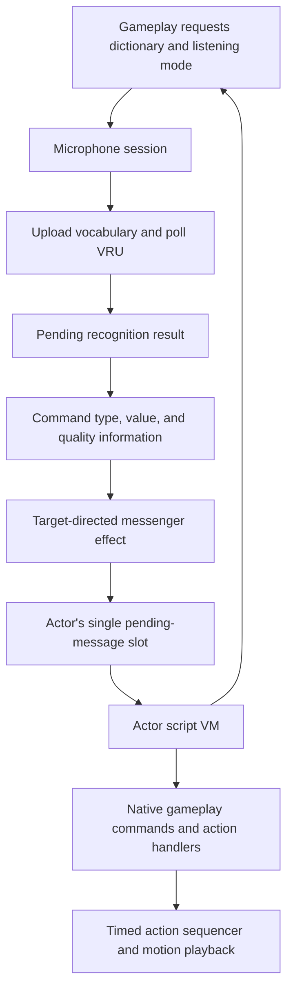
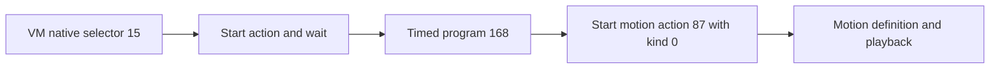

# Voice interaction and actor scripts

Voice recognition produces a candidate command. Actor scripts decide what that
command means in the current activity. Between those stages, gameplay can suppress,
redirect, or modify delivery. Recognizing a word therefore does not guarantee a
particular response.

This guide describes the recovered C control flow. Names such as `ScriptVm` and
`voiceCommandTakeMessage` describe that behavior; they are not claims about the
original source names. The VM's debug strings call it "PPU"; here that means the
script interpreter, not an additional hardware processor.

## From speech to behavior



### 1. Select vocabulary and control listening

[Microphone requests](../src/game/microphone_requests.c) queue configuration for
processing by the controller thread. Returning from a request does not establish
that the requested dictionary has finished uploading or that recognition has begun.

The [microphone session](../src/game/microphone_session.c) manages device discovery,
controller-button triggers, amplifier state, dictionary changes, and recognition
requests. Trigger mode can be held or toggled; recognition can follow the trigger
or an explicit override.

A dictionary is a list of global word IDs. Each word has encoded text for the VRU
and associated gameplay metadata. During a dictionary change, the session suppresses
recognition requests, waits for the current read to become inactive, and registers
words in batches of ten. Recognition polling resumes when uploading is complete.
See `micSessionUpdate`, `micSessionUpdateDictionary`, and `voiceDictionaryUpload`.

Decoded vocabulary and native storage contracts are described
[below](#vocabulary-and-native-storage-contracts).

### 2. Consume a recognition result

[Voice recognition](../src/game/voice_recognition.c) starts and polls VRU reads through
`osVoiceStartReadData` and `osVoiceGetReadData`. A completed read supplies candidate
indices, match distances, warning flags, voice level, and voice duration. Candidate
indices refer to the active dictionary; `voiceDictionaryGetWordId` resolves them to
global word IDs. Match distance is a device metric, not a probability.

`voiceRecognitionTakeResult` consumes the pending-result notification, even if its
output pointer is null. It returns the first answer index or -1 when no result is
pending. Consumers must check the answer count before treating an answer as valid.
The stored data is not a queue of every past utterance.

### 3. Translate and deliver a command

[Voice command processing](../src/game/voice_commands_text_panel.c) resolves word
metadata, rejects unusable word lookups, and adds quality flags. The prepared
six-word message has this meaning:

| Field | Prepared voice-command meaning |
| --- | --- |
| `type` | Word's gameplay command category |
| `arg0` | Word's gameplay command value |
| `arg1` | Device warnings, plus 0x400 for quiet input and 0x4000 for a match distance above the configured threshold |
| `arg2` | Voice level |
| `arg3` | Voice duration |
| `arg4` | Interaction candidate selected by `voiceCommandUpdate` |

The shared [ScriptMessage type](../include/script_message.h) defines this six-word
layout. These meanings apply to voice commands. Other script-message producers can
use arguments differently. The command type and value are metadata, not the raw
recognition index.

`voiceCommandLaunchEffect` checks whether gameplay permits delivery, chooses a
recipient, and creates a [messenger](../src/game/flipbook_messenger.c). Its visual
flight participates in delivery: homing or collision can lead to `messengerDeliver`,
which calls `actorPostScriptMessage`. Loss of a target or an expired lifetime can
prevent delivery. Special recipient/contact modes can modify the prepared message;
the table above describes it before those transformations.

### 4. Inspect and acknowledge the mailbox

The [actor mailbox](../src/ovl/actor_target_interaction.c) holds one pending message.
Posting normally fails when a message is already pending. A forced post replaces
it. A successful post copies the message; the caller need not retain its storage.

[Script message commands](../src/ovl/actor_script_messages_items.c) expose the pending
flag, type, and arguments to the VM. Inspecting fields leaves the flag unchanged.
`actorAcknowledgeScriptMessage` clears the pending flag and returns its previous
value; it does not erase the stored fields. Scripts should use the pending flag to
distinguish a new message from previously stored data.

### 5. Let the actor's program choose a response

The [actor VM](../src/ovl/script_vm.c) evaluates expressions, branches, accesses local
and global variables, calls script subroutines, and invokes native gameplay commands.
An actor retains its instruction position and execution context across updates.

Local frames belong to each VM. Frame -1 instead selects the shared bank of 500
packed `ScriptValue` records declared in `script_vm_globals.h`. Profile
initialization and `scriptVmResetGlobals` both clear the same 2,500-byte bank;
returning from a completed visit also requests that reset through bedroom
scenario selection. The bank is separate from each context's owned value stack.
Its indices and any borrowed string lifetimes remain caller responsibilities.

`actorRunScriptVm` runs until execution yields, transfers to an action handler,
finishes, or encounters an invalid instruction or missing context. Ordinary
instructions do not automatically yield once per frame. A program must reach a
yielding operation for other frame work to proceed.

Native commands are selected through the context's command table by
`actorScriptDispatchRegisteredCommand` in
[actor_script_action_commands.c](../src/ovl/actor_script_action_commands.c).
Commands consume arguments from the VM stack and can push a result. Their status
controls scheduling:

| Native-command result | Interpreter behavior |
| --- | --- |
| 0 | Continue interpreting immediately |
| 1 | Yield; resume bytecode on a later actor update |
| 2 | Transfer to the actor action handler |
| Other nonzero value | The interpreter treats it as a yield |

The actor update stores an execution state separately:

| VM state | Actor update behavior |
| --- | --- |
| 0 or 1 | Run bytecode |
| 2 | Advance the selected action handler |
| 4 | Finished; reset the execution state to 0 on the next update |
| 5 | Missing context or invalid opcode reported by the interpreter; a later update with a context resets the state to 0 |

An action handler can remain in state 2 across updates, then return 1 so bytecode
can resume on a later update. See `actorUpdateScriptVm`, `actorScriptYield`,
`actorScriptStartActionAndWait`, and `actorScriptWaitForSequencerStop`.

The lower-level [action sequencer](../src/game/action_script.c) is a separate system.
It schedules timed action requests, iteration waits, and sounds. Its callback return
values are not the actor VM's scheduling statuses. Motion playback is handled in
[motion_playback.c](../src/game/motion_playback.c).

## Recovered shared interfaces

The first type-recovery pass introduces these headers:

| Header | Recovered concepts |
| --- | --- |
| [`voice_recognition.h`](../include/voice_recognition.h) | Selected vocabulary, global word records, command metadata, and result-consumption contracts |
| [`voice_commands.h`](../include/voice_commands.h) | Command production/delivery contracts and gameplay quality flags |
| [`actor_script.h`](../include/actor_script.h) | Actor-state prefix, pending mailbox, and shared post/acknowledge contracts |
| [`script_vm.h`](../include/script_vm.h) | Five-byte values, known value tags, stack/return fields, execution states, and native-command callbacks |

`RuntimeObjectPrefix.state.actor` is the link at object offset `0x54`.
The recovered actor-state view names `vmAddress` at `0x1B8`,
`messengerContactMode` at `0x214`, `messagePending` at `0x218`, and
`message` at `0x21C`. Initialization establishes a `0x408`-byte actor-state
allocation. The separate runtime object prefix does not establish the actor
object's full allocation or transfer ownership of referenced resources.
Posting and acknowledgement at `0x80118E74` and `0x80119200`, together with the
script getters beginning at `0x8011C884`, establish the shared layout.

`ScriptValue` has byte alignment and a five-byte stride. Its named `data` view
contains a tag and four payload bytes; its `bytes` view supports whole-value
copies. Integer, float, string-index, and string-pointer tags are recovered.
Tag 2 is handled as integer-like by the interpreter but remains unnamed because
its distinct meaning has not been established. Do not replace the payload with
an aligned C word or numeric union: that changes the value stride.

`ScriptVm` retains the original `0x2C8` extent. The value-stack depth and pointer
are at `0x18` and `0x20`; saved depths, return offsets, and local-frame bases
start at `0x28`, `0x12C`, and `0x22C`. The command table at `0x2AC` contains
callbacks invoked with the actor; each command accesses its retained VM through
actor state. The retained table at `0x8012B400` has 278 handlers and reserved null
selector zero. All handlers share the actor-only callback signature.
`python3 tools/native_commands.py --json` lists selectors, function names,
addresses and source locations. Unknown regions remain explicitly unknown.

Each `VoiceWord` at `0x8010452C` occupies sixteen bytes: display name, device
text, command category, and command value. The former table symbols at
`0x80104534` and `0x80104538` are interior addresses of those last two fields,
not independent tables. Accessors at `0x80040CF8` and `0x80040D60` confirm the
stride and field addresses. Using a common record changes two object relocation
expressions from interior symbol addresses to record address plus field offset;
the linked instructions and complete ROM remain identical.

The shared interfaces preserve existing target calling conventions. In
particular, mailbox posting still accepts a 32-bit actor address. Unprototyped
VM helpers that receive surplus arguments have not been globally rewritten;
changing those calls would change the original instruction stream. These
remaining ABI questions and unknown fields are further recovery work, not
claims that all actor or VM types are understood.

## Conceptual interaction

This is explanatory pseudocode, not a decoded retail script or its actual syntax:

```text
request the dictionary for this activity

repeat:
    if no message is pending:
        yield
        continue

    read the message type, value, and quality flags
    acknowledge the message

    choose a response for the message and current gameplay state
    start that response and wait for its action to finish
```

Dictionary readiness, successful delivery, and an acceptable recognition result
are separate conditions. An actual program can choose how to handle each one.

## Bytecode reference and reading order

Script values occupy five bytes: a tag followed by a four-byte payload. Numeric
accessors treat integer tag 0 and code-reference tag 2 as integers; setters emit
0 for integers and 1 for floats. String access distinguishes table indices (tag 3) from borrowed pointers
(tag 4). The recovered code also contains conversions; consult the value accessors
before assigning meaning to another tag.

Instructions use a one-byte opcode with operands determined by the operation.
Selected structural opcodes in `actorRunScriptVm` are:

| Opcode | Operation |
| --- | --- |
| 10 | Store a variable |
| 24 / 25 | Push a literal / variable |
| 26 / 30 | Script call / return |
| 27 | Dispatch a native command |
| 28 / 29 | Unconditional jump / jump when false |
| 31 | Discard a value |
| 32 | Set up a local frame |
| 33 / 34 | Read / write an indexed value |
| 35 | End execution |

These numbers come from the interpreter switch. Native command selectors are a
separate namespace interpreted through the configured command table. This guide
does not identify every retail script, dictionary, or command-table entry.

Start with `micSessionUpdate`, then follow `voiceCommandUpdate`, `messengerDeliver`,
`actorPostScriptMessage`, and `actorRunScriptVm`. For a script command, follow its
native dispatch into the `actor_script_*.c` files and then into the gameplay helper
it calls. Existing function comments retain original decompilation identifiers and
addresses for comparison with disassembly.

The interpreter names its recovered byte operations with the private `ScriptOpcode`
enum in `src/ovl/script_vm.c`. Binary operands use the second-from-top stack value
as the left operand: opcode 13 is greater-than, while 14 is less-than. Floating
equality has separate named relative and absolute tolerances. Packed values use
`SCRIPT_VALUE_BYTES` and `SCRIPT_VALUE_PAYLOAD_BYTES` from `script_vm.h`; their
storage remains byte-aligned. Bytes zero through two each consume one opcode byte
without changing the value stack; a following instruction still executes normally.
`SCRIPT_VALUE_CODE_REFERENCE` (tag two) carries bytecode offsets and native-command
selectors in the retained configuration corpus. It follows the signed integer
reader and is rejected by the decimal-string parser, just like integer tag zero.
The name describes those observed roles; the original compiler terminology is
unknown. The optional [semantic review](SEMANTIC_REVIEW.md) covers those
contrasts alongside asymmetric integer and floating-equality scenarios.

Dictionary selection uses `VOICE_DICTIONARY_NONE`, and consuming a result without
a pending notification returns `VOICE_RECOGNITION_NO_RESULT`. Amplifier operation
arguments use `VoiceAmplifierSetting`; the retained amplifier state remains a
Boolean. The session limits uploads to `MIC_DICTIONARY_UPLOAD_BATCH_WORDS` per
update. Startup and injected-command/no-speech scenarios observe these paths
without establishing physical VRU fidelity. Device command-status codes whose
individual meanings remain unresolved retain their numeric forms.

## Held-item launch selectors

Cue operation `ACTION_CUE_LAUNCH_HELD_ITEM` (25) carries a signed launch-kind word
and a floating speed argument. Its private `ActionLaunchKind` enum describes
trajectories, separately from the cue operation, actor target mode and item mode.
For positive command speeds:

| Kind | Meaning |
| --- | --- |
| 0 | Aim horizontally at the player when following a live player target; otherwise use the actor's heading. |
| 1 | Use the actor's heading with an upward component. |
| 2 | Use the actor's heading plus 240 degrees with an upward component. |
| 3 | Use the actor's heading with a steep upward component. |
| 4 | Use the actor's heading with a downward component. |
| 5 | Aim from the item's world position toward the stored three-dimensional target. |
| 6 | Randomize speed and heading around actor heading plus 200 degrees. |
| 7 | Randomize heading over a full circle and emit linked and falling-particle effects. |

Kind 5 produces zero velocity when the target is too close to normalize. Kind 7
chooses horizontal speed independently of the command speed; the command still
scales its vertical component. Kinds outside zero through seven are unsupported.
The original branches and three launch tables establish these descriptions;
they do not establish animation intent, gameplay reachability or collision behavior.

## Script decoder

The independent Python reader supports three separate formats:

| Format | Representation | Consumer |
| --- | --- | --- |
| `vm` | One-byte opcodes with packed five-byte operands | `actorRunScriptVm` |
| `cue` | Twenty-byte timed cues and selection tags | `actorUpdateActionScript` |
| `sequence` | Sixteen-byte action-sequencer records | `actionScriptUpdate` |

Start with a newly authored example, without a ROM:

```sh
python3 -m tools.script_decoder vm --demo
python3 -m tools.script_decoder cue --demo
python3 -m tools.script_decoder sequence --demo
```

Each command writes `listing.txt` and `listing.json` under
`build/script-decoder/demo-FORMAT/`. The text shows labels, operand roles, candidate
branches/calls and source locations. JSON also records raw tag/payload encodings,
code-reference uses, opcode/tag counts, diagnostics and unparsed byte ranges.
No extracted retail scripts or strings are bundled with the tool or examples.

For your normalized USA ROM, supply an explicit window. For example, after a
matching build, the first retained action-sequencer program can be read with:

```sh
python3 -m tools.script_decoder sequence --symbol 0x8006EE60 \
  --elf build/pikachu.elf --bytes 0x20
```

Use `--rom-offset OFFSET --bytes LENGTH` for a known ROM range, or
`--symbol SYMBOL_OR_ADDRESS --elf build/pikachu.elf --bytes LENGTH` for a known
mapped program. Scene addresses require the exact `--section .scene_NAME`.
The tool authenticates mapped ELF section bytes against the supplied ROM;
it does not guess which overlay was active during a runtime capture.

For a VM configuration, use `vm --config SYMBOL_OR_ADDRESS --elf ... --bytes ...`.
This reads the established configuration prefix and follows its program pointer
within the explicit mappings. Add `--native-count COUNT` to bound its command
table. For a standalone VM program, native resolution instead takes
`--native-table SYMBOL_OR_ADDRESS --native-count COUNT`. Counts include any
reserved null slot. The retained `D_8012B400` table has 279 slots, including slot 0.
Alternative tables must be identified explicitly; their slots need not agree.

Native-handler links come from the authenticated table, not merely matching
selector numbers. Four retained text handlers also consume an inline packed
string-count operand. Their reviewed layouts preserve the next instruction
boundary. Unknown handler layouts stop that path; argument stack effects and
dynamic return locations remain unresolved. VM calls expose both their target
and return continuation, while conditional branches expose both possible paths.
Use repeated `--entry OFFSET` options to inspect additional known VM entry points.
Larger programs can raise the explicit budget with `--max-instructions 100000`.
VM targets are offsets from the program start: keep that start at window offset
zero rather than rebasing a fragment taken from the middle of a program.

Decompressed or captured script windows can be read with
`--input /path/to/local/script.bin --bytes LENGTH`, optionally adding
`--input-offset OFFSET`. Such inputs are explicitly marked as lacking ROM
authentication. Decompression, heap relocation, string extraction and automatic
resource discovery are outside this decoder. `--bytes` bounds a read; it does not
assert that the complete allocation or program size is known.
Raw VM inputs may still use `--elf`, `--native-table` and `--native-count` to resolve
handlers from your ROM. The report authenticates those tables separately and
continues to mark the input script as unauthenticated.

All listings stay under ignored `build/script-decoder/`; `--output` may select a
subdirectory there. Keep extracted content and generated listings local. The CLI
returns 0 for a decode without diagnostics, 1 for a partial decode with diagnostics,
and 2 for an input or mapping error. None of these results establishes execution,
gameplay reachability, resource ownership or a recovered source-language meaning.

To catalog the retained layout across the resident and scene sections:

```sh
python3 -m tools.script_decoder.catalog --elf build/pikachu.elf
```

The catalog authenticates every scanned section and keeps its overlay identity.
It finds aligned configuration candidates that reference the retained native table
and a local program preceding the header. A program-to-header window bounds the
decode; it is not an inferred allocation size. Each candidate retains diagnostics,
code fingerprints, frame operands, global-reference base indices, native calls and
code-reference roles. Direct `actorCreateForKind` calls are linked only when the
script argument is an exact configuration symbol or its address; 70 candidates
have such bindings. Nine more configurations have conditional local assignments
before actor creation; the catalog records these separately as possible sources,
without asserting branch feasibility. It also follows 47 explicit scenario
selector return indices through the 23 area configurations to Pikachu's scripts,
retaining the overlay at every pointer read. It validates the source area's
selection against the linked, ROM-authenticated catalog. These are configured
references, not a claim that
every scene or script branch has executed. Other candidates remain explicitly
unproven as live configurations. The results stay under
`build/script-decoder/catalog/`; this scan does not discover every possible script
layout or compressed resource. Two of the 128 candidates currently have no
recovered binding: resident configuration 0x8012B870 and front-yard configuration
0x80158B7C. This is not evidence that they are unused.

Decoder report schema 2 calls tag 2 `code_reference` and records its uses in
`code_reference_uses`. These references select bytecode offsets or configured
native-command slots; their payloads retain signed integer conversion behavior.
The catalog preserves separate entries for overlays even when virtual addresses
coincide, and fingerprints decoded code to expose repeated programs.

## Vocabulary and native storage contracts

The decoder's `voice_vocabulary` catalog reads the separate vocabulary DMA bank,
whose original loader copies ROM 0xA9800..0xB3C70 to 0x80100680. It records a
neighbor-delimited view of 640 word definitions and a reviewed prefix of 43
dictionary descriptors, containing 2,053 ordered entries. All 640 words have
membership in that prefix. These bounds do not prove that arbitrary dictionary
requests are valid. Display bytes and device vocabulary bytes remain separate;
the latter are not interpreted as ordinary display text.

Each word links its dictionary-local indices, global word ID, message category
and command value. Multiple words can share a command value, and a value can
have different vocabulary labels across dictionaries. The report retains those
associations instead of treating a value as a universal word identity. Original
vocabulary bytes remain in ignored local reports. Eight authored dictionary
cases check the original metadata getters, including reordered word IDs, distinct
categories and invalid-selection/index results; they do not exercise recognition.

`VOICE_DICTIONARY_DEFAULT` (0) is requested at gameplay startup and supplies the
session fallback when its requested ID is unset. `VOICE_DICTIONARY_WORLD_MAP` (31)
is requested by `wholeMapConfigureVoiceInput`; its 24 entries include destination
words carrying `SCRIPT_MESSAGE_WORLD_MAP_DESTINATION` (18). The map menu interprets
argument 0 as a destination selector, including a special-training request. These
selectors are distinct from map destination indices and scene area IDs.

The catalog records all 255 decoded `actorScriptRequestMicDictionary` calls.
Of these, 236 have literal integer-converted IDs resolving within the reviewed
dictionary prefix; 19 retain symbolic expressions. Each request remains in its
configuration's overlay and retains existing creation/scenario bindings. Reverse
links on dictionary descriptors connect them to those request sites and to written
C requests. These are possible resource uses, not scene ownership or executed paths.

### Bedroom name activity

One symbolic request belongs to the bedroom Pokémon-name activity. Its native
`actorScriptGetPokemonNameDictionaryGroup` reads the per-name group in
`gBedroomPokemonNameDictionaryGroups`. The group is a voice vocabulary partition,
not a Pokémon species, elemental type or message category. The 153 retained
catalog entries use groups 2 through 12; the script requests dictionary
`18 + group - 1`, giving IDs 19 through 29. It compares the group with a cached
value before issuing the request. The catalog indices and the recent-selection
history's 100 slots now have named extents in the source.

The decoder's `bedroom_name_catalog` authenticates both scene tables and links
each entry to command category 10, command value `catalog_index + 8`, and matching
word membership in its computed dictionary. All 153 entries have that membership.
Six catalog labels lack an exact vocabulary-label match because of case,
punctuation or alternate recognition spellings; the report preserves both views.
It does not merge catalog indices with global word IDs.

The request analyzer recognizes the guarded group conversion and records a
conditional dictionary domain. Its precondition is a valid catalog argument from
0 through 152 with intact, nonoverlapping VM frames. It does not prove caller
arguments, activity reachability or upload completion. Three authored-table cases
exercise the original native at endpoint indices and check unsigned-byte conversion;
the synthetic value 255 is not a retained retail group.

### Requested state and saved locals

The request native consumes one dictionary ID, pushes zero and yields. Configuration
dispatch changes the requested ID and acknowledges dispatch; uploading and uploaded
IDs remain independent. The native query reads requested state rather than either
upload field. Six original-instruction cases check that distinction with three
different requested IDs, including the unset value, while guarding the other fields.
They do not exercise queue submission, microphone hardware or vocabulary upload.

The other 18 symbolic requests read locals saved from the requested-dictionary
query. `saved_local_analysis` checks that the save dominates the request and
follows returning script calls with their frame bindings. A callee establishing
the same frame number temporarily shadows the caller's local base; a callee
using another frame can still write the caller's frame explicitly. The analyzer
rejects direct overwrites, possible indexed writes, unresolved frame transitions
and exhausted budgets. All 18 candidates pass its bytecode preservation check.

That check assumes valid stack/array accesses and intact, nonoverlapping frames
across yields. Native alias effects and context replacement remain separate
review obligations, listed in `native_effect_frontier`; these candidates are not
promoted to resolved runtime IDs or unconditional restoration claims. Two authored
original-VM programs contrast same-frame shadowing with a deliberate caller-frame
write, checking the full declared stack, VM state and query globals. They establish
the frame distinction, without certifying arbitrary native effects or retail paths.

### Native storage effects

Sixteen immediate scalar-append contracts are recorded in
`tools/script_decoder/native_frame_reviews.json`: fifteen direct getters/yield
callbacks and the requested-dictionary query. These callbacks
consume no arguments and append one integer or float. They preserve existing
locals only when those locals and frame metadata lie below the active stack depth,
one value slot is available, borrowed state is valid and the context remains intact.
Their return may continue or yield; this review does not cover later lifecycle or
concurrent changes.

The decoder validates explicit source fingerprints for each reviewed callback,
its scalar-push helpers, stack macros and relevant value/command definitions.
Source or dependency changes revoke the affected evidence rather than creating a
new review. Tests require the checked-in reviews to remain current. Unreviewed
callbacks remain explicit in `native_effect_frontier`.

Sixteen authored original-instruction cases check the fifteen direct
callbacks, including both blend-status branches, while guarding saved locals,
frame metadata, VM state and globals. `actorScriptPushTotalElapsedTime` now names
the clock accumulated across script resets, separately from the resettable timer
read by `actorScriptPushTimer`. The cases use distinct clock values and establish
handler footprints, without a scheduler, hardware or complete-lifetime proof.

Eight helper-backed getter contracts follow their read-only helper chains: chapter,
held-item kind, movement collision flags, target mode, player held item, view-control
selection, sequencer activity and interaction candidate. The held-item lookup
writes a predecessor result to a C-stack temporary, without changing the handle
pool or VM locals. Its contract requires an initialized nonzero-capacity pool with
valid chains and a valid item state for a live held handle. Chapter lookup requires
initialized progress metadata and save storage. These conditions remain explicit.

Helper dependencies are attached to their individual callback reviews, so a helper
change reopens the affected review without discarding unrelated evidence.
Fourteen authored original-instruction cases cover helper lookup branches, unsigned
collision flags, independent view flags and guarded scalar appends. They establish
immediate write footprints, without proving broader object lifetimes or scheduling.

Three further contracts cover `actorScriptGetItemKind`, `actorScriptGetActorKind`
and `actorScriptGetObjectType`. Each replaces one numeric handle with an integer
result, leaving the stack depth unchanged. This preserves saved locals only if
the argument lies above every protected local and frame record. The decoder
reports that additional precondition; it does not prove the operand floor.
Integer and code-reference payloads are read as integers; supported finite float
handles truncate toward zero. Invalid numeric conversions remain outside the review.

The domains are distinct: `RUNTIME_OBJECT_KIND_ITEM` (134 / 0x86) selects item-owned
state, whose item-catalog kind is a separate value. Actor configuration kinds span
1 through 37, including props. Runtime tag 130 remains unnamed. Toolbox items and
destroy-pending objects are unavailable to these handle queries. Twenty-four
authored original-instruction cases check these branches and argument replacement,
guarding the VM, saved values, handle pool and borrowed records. Held-item fixtures
also use the constructor-established tag and full item-state allocation.

Six further one-argument contracts cover numeric getters:

| Getter | Supported input after integer conversion | Stack result |
| --- | --- | --- |
| World coordinate | Nonnegative axis | World X/Y/Z, or -65536 above two |
| Stored target coordinate | Nonnegative axis | Target X/Y/Z, or -65536 above two |
| Local rotation coordinate | Axis zero through two | Local angle in degrees |
| Player coordinate | Axis zero through two | Primary player world X/Y/Z |
| Profile counter | Index zero through 165 | Saved counter from zero through fifteen |
| Creation script argument | Handle identifying valid actor state when live | Retained creation argument, or -1 when not live |

Rotation, player and profile getters do not enforce their supported index bounds.
The creation-argument getter uses the live-object lookup directly, without the
available-handle query's toolbox exclusion or an actor-kind check. Valid actor
state is a caller obligation. The profile's 83 bytes hold even counters in the
low nibble and odd counters in the high nibble.

Thirty-five authored original-instruction cases cover all coordinate axes,
world/target sentinels, profile endpoint nibbles and live/missing/destroy-pending
creation-argument lookups. Fractional inputs truncate toward zero; code-reference
payloads use their integer encoding. The cases guard protected values, VM state
and borrowed storage. They do not extend the contracts to invalid indices,
unsupported conversions, later lifetimes or arbitrary gameplay paths.

Thirty-three scalar native reviews are active. Remaining callbacks stay explicitly listed
in each saved-dictionary candidate's `native_effect_frontier`; a reviewed immediate
footprint does not establish a runtime dictionary ID or unconditional restoration.

### Deferred action requests

Twelve additional reviews cover only the immediate request phase of action-start
natives. The request selects `actionHandler`, sets `actionInitializing` and returns
`SCRIPT_COMMAND_WAIT_FOR_ACTION`. It neither consumes arguments nor pushes a
result. Arguments and any eventual result belong to the selected action handler.

`actorUpdateScriptVm` chooses its branch using the VM state at update entry. A
ready or yielded VM runs bytecode; a request makes that update finish in the waiting
state. A waiting VM instead dispatches its action handler, records its returned
state and clears `actionInitializing`. It does not resume bytecode in that same
update, even if the handler has finished. A handler selecting another handler
during dispatch does not retain a newly set initialization flag past that clear;
such handoffs need their own review.

Twenty-four authored original-instruction cases check all twelve request natives
with two previous initialization values, guarding pending operands and frame data.
Three separately seeded scheduler cases check request, stopped-poll and running-poll
branches, including both clocks and the initialization clear. They establish these
bounded transitions, without certifying a complete multi-frame game trajectory.

The decoder lists request-only evidence in `reviewed_immediate_native_effects` and
keeps unreviewed later effects in `deferred_native_effect_frontier` and the overall
`native_effect_frontier`. Request-only evidence therefore does not clear deferred
alias, stack, context-lifetime or gameplay obligations.

The loop-exit requests, including the alternate native, additionally have a
source-bound deferred review for selector three. Each dispatch requests loop exit
on the actor and tests the sequencer command cursor. A nonnull cursor keeps waiting
without touching VM values; a null cursor appends integer zero and yields. Motion
playback activity is a separate state and does not determine this completion test.
Protected locals and frame records must remain below the active depth, with a free
result slot and intact, nonoverlapping actor/VM storage throughout the wait.

Eight authored original-instruction cases cover stopped/running sequencing, both
initialization states and direct versus scheduler dispatch, guarding the loop flag,
saved values, VM state and clocks. They do not prove motion advancement or eventual
completion. The decoder exposes validated later effects in `active_deferred` and
`reviewed_deferred_effects`. Changes to the dispatch/helper chain revoke this later
review independently of the immediate request review.

The timed-action request additionally has a deferred selector-two review. Its
initializing handler consumes one program ID, resets the established sequencer
fields and returns waiting. Later polls do not consume that operand again: they
leave VM values untouched while a command remains, or append integer zero and yield
when sequencing stops. The scheduler's initialization clear separates these phases.
This contract requires a valid numeric program operand above protected records,
valid table backing and intact, separate actor/VM storage throughout the wait.

Twelve authored original-instruction cases check initialization with integer,
finite fractional and code-reference operands, no-program selection, waiting and
completion through direct and scheduler dispatch. The original no-program sentinel
preserves independent motion and still returns waiting on initialization; completion
requires the later poll. Its negative C array index remains an authenticated target
exception, requiring explicit handling in a portable host implementation. These
cases establish phase footprints, without simulating timed-program advancement or
certifying eventual completion.

There are 33 scalar contracts and 12 immediate request contracts, three of which
also have deferred reviews for timed-action startup or loop exit. Other requests
remain partially reviewed and keep their later effects explicit in the
saved-dictionary frontier.

### Player view selection

The view query is `playerIsViewControlSelected`, exposed to scripts by
`actorScriptPushPlayerViewControlSelected`. `PLAYER_PERMISSION_VIEW_CONTROL`
(0x8000) selects direct view-angle control, while `PLAYER_PERMISSION_VIEW_INPUT`
(0x200) permits controller input to change the angles. Yaw input requires the input
flag; pitch input requires both flags. The selection query can therefore return one
while actual angle input remains disabled. Other permission encodings remain
unchanged.

### Player input filtering

Control schemes retain a 16-bit input mask, separately from the 32-bit permission
mask. Input masks combine controller button bits with `PLAYER_INPUT_STICK_X`
(0x40) and `PLAYER_INPUT_STICK_Y` (0x80). The player's `keptInputs` field holds the
mask; `handledInputs` records rejected or consumed inputs, including stick flags.
For example, 0x8000 in an input mask means the A button. It does not mean the
same-valued `PLAYER_PERMISSION_VIEW_CONTROL` permission.

Filtering applies the mask to held, pressed, released and repeated button states.
Disabled stick axes are suppressed; their input flag is reported when the rejected
magnitude is at least fifty. Three authored original-instruction probes distinguish
below-threshold suppression, the threshold boundary and independent A-button and
horizontal-stick retention. These validate the input domains without certifying
control-mode transitions.

The deferred control-scheme request waits without consuming its operand while the
game is in text-window mode. Applying a scheme also runs the previous player mode's
optional leave callback before selecting new callbacks and permissions. Those
callback effects remain a separate review obligation.

The decoder's `player_control_schemes` catalog authenticates all 28 scheme records
and 32 behavior-mode records. Each scheme links its mode, controller port and
retained input mask; each mode links update/leave callbacks and permissions. The
three leave callbacks are `playerFinishStun`, `playerFinishHelpDisplay` and
`playerFinishTargetFocus`. Their effects include screen/rumble cleanup or restoring
companion control, and remain explicit in `leave_callback_frontier`.

Across the retained configuration views, all 323 control-scheme requests have
bounded argument expressions. The 322 literal requests select valid catalog
indices; one playground request uses frame-one local zero. In configuration
`scene_playground/8013e1bc`, that local has literal assignment sites for schemes 16
and 1 before the request. These are candidate values for its scoped control-resume
role, rather than a closed runtime domain: intervening script/native effects still
need review. A table link or argument expression does not prove that a request is
reachable or that its mode transition safely completes.

## Area scenario selection

`presentationInitializeForCurrentArea` selects `gAreaScenarioIndex` from story
progress. That index selects companion behavior, card textures and collection
titles together; it also affects scene population. The selector functions now
use area names and the `Scenario` suffix to describe this shared role.

The recovered literal-return domains are:

| Area or group | Scenario indices |
| --- | --- |
| Bedroom | 0–9 |
| Entryway | 0 |
| Front yard | 0–6 |
| Viridian entrance | 0–2 |
| Viridian forest | 0 |
| Viridian deep | 0, 1 |
| Springleaf entrance, Oddish meadow, Springleaf field | 0, 1 |
| Olivine lakeshore/lake, Ochre entrance/deep, Cobalt island/coast | 0 |
| Abra shop | 0, 1 |
| Wilderness camp and the three fishing areas | 0 |
| Viridian edge | 0, 1 |
| Playground | 0 |
| Credits | 0, 1 |

These domains bound the entries inspected by catalog schema 2; they do not prove
every return path is reachable or infer the complete table allocation. The
inventory rejects unresolved return expressions and unfamiliar area assignments.
`companion_scenario_sites` records each reference's selector and index.

For the forest edge, chapter 1 selects scenario 0 and chapter 7 selects scenario 1.
Both request presentation action 0xF4 and audio cue 0x15. Credits selects scenario 1
at chapter 0, setting audio to zero while preserving the caller's action; chapter
9 selects scenario 0 with action 0x32 and audio 0x15. Unsupported chapters return
zero while leaving those outputs unchanged. Six original-instruction experiments
check these outputs, return indices and fallback preservation in three interpreter
repetitions each. Unicorn remains unsupported for these cases. Other selector
domains currently rely on matching source and authenticated scene-table evidence.

## From VM action requests to motion

The native selector, timed-program ID and motion-action ID are separate domains:



The catalog's `native_action_calls` records arguments and scheduling contracts
for six reviewed commands. Arguments below are listed in script push order.

| Native command | Arguments | Consumption and result |
| --- | --- | --- |
| `actorScriptStartActionAndWait` | Timed-program ID | Deferred; wait for sequencing to stop, then receive zero. |
| `actorScriptStartInterruptibleAction` | Timed-program ID | Deferred; wait for sequencing to stop or a message, then receive zero or the pending flag. |
| `actorScriptStartActionScript` | Timed-program ID | Immediate; receive zero and yield. |
| `actorScriptStartActionWithMode` | Timed-program ID, default kind | Immediate; receive zero and yield. |
| `actorScriptStartTimedAction` | Timed-program ID, duration in seconds | Immediate; receive zero and yield; negative duration disables the limit. |
| `actorScriptSetDefaultActionMode` | Default kind | Immediate; receive zero and continue. |

Deferred commands retain their operands until the selected action handler's
initialization update. The mode-setting interface requires a value representable
in the original signed 16-bit storage; its retained numeric conversions remain
unchanged. A VM scheduling result is separate from the value returned on its stack.

All 5,383 calls in the census (3,974 distinct code/offset sites) have bounded
argument expressions. Recovery retains script-return expressions with arity from
the target's frame-entry contract, indexed array reads, and random-choice results
with known index ranges. These are structural expressions: callee behavior, array
contents and returning-path feasibility remain unproven where not established.
Variable references remain coordinates rather than inferred constants. Original
VM arithmetic semantics remain explicit for symbolic additions. The 4,249
constant-ID requests resolve to 287 distinct timed programs.
`action_script_resources` contains their bounded END-terminated streams, hashes,
motion requests and retained motion debug labels. All 287 decode without diagnostics.
The program table's linked extent bounds reads; it does not establish a complete
resource allocation or prove the requested paths execute.

The catalog also summarizes functions whose return values select timed programs.
It follows branches and returning call continuations without entering callees.
All 18 producer summaries have complete static integer return domains. A complete
domain bounds values on the
decoded returning paths, without proving termination, path feasibility or native
side effects. These domains supplement literal requests in the resource census.

One recovered result is `ACTION_SCRIPT_NO_PROGRAM` (-1). This selects no timed
commands while preserving independent motion playback. It is distinct from
`actionScriptStop`, which also requests motion-loop exit and cancels a pending
motion request. The matching implementation obtains the null command pointer
through a negative array index: the preceding word is an unused zero operand in
the final program's END record. This is outside the declared C array view;
host ports must handle the sentinel explicitly. The decoder authenticates this
backing layout and reports it separately from ordinary program streams.
Other negative IDs remain unresolved.

The shared response selector's last nonliteral return reads a ten-entry local
table. An inclusive check bounds the source value to 23 through 32; subtraction
of 23 selects the initialized element. Recovery requires a contiguous guard,
initialization and read with no competing entry into their interior. It rejects
missing writes, intervening mutations and bounds sourced from the initialized
frame. Valid nonoverlapping active frames remain a precondition. These lookup
domains expand the census to 292 ordinary programs plus the no-program sentinel.
Six authored original-interpreter cases check guard boundaries, fallback, packed
table writes and fractional-index truncation; they do not prove retail reachability.

In the bedroom script, frame 0 slot 9 receives the current message type and slot
10 receives message argument 0 before response selection. The shared selector
therefore maps message data to timed programs, with a caller-supplied flag affecting
one branch. This identifies the coordinates in that script, without assigning a
universal meaning to those slots in other programs or naming every argument value.

For message category 2, values 23 through 32 consistently identify ten
Pikachu-like phrases. `VoicePikachuPhraseValue` in `voice_phrases.h` names that
scoped domain. Thirteen retained word records cover those ten values; alternate
records remain separate with their own dictionary memberships. The decoder checks
the names against the retained display labels and requires dictionary membership.
These are recognized phrases, without a recovered translation or emotional meaning.

The bedroom response selector's guarded table connects them to timed programs:

| Phrase selector | Timed program |
| --- | --- |
| `VOICE_PHRASE_PIKA_PIKACHU` | 51 |
| `VOICE_PHRASE_PIKA_PIKA_PI` | 268 |
| `VOICE_PHRASE_PI_PIKACHU` | 135 |
| `VOICE_PHRASE_PI_PIKA_PI` | 34 |
| `VOICE_PHRASE_PIKKA` | 204 |
| `VOICE_PHRASE_PIKA` | 259 |
| `VOICE_PHRASE_PIKAPIKA` | 175 |
| `VOICE_PHRASE_PI_KA` | 155 |
| `VOICE_PHRASE_PI_KA_KA` | 22 |
| `VOICE_PHRASE_PI_KAKAPI` | 150 |

This is a static message-to-program connection, not evidence of microphone input,
successful delivery, rendered reactions or retail-path reachability.

`ActionScriptState.selectedProgramId` retains the selected program even after
natural END stops command execution. `actionScriptGetId` and the native callback
`actorScriptPushTimedProgramId` expose that selection; command activity must be
queried separately. Explicit stop or no-program selection sets the ID to -1.
Six bounded original-instruction cases check selection, retained IDs and natural
completion. They do not establish complete playback lifecycles or rendering.

For example, a playground companion function returns one of -1, 29, 87, 89,
156, 176, 178 and 179. Its tests of the retained selection and command activity,
together with the programs' motion labels, support an idle-variation selector:
it preserves an active stance by returning -1, or selects a variation. The
labels support motion descriptions, without establishing an emotional meaning.

The motion labels support these names in `action_script_ids.h`:

| Timed program | Requested motion | Established role |
| --- | --- | --- |
| 17 | 190 | Turn toward the desired heading. |
| 168 | 87 | Look around. |
| 358 | 288 | Face the destination while underground. |
| 365 | 293 | Move toward the destination. |

The observed opening voice flow starts timed program 168. Its debug-label-supported
role is now named `ACTION_SCRIPT_LOOK_AROUND`; rendered motion and emotional
interpretation remain unverified. Original program bytes and labels remain local
ROM-derived reports rather than tracked resource data.

In a sequencer start-action command, kind 18 means
`ACTION_SCRIPT_INHERIT_DEFAULT_KIND`: use the actor's configured default kind.
The cue collection's tag 18 has its own fallback-selection role. The decoder
preserves that distinction with `inherits_default_kind` on sequencer requests.

`actorScriptWaitForSequencerStop` completes when timed command execution stops.
Motion playback has separate completion checks. Two original-instruction cases
contrast stopped sequencing with timed motion and running sequencing with disabled
motion, checking the wait result and full declared stack/state footprint. This
does not certify visible animation or the circumstances that reach either state.

## Actor identities and script searches

`ActorKind` in `actor_kind.h` names all 37 configurations in the retained actor
query domain. Each identity is checked against its ROM-backed inspection name,
configuration view and hierarchy template. All 37 root templates carry the
corresponding runtime kind. The catalog's `actor_kinds` retains those links and
the resource index; creation bindings attach the configured identity when the
source supplies a known kind constant. Original names and configuration bytes
remain local reports.

The domain contains actor props as well as creatures. For example, 16 is a
treasure chest, 20 a fishing rod and 21 a telescope. Script category 4 is therefore
named `SCRIPT_CATEGORY_ACTOR`. Its kind getter is `actorScriptGetActorKind` and
the corresponding position search is `actorScriptFindActorNearPosition`.
Their numeric encodings and runtime behavior are preserved. Twelve original-
instruction cases check prop identities, both Pikachu kinds, rejection of kind
38 by the actor-kind query and separation from object type 130.

Kinds 36 and 37 both have Pikachu inspection names but retain separate
configurations and root templates. `ACTOR_KIND_PIKACHU_ALTERNATE` names the
scene-authored variant; `ACTOR_KIND_PIKACHU` is the active companion's
configuration. The catalog preserves both identities rather than merging names.

The search operand 38 is `ACTOR_SEARCH_RANGE_ENDPOINT`. As a minimum it selects
kind 1; as a maximum it selects kind 37. It is a search alias, not a creation
configuration. Actor creation calls now use the named configuration constants.
The field/entrance attention resident is Squirtle; the growth-resident creation
paths select Oddish, Gloom and Vileplume according to saved growth state. The
message-flow descriptions below remain scoped to their respective scripts.

## Actor mailbox categories

`ActorScriptMessageKind` names categories with established gameplay producers.
Scheduler notifications use the separate `GameMessageKind` domain.

| Category | Producer | Payload |
| --- | --- | --- |
| 14: item impact | `actorPostItemImpactMessage` | Item handle in arguments 0/4; speed magnitude in argument 2. |
| 15: cooperation request | `playerRequestTargetCooperation` | Selected interaction target handle in argument 4. |
| 16: action notification | `actionCommandNotifyStoredTarget` | Cue values in arguments 0/2/3; sender actor handle in argument 4. |
| 17: proxy used | `playerConsumeInteractionProxy` | Proxy metadata in argument 0, remaining uses in 2 and proxy handle in 4. |

The opening voice scenario executes program 0x8013C0E4. A read-only live capture
at poll 2086 matches all 29,924 bytes from that address to configuration
0x801435C8 in `.scene_viridian_edge`. The credits candidate at the same program
address differs at byte 10. Independently, all 19,105 conditional branches in the
retained observation window agree with the forest-edge decode. The program tests
categories 13, 15 and 14 before copying other categories into local slots. Matching
this byte window establishes the resource correspondence; it does not establish
its complete allocation, actor ownership, or the meaning of every variable.

The catalog's `script_message_posts` entries recover arguments for all 150
decoded calls to `actorScriptPostMessage` in the configuration census.
These counts include repeated configurations (120 distinct code/offset call
sites). Recovery follows at most 32 contiguous producer instructions with no
competing entry into their interior. Supported producers are integer literals,
variable reads, four reviewed handle getters and representable constant integer
addition. Other stack effects remain unresolved if encountered. The argument order is recipient handle,
type, argument 0, argument 2, argument 3 and argument 4. The native handler sets
argument 1 to zero, rejects missing recipients, requests unforced delivery and
pushes success. Variable operands retain their frame/slot coordinates; they are
not inferred actor identities or persistent variable names.

Of those recovered calls, 138 construct category 13 across 15 scene sections.
Their payloads vary, so category 13 and its subcommands still need recipient-side
analysis before receiving gameplay names. These category names establish
producer contracts; they do not identify every recipient
reaction or override arbitrary messages constructed by script code. Impact cases
check the exact mailbox payload and pending-message rejection with synthetic
velocities, without claiming collision or item-lifetime coverage.

### Resident attention exchange

The field's kind-3 resident uses
`gResidentAttentionScript_scene_springleaf_field` (configuration 0x801571E4).
Its creation is conditional on progress field 0x12. At script offset 466 it sends
Pikachu category 13, argument 0 equal to 1, and its own handle in argument 2.
The entrance's corresponding resource at 0x801573B8 sends the same payload at
offset 369. This supports naming these resources for their attention-request
role. Their ROM-backed configuration identities identify both residents as Squirtle.

For field scenario zero, the area table selects Pikachu configuration 0x80156884.
Its message intake copies categories 13/14/15 into frame-zero slots 9–13 in
type/argument-0/argument-2/argument-3/argument-4 order. On the category-13,
argument-0-equals-1 path at offsets 30487–30587, it reads the sender handle from
slot 11, tracks that object and calls the response routine at offset 29859.
That routine starts action 17 and sends the sender category 13 with argument 0
equal to 3 before selecting further reactions. Another path uses the same
incoming handle to establish tracking and selects local behavior state 7.
These are static script paths; runtime acceptance and rendered reactions have
not yet been observed for this exchange.

The field resident's seven frame-zero slots have these scoped roles:

| Slots | Role |
| --- | --- |
| 0–2 | Initial world position, retained for return positioning. |
| 3 | Whether the current chapter is 8, affecting the exit path. |
| 4 | Response count and exit threshold value; 8 ends the repetition. |
| 5 | Initial total-elapsed timestamp for the delayed start. |
| 6 | Per-attempt response stage, distinguishing the first reply and later sound. |

These roles describe this resource only. Equal slot numbers in other scripts
do not establish shared variables. The growth-resident reaction resource at
0x80156F04 in the entrance uses a different contract: category 1 starts an escape
reaction, while category 13 starts a Pikachu-facing action sequence and later
sends category 13 with argument 0 equal to 2. Its creation argument selects the
growth progress entry. Category 13 therefore cannot be assigned one universal
payload layout or reaction name from the attention exchange alone.

To compare a local live capture with the ROM-backed candidates:

```sh
python3 -m tools.script_decoder.live --runtime build/semantic-review/decoded-live-program/runtime.json
```

The voice runtime driver accepts `--capture-program-bytes 29924` to save one
read-only window per observed program address after poll 2000. Captures remain
under the local runtime output directory. The comparison authenticates the ROM,
ELF mappings, runtime ROM digest and captured-file digest, and reports every
same-address candidate separately. A shorter shared prefix can remain ambiguous.
